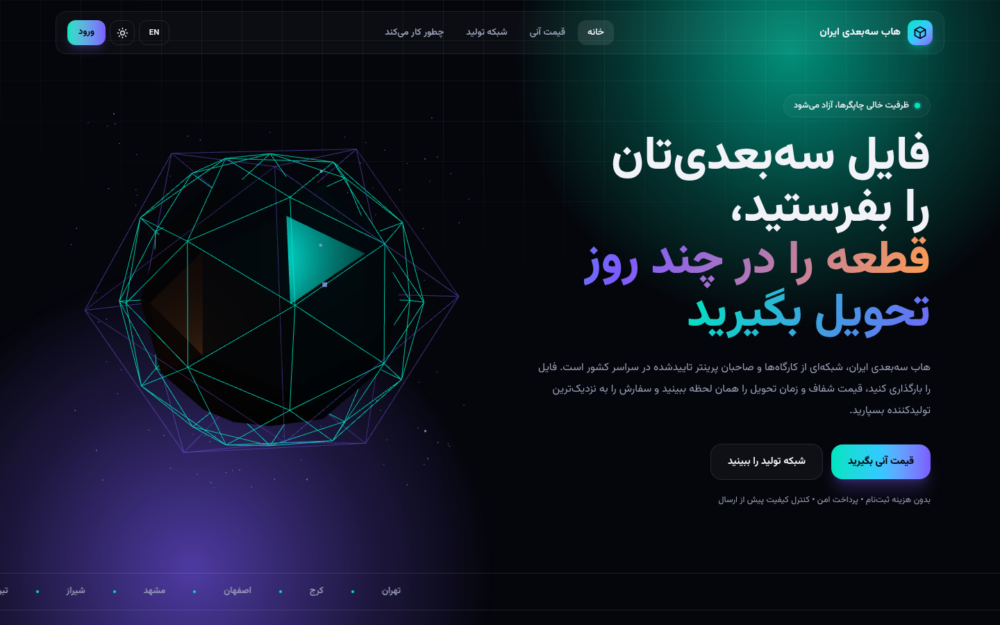
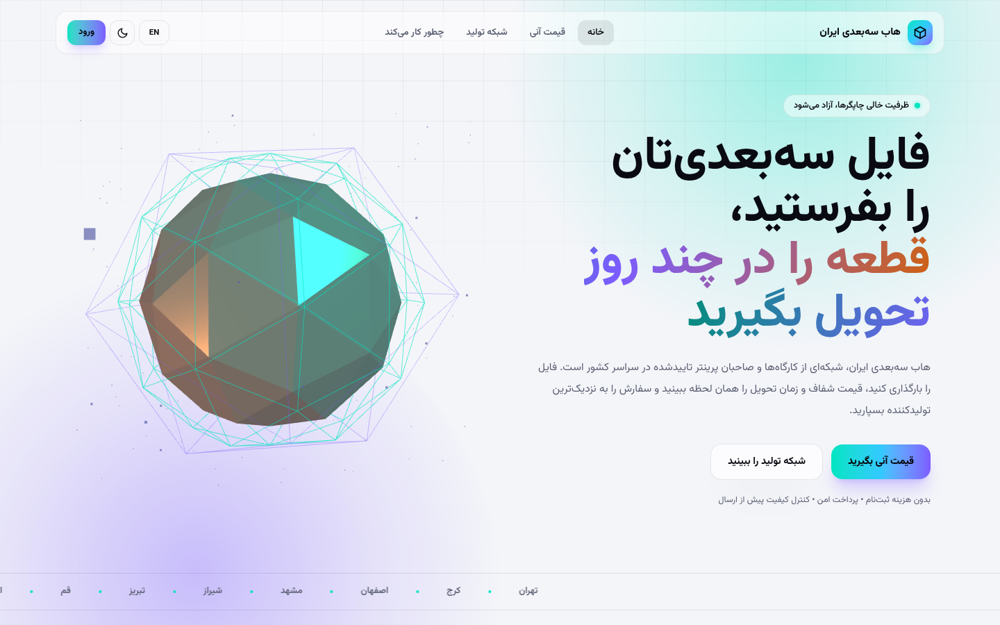
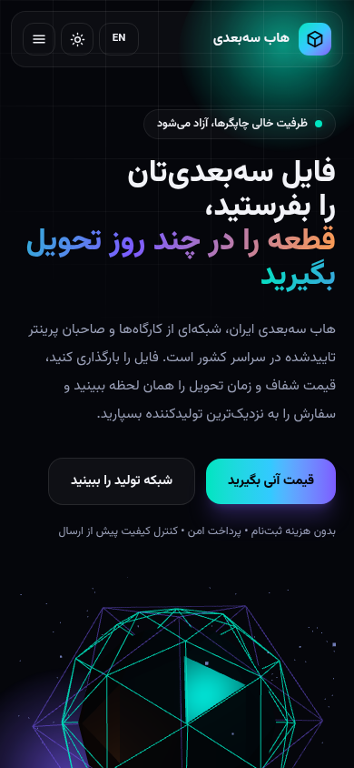
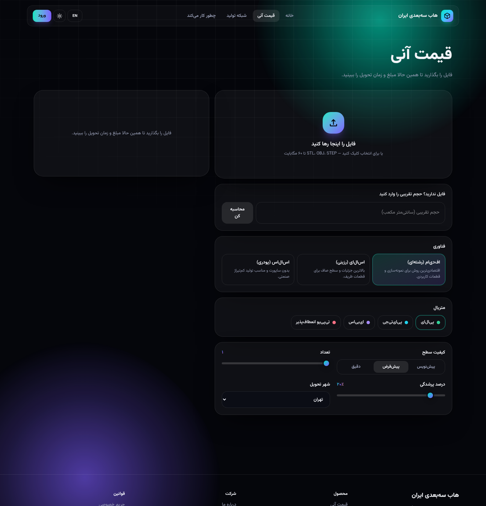
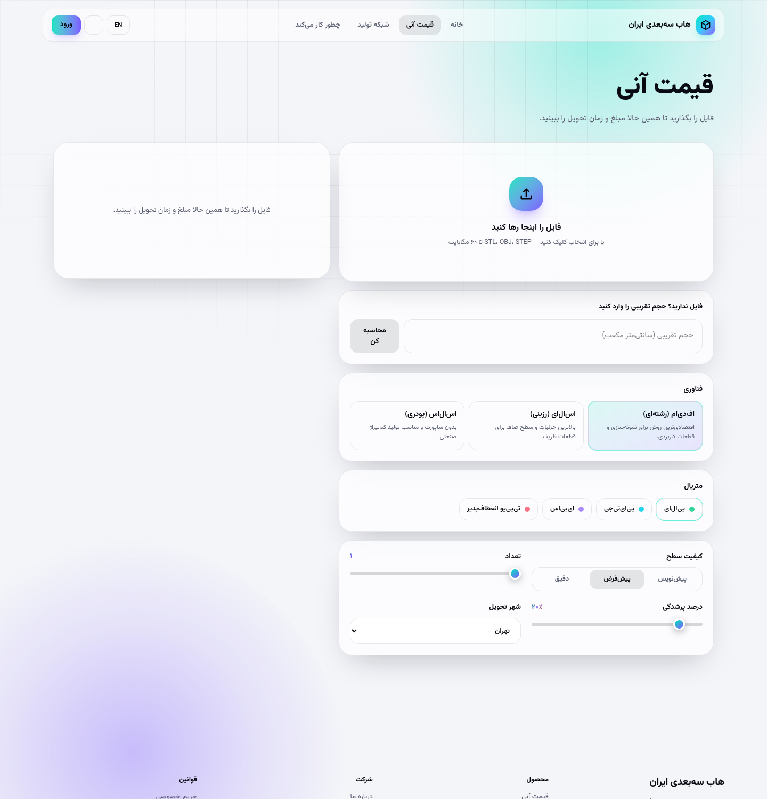
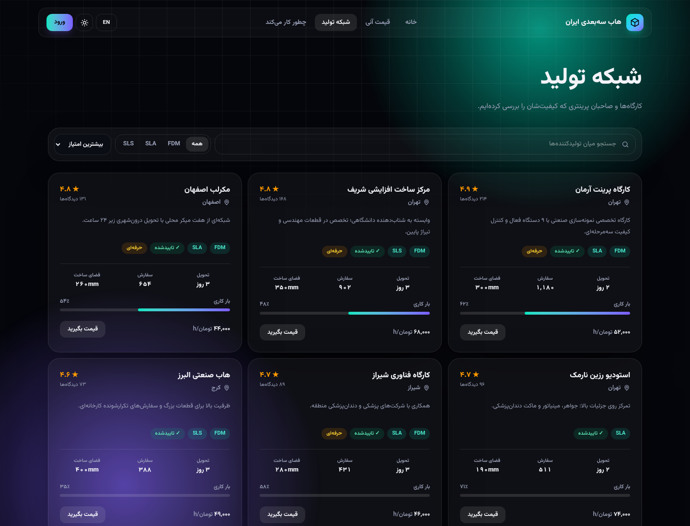
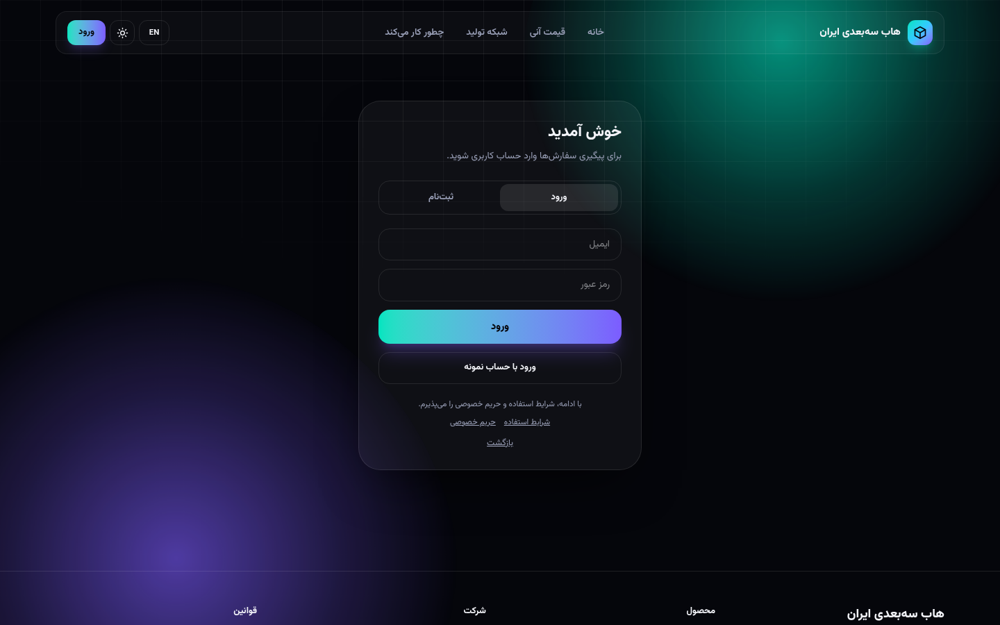
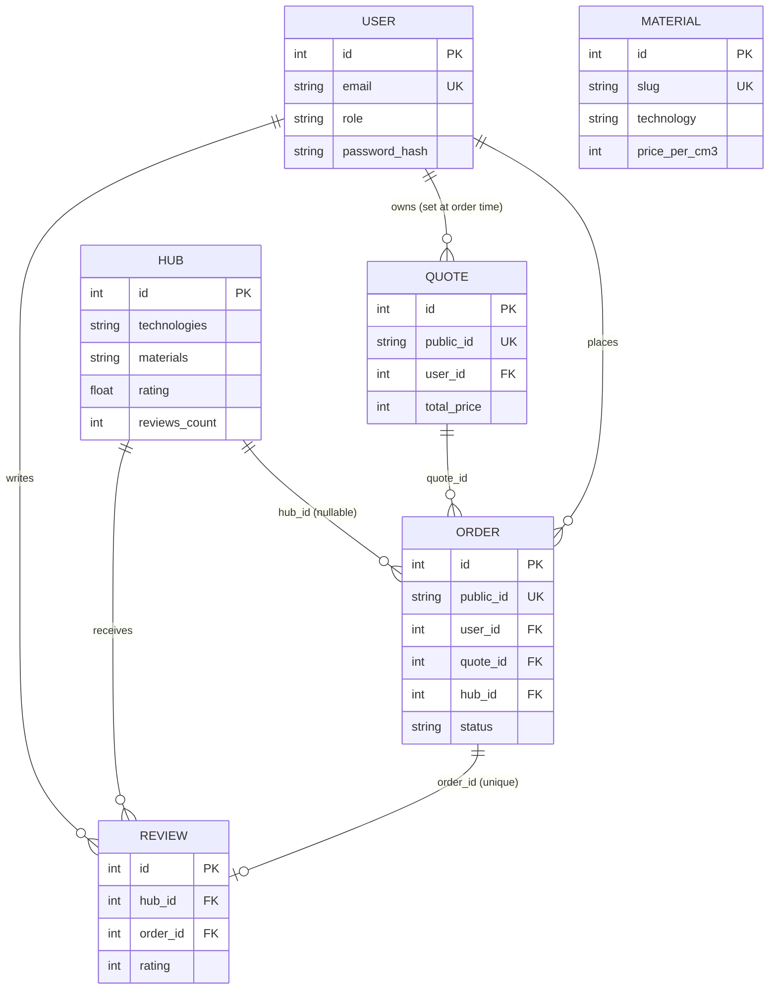
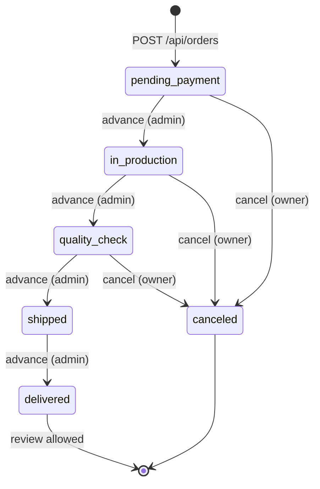
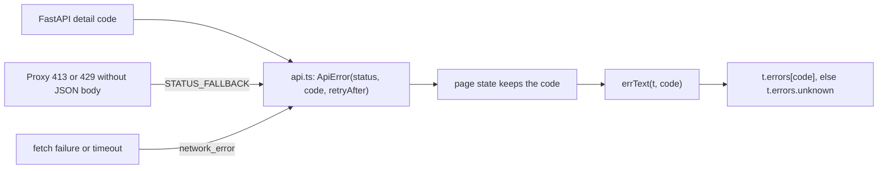

# 3D Hub Iran: implementation report

State of the code at commit `47ba9b9` on branch `audit/security-perf-ux`. The base is the MVP commit `215bc8c`. Citations are `file:line` against that commit. Everything below was checked against the working tree on 2026-10-22; where a claim could not be confirmed in code it is marked as such.

| Commit | What it contains |
|---|---|
| `215bc8c` | MVP (original code, used as the baseline) |
| `228f4a1` | Backend security fixes (auth, orders, uploads, config) and the regression suite |
| `35e6115` | Upload rate limit and parse concurrency cap |
| `47ba9b9` | Security headers, self-hosted fonts, accessibility, UI polish, hardened containers, CI |

Related documents: [architecture and decisions](01-architecture.md), [runbook](11-runbook.md), [index](README.md). Evidence files are in [evidence/](evidence/).

## 1. Purpose and scope

3D Hub Iran is a Persian/English marketplace for 3D-printing jobs. A customer uploads a model (or types a volume), gets an instant price and lead time, sees which production partners ("hubs") can make the part, places an order, and follows it on a dashboard. The platform fee is a fraction of the order, 0.15 by default (`backend/app/config.py:29`).

This report covers the whole running system: FastAPI backend, Next.js frontend, containers and CI. It is the reference for what exists. Section 9 lists what does not exist yet, and section 10 lists points where the code, the old audit notes or the product copy disagree with each other.

### Verification summary

Only numbers from `docs/evidence/` are quoted.

| Check | Result | Source |
|---|---|---|
| Regression suite on the original code (50 tests) | 48 failed, 2 passed, 361.37 s | `evidence/baseline-original-code.txt` |
| Same suite on the current code (now 60 tests) | all 60 pass in 15.5 s on an idle machine | `evidence/final-test-run.txt`; the raw output is not stored in `docs/evidence/` |
| Live probe against a running stack | 27 of 28 checks passed | `evidence/live-probe-result.json` |
| The one failing probe check (login timing, known 1535 ms vs unknown 16 ms) | measurement artefact of the rate limiter, re-measured separately | `evidence/login-timing-after.txt` |
| Login timing, original code | known email 232.7 ms vs unknown email 6.8 ms (34x) | red-team finder run on `215bc8c`; the raw output is not stored in `docs/evidence/` |
| Login timing, current code | the two distributions overlap (medians 1283 vs 1162 ms, then 770 vs 843 ms); machine load average was about 40, so absolute numbers are inflated | `evidence/login-timing-after.txt` |
| API responsiveness during a heavy parse | 90k-triangle, 8.5 MB upload parsed in 21.00 s; health p50 51 ms, max 1022 ms over 214 pings | `evidence/live-probe-result.json` |
| Frontend home route, first-load JS | 167 kB, three.js not in the initial bundle; shared chunks 103 kB; all routes static | `evidence/frontend-build-routes.txt` |
| Dependency scan (OSV, 2026-10-16) | only `pip 24.0` has advisories (build tooling, removed from the runtime image) | `evidence/dependency-and-sast.txt` |
| Bandit, medium and above | no findings | `evidence/dependency-and-sast.txt` |

### Limits and controls at a glance

| Control | Value | Source |
|---|---|---|
| Password hashing | scrypt N=2^15, r=8, p=1, 16-byte random salt; at most 4 hashes at once | `security.py:20,23,32-34` |
| Unknown email at login | one dummy scrypt, so the work matches a real check | `security.py:58-63`, `auth.py:44-46` |
| Login limit | 10 per minute per IP (login and register share one bucket); 10 failures per 10 minutes per email | `config.py:33-34`, `ratelimit.py:63-66`, `auth.py:40-42` |
| Upload analyses | 30 per minute per IP | `config.py:36`, `quotes.py:110` |
| Parallel mesh parses | 2; the next request gets `503 busy` | `config.py:37`, `quotes.py:22,119-120` |
| Mesh size | 250,000 triangles for every format | `geometry.py:23` |
| Request bodies | 64 KB JSON; 60 MB upload plus 16 KiB framing | `config.py:31-32`, `middleware.py:17-18,36` |
| Orders | 60 per hour per user | `config.py:35`, `orders.py:29` |
| Token lifetimes | login token 24 h, signed quote 24 h | `config.py:25-26` |
| Backend container | 512 MB RAM and swap, 1 CPU, 128 processes | `docker-compose.yml:59-62` |

## 2. Stack and versions

### Platform

| Item | Value | Source |
|---|---|---|
| Backend runtime | Python 3.12 (`python:3.12-slim-bookworm`), uvicorn, one worker | `backend/Dockerfile`, CMD line 57 |
| Frontend runtime | Node 22 (`node:22-alpine`), Next.js standalone output | `frontend/Dockerfile`, `frontend/next.config.ts:41` |
| Database | SQLite in WAL mode on the named volume `backend-data` | `backend/app/db.py:22-30`, `docker-compose.yml:48` |
| Orchestration | Docker Compose, two hardened services | `docker-compose.yml` |

### Backend (`backend/requirements.txt`, all pinned with `==`)

| Package | Version | Role |
|---|---|---|
| fastapi | 0.142.4 | web framework |
| starlette | 1.8.0 (transitive) | ASGI toolkit, version from `evidence/dependency-and-sast.txt` |
| uvicorn[standard] | 0.54.0 | ASGI server |
| sqlmodel | 0.0.48 | ORM and models |
| pydantic-settings | 2.15.0 | settings from environment |
| PyJWT | 2.15.1 | login tokens and signed quotes |
| email-validator | 2.3.0 | `EmailStr` validation |
| python-multipart | 0.0.32 | upload parsing |

Development only (`backend/requirements-dev.txt`): pytest 9.1.1, httpx 0.28.1, bandit 1.9.4, pip-audit 2.10.1.

### Frontend (`frontend/package.json`)

| Package | Version | Role |
|---|---|---|
| next | 15.5.27 | App Router framework |
| react, react-dom | 19.1.9 | UI |
| framer-motion | `^12.43.0` (lockfile: 12.43.0) | springs and layout animation |
| three | 0.180.0 | hero object and STL preview |
| tailwindcss, @tailwindcss/postcss | 4.1.13 | styling |
| typescript | 5.7.3 | type checking (`next build` fails on type errors, `next.config.ts:44`) |

Fonts: Vazirmatn variable font, self-hosted as three woff2 subsets (arabic 46,308 bytes, latin 34,524, latin-ext 21,860) under `frontend/public/fonts/`, license in `OFL-LICENSE.txt`.

## 3. Features by user journey

| Journey | What the user can do | Where it lives | Notes |
|---|---|---|---|
| Browse hubs | List production partners, search by name or city, filter FDM/SLA/SLS, sort by rating, speed, orders or price | `frontend/src/app/hubs/page.tsx`, `GET /api/hubs` (`routers/catalog.py:56-75`) | Search is debounced 200 ms (`hubs/page.tsx:44-49`). The hub detail endpoint exists but the UI does not call it. |
| Landing page | Live counters, material strip, how-it-works, FAQ, city strip | `frontend/src/app/page.tsx`, `GET /api/stats` (30 s per-process cache, `catalog.py:88-109`) | three.js hero is loaded with `next/dynamic` (`page.tsx:17`). |
| Instant quote by upload | Drop or pick STL, OBJ, STEP, STP, IGES, IGS or 3MF up to 60 MB; see price, lead time, warnings and the top 4 matching hubs | `frontend/src/app/quote/page.tsx`, `POST /api/quotes/analyze` (`routers/quotes.py:99-127`) | STL and OBJ are measured exactly (signed-tetrahedron volume, `geometry.py:36-41`). Other formats get a flagged size-based estimate (`geometry.py:157-167`). A browser preview renders STL files up to 30 MB (`quote/page.tsx:35`). |
| Instant quote by manual volume | Type a volume in cm3 (0.1 to 100,000) and get the same quote | `POST /api/quotes/manual` (`quotes.py:130-134`) | Bounding box defaults to 60 x 60 x 60 mm on the client (`quote/page.tsx:145`). |
| Live re-pricing | Every knob (material, quality, infill, quantity, city) re-prices after 260 ms; the previous request is aborted | `quote/page.tsx:106-170` | UI sliders: quantity 1 to 100, infill 10 to 100 in steps of 5 (`quote/page.tsx:353,363`); the API accepts 1 to 10,000 and 5 to 100. After a file is measured, re-pricing uses the manual endpoint, so the file is uploaded once. |
| Signed quote token | The price is signed by the server; nothing is stored until the customer orders | `security.py:82-106`, `quotes.py:86-87`, `orders.py:31-44` | Valid 24 h by default. See [ADR-1](01-architecture.md#adr-1-stateless-signed-quotes). |
| Order | Choose one of up to 4 matched hubs (the best match is preselected; when nothing matches the order goes without a hub), enter an address (5 to 500 characters) and an optional note, place the order | `quote/page.tsx:192-213`, `POST /api/orders` (`orders.py:26-56`) | Login required; anonymous users are sent to `/login?next=/quote`. |
| Dashboard (`پیش‌خوان`) | Totals, order list with a five-step progress bar, cancel | `frontend/src/app/dashboard/page.tsx`, `GET /api/orders` (`orders.py:72-82`) | Loads the latest 50 orders; there is no pagination control in the UI. |
| Cancel | Owner can cancel until the order ships | `POST /api/orders/{id}/cancel` (`orders.py:123-132`) | `too_late_to_cancel` once `shipped` or `delivered`. |
| Admin advance | An admin moves an order to the next status | `POST /api/orders/{id}/advance` (`orders.py:110-120`) | Button shown only when `user.role === "admin"` (`dashboard/page.tsx:63,197`). Stands in for payment and hub consoles. |
| Review after delivery | Customer of a delivered order rates its hub once | `POST /api/orders/reviews` (`orders.py:135-159`) | **Backend only: no screen calls it.** Covered by `test_review_requires_a_delivered_order_and_is_one_per_order`. |
| Account | Register, log in, log out; `GET /api/auth/me` on page load when a token exists | `routers/auth.py`, `components/Providers.tsx:45-61,102-117`, `app/login/page.tsx` | Password 8 to 128 characters, not blank (`schemas.py:28-40`). |
| Bilingual RTL/LTR | Persian (default) and English, switch at any time; Persian digits | `lib/i18n.ts` (`dict.fa`, `dict.en`), `lib/format.ts`, `Providers.tsx:75-80` | `dir` and `lang` set on `<html>`; choice kept in `localStorage` key `h3d_lang`. Persian wording follows the UX-writing vocabulary (`i18n.ts:1-5`). |
| Light and dark | Toggle, or follow the OS on first visit; eased switch | `Providers.tsx:45-51,82-100`, `layout.tsx:36` (no-flash script), `globals.css:3-45,189-196` | Key `h3d_theme`. |
| PWA shell | Installable (manifest with standalone display and icons), offline app shell | `public/manifest.webmanifest`, `public/sw.js`, `components/SwRegister.tsx` | Service worker is registered in production only. `/api/` is never intercepted (`sw.js:60`). Errors are never cached (`sw.js:11`). Cache name `h3d-v2`. |
| Accessibility and motion | Skip link, keyboard dropzone, `aria-pressed` and `aria-expanded` toggles, `role="alert"` errors, reduced-motion, reduced-transparency and more-contrast styles | `Providers.tsx:30-33`, `quote/page.tsx:239-256`, `globals.css:198-236` | Reduced motion shortens transitions to 150 ms and stops loops instead of removing all motion (`globals.css:198-212`). |
| Legal pages | `/privacy` and `/terms` | `app/privacy/page.tsx`, `app/terms/page.tsx` | Both state on the page that they are working drafts not yet reviewed by counsel. |

### Screenshots



Home page, Persian RTL, dark theme: hero with the lazily loaded three.js object and the city strip.



Home page, Persian RTL, light theme.



Home page at phone width, dark theme, with the menu button instead of the nav bar.



Quote page, dark theme, empty state: dropzone, manual volume field, technology, material, quality, infill, quantity and city controls.



Quote page, light theme, empty state. The file name says `en`, but the capture shows the Persian UI (see section 10).



Producer network (`/hubs`), dark theme: search, technology filter, sort control and hub cards with rating, lead time, build volume, load bar and hourly rate.



Login page, dark theme. The extra "login with demo account" button means this capture was taken from a demo build (`NEXT_PUBLIC_DEMO=1`); a production build does not render it (`login/page.tsx:13,148`).

## 4. Data model

Defined in `backend/app/models.py`; created by `SQLModel.metadata.create_all` plus idempotent upgrades in `backend/app/db.py:35-54`. Money is stored as integer Toman. Index names below were read from the SQLModel metadata, not assumed.



| Table | Key columns | Indexes and constraints | Notes |
|---|---|---|---|
| `user` | `email`, `role` (`maker`, `hub`, `admin`), `password_hash`, `full_name`, `phone`, `company`, `created_at` | unique index `ix_user_email` | Registration always creates `maker` (`RegisterIn` has no role). Only `admin` has behaviour. Hash is `scrypt$N$r$p$salt$digest`; legacy `salt$digest` PBKDF2 rows still verify and are upgraded at login (`security.py:37-52`, `auth.py:54-57`). |
| `hub` | names and cities (fa, en), `lat`, `lng`, `technologies` and `materials` as comma-separated strings, `rating`, `reviews_count`, `orders_done`, `lead_time_days`, `max_build_mm`, `capacity_pct`, `hourly_rate`, `verified`, `pro`, bios | primary key only | Matching splits the CSV strings into sets, so `pa12` does not match `pa12-gf` (`quotes.py:27-29`). `hourly_rate` is shown and used for sorting but not used by pricing (`pricing.py:61`). |
| `material` | `slug`, names, `technology`, `density`, `price_per_cm3`, `color_hex`, `min_wall_mm`, descriptions | unique index `ix_material_slug` | 8 rows seeded: pla, petg, abs, tpu, resin-std, resin-tough, pa12, pa12-gf (`seed.py:8-33`). |
| `quote` | `public_id` (`Q-` plus 16 hex), `user_id`, `filename`, `volume_cm3`, `bbox_x/y/z`, `triangles`, `material_slug`, `technology`, `quality`, `infill`, `quantity`, `city`, `unit_price`, `total_price`, `lead_time_days`, `print_hours`, `warnings` (CSV) | unique index `ix_quote_public_id`; FK `user_id` | Rows are written only when an order is placed (`orders.py:43-46`). |
| `order` | `public_id` (`H3D-` plus 16 hex), `user_id`, `quote_id`, `hub_id` (nullable), `status`, `address`, `note`, `amount`, `commission`, `created_at`, `updated_at` | unique index `ix_order_public_id`; index `ix_order_user_id`; FKs on `user_id`, `quote_id`, `hub_id` | `quote_id` and `hub_id` have no index. IDs come from `secrets.token_hex(8)` (`orders.py:43,49`). |
| `review` | `hub_id`, `user_id`, `order_id`, `author`, `rating` 1 to 5, `body`, `created_at` | UNIQUE on `order_id` (one review per order); FKs on `hub_id`, `user_id`, `order_id` | `hub_id` has no index. Seeded reviews have NULL `user_id` and `order_id` (`seed.py:94-95`). |

Other facts:

- `db.py:36-39` adds `ux_quote_public_id`, `ux_order_public_id`, `ix_order_user_id` and `ux_review_order_id` for databases created before the audit. On a fresh database three of these duplicate indexes that the models already create (see section 10).
- SQLite pragmas on every connection: `journal_mode=WAL`, `synchronous=NORMAL`, `busy_timeout=5000`, `foreign_keys=ON` (`db.py:23-30`).
- `Order.commission` is computed at order time as `int(total * c / (1 + c))` from the signed total (`orders.py:48`), while the quote's `platform_fee` is `round(subtotal * c / 1000) * 1000` (`pricing.py:67`). The two can differ by rounding.
- Seeded data: 8 materials, 8 hubs, 5 reviews (`seed.py`). The demo user `demo@3dhub.ir` is created only when `DEV` or `SEED_DEMO` is true (`seed.py:96-100`).

### Order status flow



`FLOW` is defined at `orders.py:20`. Status changes are compare-and-set updates, so two concurrent clicks cannot double-advance or cancel an order that just shipped; the loser gets `409 order_changed` (`orders.py:98-107`).

## 5. API reference

### Behaviour common to all routes

| Aspect | Behaviour | Source |
|---|---|---|
| Error body | `{"detail": "<code>"}`; validation errors return `{"detail":"validation_error","errors":[{"loc":[...],"type":"..."}]}` with locations only, never the submitted values | `main.py:58-62` |
| Unhandled errors | `500 {"detail":"internal_error","request_id":"..."}` | `main.py:65-69` |
| Request id | every response that passes through the middleware carries `X-Request-ID`, and the same id is in the access log line. The answer to an unhandled exception is built outside the middleware and has the id only in its body (section 10, item 17) | `middleware.py:65,77,94` |
| Body limits | JSON bodies 64 KB (`MAX_JSON_KB`); `/api/quotes/analyze` 60 MiB plus 16 KiB framing; larger gives `413 payload_too_large`, also for chunked bodies with no or a false `Content-Length` | `middleware.py:29-55` |
| Security headers | `nosniff`, `Referrer-Policy: no-referrer`, CSP `default-src 'none'; frame-ancestors 'none'`, `Permissions-Policy`, HSTS only when the scope scheme is https. Not present on the unhandled-exception answer (section 10, item 17) | `middleware.py:76-84` |
| Caching | `no-store` under `/api/auth`, `/api/orders`, `/api/quotes`; `public, max-age=60` on other successful GETs except `/api/health` | `middleware.py:16,85-88` |
| CORS | exact origins from `CORS_ORIGINS`; a localhost-any-port regex only when `DEV=true`; no credentials; methods `GET`, `POST`, `OPTIONS`; headers `Authorization`, `Content-Type`; preflight cached 600 s | `main.py:39-49` |
| API docs | `/docs` and `/openapi.json` exist only when `DEV=true` | `main.py:32-34` |
| Auth | `Authorization: Bearer <jwt>`; role is read from the database row, not the token | `security.py:109-128,143-147` |

### Routes

| Method | Path | Auth | Purpose | Notable limits and error codes |
|---|---|---|---|---|
| POST | `/api/auth/register` | none | Create an account; returns `{token, user}` | Shared per-IP bucket with login: 10 per 60 s, then `429 too_many_requests` with `Retry-After`. `409 email_already_registered`. Email at most 254 characters, lower-cased; password 8 to 128, not blank; `full_name` and `company` at most 120; `phone` at most 32. |
| POST | `/api/auth/login` | none | Log in; returns `{token, user}` | Same per-IP bucket. Also 10 failures per email in 600 s, then `429` with `Retry-After: 600`. `401 invalid_credentials` for unknown email and wrong password alike. Legacy hashes are upgraded on success. |
| GET | `/api/auth/me` | Bearer | Current user | `401 not_authenticated` (no header), `401 invalid_token` (bad, expired, wrong type, or user gone). |
| GET | `/api/materials` | none | Materials, optional `technology` filter (at most 8 characters) | |
| GET | `/api/technologies` | none | The three technologies with copy and throughput | Static list. |
| GET | `/api/qualities` | none | Quality codes with layer height | Not called by the UI. |
| GET | `/api/cities` | none | Seven delivery cities with extra lead days | |
| GET | `/api/hubs` | none | Filtered, sorted hub list | `city` (40), `technology` (8), `material` (32), `q` (80), `sort` (12; unknown values fall back to rating), `limit` 1 to 200, default 100. Technology and material match whole tokens. |
| GET | `/api/hubs/{hub_id}` | none | Hub plus its latest 50 reviews (no `user_id` or `order_id`) | `404 hub_not_found`. Not called by the UI. |
| GET | `/api/stats` | none | Landing-page counters | Cached 30 s per process. |
| GET | `/api/health` | none | Liveness: `{"status":"ok"}` | Does not touch the database. |
| POST | `/api/quotes/analyze` | none | Upload a model, get a signed quote, mesh stats, pricing, warnings and up to 4 matching hubs | Multipart `file` plus `material_slug`, `quality`, `infill` 5 to 100, `quantity` 1 to 10,000, `city`. 30 per minute per IP (`429`). Extension allow-list (`422 unsupported_file_type`). `413 file_too_large` above `MAX_UPLOAD_MB`. `503 busy` with `Retry-After: 2` when 2 parses already run. `422 volume_out_of_range` above 100,000 cm3. `400 unknown_material`. |
| POST | `/api/quotes/manual` | none | Same result from a typed volume | JSON: `volume_cm3` above 0 and at most 100,000, `bbox` of three numbers 0 to 10,000, plus the shared options. **No per-IP limit**; only the 64 KB body cap applies. |
| GET | `/api/quotes/{public_id}` | Bearer | A saved quote, owner only | `404 quote_not_found`. Only quotes created by an order exist as rows. Not called by the UI. |
| POST | `/api/orders` | Bearer | Place an order from a signed quote | 60 per hour per user (`429`). `400 invalid_quote` (bad signature, expired, wrong type). `404 hub_not_found`. `422 hub_cannot_produce` (technology, material or build volume). `address` 5 to 500, `note` at most 1000, `hub_id` optional. |
| GET | `/api/orders` | Bearer | The caller's orders with quote and hub in one JOIN | `limit` 1 to 100 (default 50), `offset` at least 0. |
| GET | `/api/orders/{public_id}` | Bearer | One order, owner only | `404 order_not_found` for missing and foreign orders alike. Not called by the UI. |
| POST | `/api/orders/{public_id}/advance` | admin | Move to the next status | `403 forbidden`; `404 order_not_found`; `409 order_changed`. No-op on `delivered` and `canceled`. |
| POST | `/api/orders/{public_id}/cancel` | Bearer, owner | Cancel | `400 too_late_to_cancel` (shipped or delivered); `409 order_changed`; repeating on a canceled order is a no-op. |
| POST | `/api/orders/reviews` | Bearer, owner | Review the hub of a delivered order | `403 review_not_allowed`; `400 order_has_no_hub`; `409 already_reviewed`; rating 1 to 5, body at most 1000. Hub rating is updated by one atomic SQL statement. Not called by the UI. |

## 6. Configuration

Settings come from environment variables and an optional `backend/.env` (`config.py:15`). Names are the upper-case field names.

| Variable | Default | Forwarded by compose | Effect |
|---|---|---|---|
| `JWT_SECRET` | empty | yes, required (`:?`) | HMAC key for login tokens and, through a derived key, signed quotes. Outside `DEV` the app raises `RuntimeError` on start if it is empty, shorter than 32 characters or in the known-weak list (`config.py:6-11,40-49`). |
| `DEV` | `false` | yes | Enables `/docs` and `/openapi.json`, the localhost CORS regex and seeds the demo user; allows an empty secret by generating a random per-process one. Never on a server. |
| `SEED_DEMO` | `false` | yes | Creates `demo@3dhub.ir` / `demo1234` if it does not exist. Never in production. Seeding only adds: turning the flag off later does not remove an existing demo user (`seed.py:96-100`). |
| `DATABASE_URL` | `sqlite:///./data/hub3d.db` | yes (compose default `sqlite:////app/data/hub3d.db`) | SQLAlchemy URL. SQLite gets WAL pragmas and a 10 s connect timeout (`db.py:15-30`). |
| `CORS_ORIGINS` | `http://localhost:3560,http://localhost:3200,http://localhost:3000` | yes (compose default `http://localhost:3560`) | Comma-separated exact origins. |
| `PLATFORM_COMMISSION` | `0.15` | yes | Platform fee fraction used in pricing and in the order's commission. |
| `MAX_UPLOAD_MB` | `60` | yes | Largest accepted upload. The frontend hard-codes 60 MB (`quote/page.tsx:34`) and the error copy says 60 MB, so raising it also needs frontend changes. |
| `MAX_JSON_KB` | `64` | no | JSON body cap. |
| `LOGIN_RATE_LIMIT` | `10` | yes | Per-IP attempts per window for login and register together, and also the per-email failure budget (window 600 s). |
| `LOGIN_RATE_WINDOW_S` | `60` | no | Window for the per-IP auth bucket. |
| `ORDERS_PER_HOUR` | `60` | yes | Orders per user per hour. |
| `ANALYZE_PER_MINUTE` | `30` | no | Upload analyses per IP per minute. |
| `MAX_PARALLEL_PARSES` | `2` | no | Concurrent mesh parses; extra requests get `503 busy`. |
| `JWT_EXPIRE_MINUTES` | `1440` | no | Login token lifetime. No refresh and no revocation. |
| `QUOTE_TTL_MINUTES` | `1440` | no | Signed quote lifetime. |
| `JWT_ALGORITHM` | `HS256` | no | Login-token algorithm. Quote tokens are fixed to HS256 (`security.py:94,100`). Use an HMAC algorithm only. |
| `JWT_ISSUER` | `3dhub-iran` | no | `iss` claim required on both token types; changing it invalidates every token. |
| `APP_NAME` | `3D Hub Iran API` | no | FastAPI title. |

Variables that are not in `config.py`:

| Variable | Where | Effect |
|---|---|---|
| `FORWARDED_ALLOW_IPS` | read by uvicorn; compose default `127.0.0.1` | Proxy addresses whose `X-Forwarded-For` and `X-Forwarded-Proto` are trusted. Decides the client IP used by every rate limit. |
| `BIND` | compose only, default `127.0.0.1` | Interface the published ports bind to (`docker-compose.yml:52,79`). |
| `NEXT_PUBLIC_API_BASE` | frontend build argument, default `http://localhost:8400` | Public API URL the browser calls; also narrows the CSP `connect-src` (`next.config.ts:5-12,28`). Rebuild after changing it. |
| `NEXT_PUBLIC_DEMO` | frontend build argument, default empty | `1` shows the demo-login button (`login/page.tsx:13`). |
| `HOSTNAME`, `PORT`, `NODE_ENV` | `frontend/Dockerfile` | Bind address `0.0.0.0`, port 3000, production mode for the standalone server. |

Compose forwards 9 of the 18 settings. The other 9 keep their defaults inside the container unless `docker-compose.yml` is edited.

## 7. Frontend structure

```
frontend/
  next.config.ts          CSP and security headers, standalone output, cache headers
  public/                 manifest.webmanifest, sw.js, icons, fonts/ (self-hosted Vazirmatn)
  src/app/                layout.tsx, globals.css, fonts.css and one folder per route
  src/components/         Providers, Header, Footer, Hero3D, StlViewer, SwRegister, Bits, Reveal
  src/lib/                api.ts, i18n.ts, format.ts
```

### Routes

All routes are prerendered as static content (`evidence/frontend-build-routes.txt`); every page is a client component that fetches data in the browser.

| Route | File | Purpose | API calls | First-load JS |
|---|---|---|---|---|
| `/` | `app/page.tsx` | Landing page | `/api/stats`, `/api/materials` | 167 kB |
| `/quote` | `app/quote/page.tsx` | Quote and order | `/api/materials`, `/api/cities`, `/api/technologies`, `/api/quotes/analyze`, `/api/quotes/manual`, `POST /api/orders` | 167 kB |
| `/hubs` | `app/hubs/page.tsx` | Producer network | `/api/hubs` | 162 kB |
| `/dashboard` | `app/dashboard/page.tsx` | Orders (`پیش‌خوان`) | `/api/orders`, `/advance`, `/cancel` | 162 kB |
| `/login` | `app/login/page.tsx` | Login and sign-up | `/api/auth/login`, `/api/auth/register` (through `Providers`) | 161 kB |
| `/privacy`, `/terms` | `app/privacy`, `app/terms` | Draft legal text | none | 118 kB each |

Shared chunks are 103 kB. three.js is imported lazily in `app/page.tsx:17` and `app/quote/page.tsx:15`, so it is not in any route's initial bundle.

### Components and libraries

| Module | Role |
|---|---|
| `components/Providers.tsx` | One React context (`useApp()`): language, theme, user, `ready` flag, `login`, `signup`, `logout`; wraps children in `MotionConfig reducedMotion="user"` (`:127`) and renders the skip link. |
| `components/Header.tsx`, `Footer.tsx` | Navigation, language and theme toggles, account links; the menu button has `aria-expanded` and closes on Escape. |
| `components/Hero3D.tsx` | Landing three.js object. The WebGL context is built once; theme changes recolour in place; the loop sleeps when off-screen or the tab is hidden; reduced motion draws a single frame. |
| `components/StlViewer.tsx` | Preview of the user's own STL. Refuses meshes above 1,500,000 vertices (`:9`), disposes geometry and renderer on unmount. |
| `components/SwRegister.tsx` | Registers `/sw.js` in production, unregisters any worker in development. |
| `components/Bits.tsx`, `Reveal.tsx` | `Counter`, `Pill`, `TiltCard`; scroll-reveal wrapper. |
| `lib/api.ts` | The only code that reads or writes the token (`h3d_token`); `fetch` with `credentials: "omit"`, 20 s timeout (60 s for uploads), `Content-Type` set only for string bodies so anonymous GETs stay CORS-simple (`:41-43`), `ApiError(status, code, retryAfter)`. |
| `lib/i18n.ts` | `dict.fa` and `dict.en` with identical shape; `Dict` type is derived from the Persian dictionary (`:220`). |
| `lib/format.ts` | `money()` and `num()`; Persian digits for `fa`. |

### State

React context for app-wide state, `useState` inside pages, no external store. `localStorage` holds exactly three keys: `h3d_token`, `h3d_lang`, `h3d_theme`, and every access is wrapped in `try/catch` (`api.ts:22-32`, `Providers.tsx:45-52`). Asynchronous work is guarded against stale results: the quote page aborts the in-flight request and compares a request id before writing state (`quote/page.tsx:84-87,115-119`), and list pages abort on unmount.

A 401 on a request that carried a token clears the token and dispatches `h3d:logout` (`api.ts:78-81`); a wrong password is excluded because its code is `invalid_credentials`. The `storage` event carries logout across tabs (`Providers.tsx:64-73`). The login `next` parameter is accepted only if it is a same-origin absolute path (`login/page.tsx:17-18`).

### Error mapping

Pages store the error as a code string and translate it at render time, so a message follows the language switch.



Examples: `invalid_credentials` shows «ایمیل یا رمز عبور نادرست است» (the vocabulary guide prefers «نادرست» over «اشتباه»); `too_many_requests` on the login page also shows the wait time from `Retry-After` (`login/page.tsx:30-36`). Backend codes without a translation fall back to `errors.unknown`: `quote_not_found`, `order_not_found`, `review_not_allowed`, `order_has_no_hub` and `already_reviewed`. The first four cannot occur in normal use; `order_not_found` can appear if a cancel or advance targets a missing order.

### Headers and PWA

- `next.config.ts:22-35` builds the CSP: `script-src 'self' 'unsafe-inline'` (plus `'unsafe-eval'` only outside production), `connect-src 'self'` plus the API origin, `frame-ancestors 'none'`, `object-src 'none'`, `base-uri 'self'`, `form-action 'self'`. Other headers: `X-Content-Type-Options`, `X-Frame-Options: DENY`, `Referrer-Policy: strict-origin-when-cross-origin`, `Permissions-Policy`, `Cross-Origin-Opener-Policy: same-origin`, `Strict-Transport-Security` (`:50-57`). `poweredByHeader` is off (`:42`). Rationale: [ADR-5](01-architecture.md#adr-5-content-security-policy).
- Fonts and icons are served with `immutable` one-year caching; `/sw.js` is never cached (`:59-67`).
- `public/sw.js` pre-caches `/`, `/quote`, `/hubs`, the manifest and the icon one URL at a time; navigations are network-first with a cached fallback; static assets are stale-while-revalidate; only 200 same-origin responses are stored.

## 8. Build and run

### Docker Compose

```bash
cp .env.example .env
sed -i "s/^JWT_SECRET=.*/JWT_SECRET=$(openssl rand -hex 32)/" .env
docker compose up --build -d
```

Frontend `http://localhost:3560`, API health `http://localhost:8400/api/health`. Both ports bind to `127.0.0.1` unless `BIND` is changed. Compose refuses to start without `JWT_SECRET` (`docker-compose.yml:37`). Details, demo mode and proxy setup are in the [runbook](11-runbook.md).

Container hardening in `docker-compose.yml`: `init: true`, `read_only: true`, `cap_drop: [ALL]`, `no-new-privileges`, bounded json-file logs (10 MB x 3), and per service `pids_limit` (128 backend, 256 frontend), `mem_limit` 512 MB, `cpus` 1.0. The backend writes only to the `backend-data` volume and a 128 MB `/tmp` tmpfs. Images run as uid 10001 (backend) and 1001 (frontend). The compose hardening itself is not exercised by CI.

### Local development

```bash
# backend
cd backend && python3 -m venv .venv && ./.venv/bin/pip install -r requirements-dev.txt
cp .env.example .env        # set JWT_SECRET (make secret) or DEV=true
./.venv/bin/python -m uvicorn app.main:app --reload --port 8400

# frontend
cd frontend && npm ci
NEXT_PUBLIC_API_BASE=http://localhost:8400 npm run dev -- -p 3560
```

### Tests

`cd backend && python -m pytest` (or `make test`). The suite has 60 tests in `backend/tests/test_security.py` and runs the real ASGI app in-process on a throw-away SQLite file (`tests/conftest.py`): no server, no network. It is CPU-heavy on a loaded machine because it performs real password hashing. There are no frontend tests; the frontend gates are `next build` (type check) and the production `npm audit`.

### CI

| Workflow | Jobs |
|---|---|
| `.github/workflows/ci.yml` | backend: pytest, bandit (`-ll`), pip-audit. frontend: `npm ci`, `npm audit --omit=dev --audit-level=high`, `next build`. docker (per image): hadolint, build, Trivy (HIGH and CRITICAL, fixable only), Syft SBOM artifact. |
| `.github/workflows/security.yml` | gitleaks (full history), Semgrep (`.semgrep.yml` plus `p/owasp-top-ten`), CodeQL for Python and JavaScript/TypeScript, dependency review on pull requests, weekly schedule. |
| `.github/dependabot.yml` | Weekly: pip, npm, both Dockerfiles, GitHub Actions. |

`make audit` runs bandit, pip-audit and npm audit locally.

## 9. What is intentionally not built yet

| Item | State in the code today | Effect today | Natural next step |
|---|---|---|---|
| Payments | No gateway. `Order.status` starts at `pending_payment` and only an admin moves it (`orders.py:110-120`). `commission` is computed but never collected. | Nobody pays. The landing copy still says "secure payment" (section 10). | Gateway integration, webhook that advances `pending_payment`, remove the admin step for that transition. |
| Producer console and user-to-hub link | Role `hub` exists as a string, but `Hub` has no owner column and no route is hub-scoped. | Hubs cannot see or advance their jobs; an admin does it by hand. | `Hub.owner_user_id`, hub-scoped order listing and status updates, hub onboarding. |
| Email verification and password reset | No email sending anywhere; the email is not verified at registration. | A forgotten password cannot be recovered; a typo in the email is accepted. | Verification token and reset flow over an email provider. |
| Refresh tokens and revocation | One 24 h access token, logout only clears the browser (`config.py:25`). `current_user` only checks that the user row exists (`security.py:125-127`). | A stolen token works until it expires; there is no per-user disable. | Short access token plus refresh token with a server-side session table. See [ADR-6](01-architecture.md#adr-6-login-token-in-localstorage). |
| Postgres and Alembic | SQLite only in practice. Upgrades are hand-written SQL in `db.py:35-54`; no Postgres driver in `requirements.txt`. | Single node, single writer. | See [ADR-4](01-architecture.md#adr-4-sqlite-in-wal-mode-and-the-path-to-postgres). |
| Native APK and IPA | Installable PWA only (manifest, icons, service worker); `prefer_related_applications` is false. | No app-store presence. | Wrap the PWA or build native clients against the same API. |
| Review screen | API and tests exist; the UI has no form and the hub page shows only the review count. | Reviews can only be created by API clients. | Review form on delivered orders; hub detail view using `GET /api/hubs/{id}`. |
| Legal text | `/privacy` and `/terms` are drafts and say so on the page. | Not ready for launch. | Counsel review. |

## 10. Points found while writing this report

These are places where the code, the original audit notes (`HANDOFF.md`) or the product copy disagree, or where a control is narrower than a quick reading suggests. None was changed; this pass only documents them.

| # | Observation | Evidence | Impact |
|---|---|---|---|
| 1 | A signed quote is a bearer token and is not single-use. The same token can be ordered repeatedly until it expires. `HANDOFF.md` section 5 item 5 names "the same quote can be ordered many times"; ownership, hub validation and ID entropy were fixed, replay was not. | `orders.py:26-56` records nothing about token use | Bounded by 60 orders per hour per user (`orders.py:29`). Duplicate orders are possible; there is no payment to abuse yet. |
| 2 | Registration still reveals whether an email exists. | `auth.py:25-26` returns `409 email_already_registered` | Mitigated only by the shared 10 per minute per IP limit. `HANDOFF.md` item 9 suggested a generic response; only login was made constant-time. |
| 3 | The per-email failure budget can be used to lock a known email out of login for about 10 minutes: ten failed attempts block the account even for the right password. | `auth.py:40-42,50`. The comment at `auth.py:38-39` says the budget cannot be used to lock a victim out "by just hitting login", which holds only for hits that do not fail. | Temporary denial of login for one account. Ten failures fit inside one minute of a single IP's own limit (10 per minute), and the lock can be renewed after it expires. |
| 4 | Landing copy promises «پرداخت امن» / "Secure payment" while no payment flow exists. | `frontend/src/lib/i18n.ts:21,126` | Product-copy mismatch. |
| 5 | `POST /api/quotes/manual` is unauthenticated and has no per-IP limit; only `analyze` is limited. | `quotes.py:99-111` vs `quotes.py:130-134` | Read-only DB work per call (one material query and one hub query); no writes. Not measured under load. |
| 6 | The comment "about 0.6 s of pure-python work in the worst case" for the 250,000-triangle cap is not backed by evidence. The only measurement is 21.00 s for a 90k-triangle, 8.5 MB upload, taken on a heavily loaded machine. | `geometry.py:22`, `evidence/live-probe-result.json` | The two are not comparable. Parse time on an idle machine is unmeasured. |
| 7 | Peak memory of two simultaneous 250,000-triangle parses (Python tuples) against the 512 MB container limit was not measured. | `geometry.py:23`, `docker-compose.yml:60`, `quotes.py:22` | Open sizing question. |
| 8 | Compose forwards 9 of 18 backend settings, and neither `.env.example` file lists all of them. | `docker-compose.yml:36-46`, `config.py:17-37` | `JWT_EXPIRE_MINUTES`, `QUOTE_TTL_MINUTES`, `ANALYZE_PER_MINUTE`, `MAX_PARALLEL_PARSES`, `MAX_JSON_KB`, `LOGIN_RATE_WINDOW_S`, `JWT_ISSUER`, `JWT_ALGORITHM` and `APP_NAME` cannot be set through compose without editing it. |
| 9 | Fresh databases carry duplicate unique indexes: `ux_quote_public_id`, `ux_order_public_id` and `ux_review_order_id` repeat what the models already create. | `db.py:36,37,39` against the metadata printout | One extra index write per insert; harmless. |
| 10 | The README says to "swap `DATABASE_URL` for Postgres", but no driver is pinned, upgrades are SQLite-specific, and the rating update calls `round(x, 2)` on a float expression. | `README.md` stack table, `db.py:43-54`, `orders.py:154-156` | Untested on Postgres. `round(double precision, integer)` does not exist in PostgreSQL, so this statement would likely need a cast; not verified here. |
| 11 | `Order.commission` is recomputed from the total and can differ from the quote's `platform_fee` by rounding. | `orders.py:48`, `pricing.py:67` | Up to a few hundred Toman by arithmetic. |
| 12 | Pricing ignores `Hub.hourly_rate` (machine time uses a constant 45,000), so choosing a different hub never changes the price. | `pricing.py:61` | Product behaviour, not a security issue. |
| 13 | The city strip on the landing page lists 12 cities; the API accepts 7 (`City` literal). | `app/page.tsx:23-24`, `schemas.py:8` | Marketing list only. |
| 14 | There is no ESLint dependency or config, and `next build` skips linting. `npm run lint` is not usable as is. | `package.json`, `next.config.ts:43` | Type checking is the only static frontend gate. |
| 15 | Screenshot `quote-light-en.png` shows the Persian UI, and `login-dark.png` was captured from a demo build. | the image files | Captions above say so. |
| 16 | The 232.7 ms vs 6.8 ms login-timing figures are not in `HANDOFF.md` or `docs/evidence/`. | task brief; evidence folder listing | Quoted here with that caveat. |
| 17 | The answer to an unhandled exception (`500 internal_error`) is built by Starlette's outermost error middleware, outside `SecureHeaders` and `CORSMiddleware`. Its body carries `request_id`, but it has no `X-Request-ID` header, no security headers, no `Cache-Control` and no CORS headers. | `starlette/applications.py:65-81` (version 1.8.0 in `backend/.venv`); `main.py:65-69`. Confirmed with an in-process probe during this pass (a route that raises; the five headers were all absent). The probe is not part of the regression suite. | A cross-origin browser cannot read a response without CORS headers, so by CORS rules `api.ts` would report `network_error` instead of `internal_error`. Not tested in a browser. The id in the body still matches the `unhandled error rid=` log line. |
| 18 | The rate-limit key sweep uses the window of the call that triggered it. Past 20,000 keys, a call with a 60 s window drops every bucket idle for more than 60 s, including `fail:` (600 s) and `order:` (3,600 s) buckets that still count. | `ratelimit.py:33-35` | Needs more than 20,000 distinct keys; matters only under a key flood. Not tested. |
| 19 | The README says the token is only read and written in `api.ts` and that a Semgrep rule enforces it. The rule forbids `setItem` with a token-like key elsewhere; it does not cover reads. A grep of `frontend/src` shows token reads only in `api.ts`. | `.semgrep.yml:77-103`, `grep localStorage frontend/src` | Documentation is slightly broader than the rule. |
