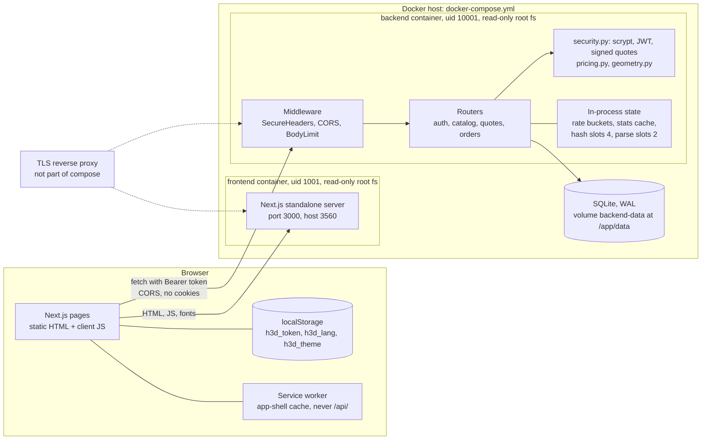
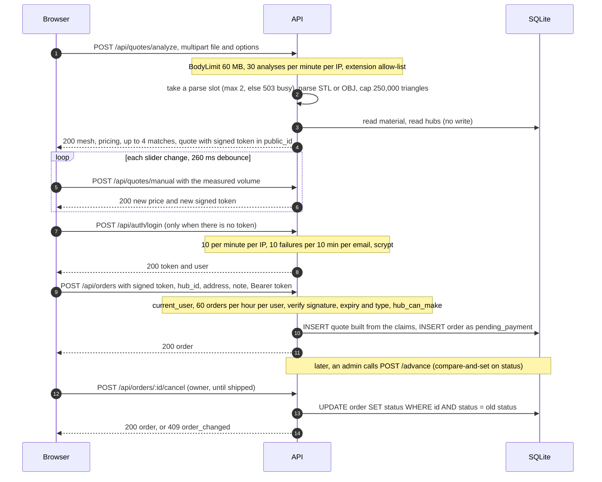
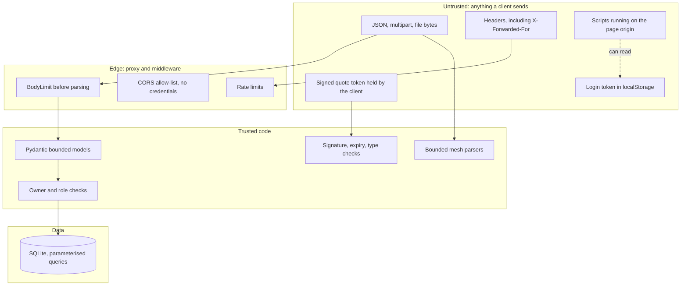

# 3D Hub Iran: architecture and decisions

State of the code at commit `47ba9b9` on branch `audit/security-perf-ux`, checked against the working tree on 2026-10-22. Citations are `file:line` under `backend/app/` or `frontend/` unless a path is given. Numbers come only from [evidence/](evidence/) or from the code itself.

Related: [implementation report](00-implementation-report.md) (what exists), [runbook](11-runbook.md) (how to operate it), [index](README.md).

## 1. Components

The browser talks to the API directly. The Next.js server has no rewrites or proxying (`frontend/next.config.ts` has none) and only serves prerendered pages, assets and headers; every page is a client component that calls the API with `fetch` (`frontend/src/lib/api.ts:57`). By default the two are different origins (3560 and 8400), so CORS applies.

| Component | Technology | State it holds | Scales by |
|---|---|---|---|
| Frontend | Next.js 15.5.27 standalone, Node 22 | none (static output) | more containers behind any HTTP balancer |
| API | FastAPI 0.142.4 on uvicorn 0.54.0, one worker | rate-limit buckets, stats cache, two semaphores, all per process | not yet: see [ADR-3](#adr-3-in-process-rate-limiter-and-its-ceiling) |
| Database | SQLite 3 in WAL mode on a named volume | all durable data | not yet: see [ADR-4](#adr-4-sqlite-in-wal-mode-and-the-path-to-postgres) |
| Quote token | HS256 JWT held by the client | the priced snapshot | any replica with the same secret can verify it: see [ADR-1](#adr-1-stateless-signed-quotes) |

Middleware order, outermost first (`main.py:37-50`): `SecureHeaders` (request id, headers, access log), `CORSMiddleware`, `BodyLimit`, then routers. Both custom middlewares are pure ASGI classes (`middleware.py:1-4`), not `BaseHTTPMiddleware`.

## 2. Request flow: quote to order

Source for each step: `quotes.py:99-127` (analyze), `quotes.py:63-94` (price, match, sign), `quote/page.tsx:106-170` (debounced re-price through `/manual`), `auth.py:36-58` (login), `orders.py:26-56` (order), `orders.py:98-107` (compare-and-set). The only database writes in the whole quote flow are the two INSERTs in step 10; the regression test `test_quoting_never_writes_to_the_database` (`tests/test_security.py:120`) covers the first half.

After delivery, `POST /api/orders/reviews` lets the customer rate the hub once (`orders.py:135-159`). No screen calls it yet (report, section 9).

## 3. Trust boundaries

| Boundary | What crosses | Controls in code | Known gap |
|---|---|---|---|
| Internet to API | JSON, multipart, headers | body caps before parsing (`middleware.py:29-55`); bounded models, literals and ranges (`schemas.py`); validation errors list locations only (`main.py:58-62`); extension allow-list (`quotes.py:23,113`) | `POST /api/quotes/manual` and catalogue GETs have no per-IP limit, only the 64 KB body cap |
| Client IP | `X-Forwarded-For` | uvicorn trusts it only from `FORWARDED_ALLOW_IPS`; every limiter keys on the resulting address (`ratelimit.py:55-56`) | a wrong value makes all users share one bucket, or lets clients spoof their IP |
| Browser scripts to token | `localStorage` read | strict API origin in CSP `connect-src` (`next.config.ts:28`); token writes confined to `api.ts` by a Semgrep rule (`.semgrep.yml:77-103`) | any XSS can read the token: [ADR-6](#adr-6-login-token-in-localstorage) |
| Signed quote to API | price snapshot | HS256 only, separate derived key, `exp`, `iss` and `typ` required (`security.py:87-106`) | not single-use and not bound to a user (report, section 10, item 1) |
| API to database | queries | SQLModel/SQLAlchemy bound parameters; raw SQL only as constants in `db.py:35-49`; foreign objects answer 404 (`orders.py:85-89`, `quotes.py:141-144`) | none known |
| Roles | the `role` column | role is read from the database row, never from the token (`security.py:143-147`); `advance` is admin only (`orders.py:110-112`); registration cannot set a role (`schemas.py:28-33`) | no admin UI: promotion is a manual database edit |
| Uploaded bytes to parser | up to 60 MB | pure Python, no native parser; 250,000-triangle cap in every parser (`geometry.py:23`); parse slots (`quotes.py:22,119-120`) | peak memory at the container limit is unmeasured |
| Container to host | processes, files, ports | non-root uid, `read_only`, `cap_drop: [ALL]`, `no-new-privileges`, pids, memory and CPU limits, loopback-only ports (`docker-compose.yml:17-28,52,59-62`) | compose hardening is not exercised by CI |
| Build to runtime | `NEXT_PUBLIC_*` | inlined into the browser bundle, so only public values belong there (`frontend/Dockerfile:21-27`) | none known |

## 4. Architecture decision records

Each record states the context, the decision and its consequences, including the upgrade path. All are status Accepted for the current code.

### ADR-1: Stateless signed quotes

**Context.** The original code inserted a `Quote` row on every price calculation, and the quote page re-prices 260 ms after every slider move. Anonymous traffic therefore grew the database without limit, and an order accepted any quote id, including another user's (`HANDOFF.md` section 5 items 5 and 11).

**Decision.**
- Pricing writes nothing. The server signs the computed snapshot as a JWT and returns it in `quote.public_id` (`quotes.py:77-87`).
- The token is HS256, signed with a derived key `sha256("quote-v1:" + JWT_SECRET)` (`security.py:87-88`), carries `iss`, `typ=quote`, `iat` and `exp` (24 h by default, `config.py:26`), and is read with `exp`, `iss` and `typ` required (`security.py:97-106`).
- `POST /api/orders` verifies the token and builds the `Quote` row from its claims (`orders.py:31-44`), so a client cannot change a price. The hub is validated against the signed material and bounding box at order time (`orders.py:34-41`).
- Login tokens use the raw secret and `typ=access`, so a quote cannot act as a login token, nor the reverse (`test_quote_token_cannot_be_used_as_auth_token`, `tests/test_security.py:50`).

**Consequences.**
- Quoting costs no database writes and any replica holding the same secret can verify a token. The live probe passed "quote returns signed token and stores nothing" and "tampered price rejected at order time" (`evidence/live-probe-result.json`).
- The price is frozen for the token lifetime. A change to material prices does not reach an outstanding quote.
- The token is signed, not encrypted: its claims (file name, volume, bounding box, price) are readable by whoever holds it.
- It is not single-use and not bound to a user, so the same token can be ordered repeatedly until it expires. The per-user limit of 60 orders per hour bounds this; there is no payment to abuse yet.
- Rotating `JWT_SECRET` invalidates every outstanding quote as well as every login ([runbook](11-runbook.md#key-rotation)).
- Upgrade path: add `sub` (user id) and a `jti` to the claims and record used ids at order time, or store quotes server-side once prices need to change under an open quote.

### ADR-2: scrypt hashing with a concurrency cap

**Context.** The original code hashed passwords with PBKDF2-SHA256 at 120,000 iterations and skipped hashing for unknown emails, which made login time reveal which accounts exist. The red-team finder run measured 232.7 ms for a known email against 6.8 ms for an unknown one, a factor of 34 (raw output not stored in `docs/evidence/`).

**Decision.**
- `hashlib.scrypt` from the standard library with N=2^15, r=8, p=1 (32 MiB per hash), a 16-byte random salt and a 32-byte key (`security.py:19-34`). No new dependency.
- The stored form `scrypt$N$r$p$salt$digest` carries its own parameters. Legacy PBKDF2 hashes still verify, and `needs_rehash` upgrades them on the next successful login (`security.py:37-52`, `auth.py:54-57`; `test_legacy_pbkdf2_hash_still_logs_in_and_is_upgraded_to_scrypt`, `tests/test_security.py:83`).
- An unknown email runs one dummy verify, so both paths do one scrypt (`security.py:58-63`, `auth.py:44-46`). Comparison uses `hmac.compare_digest`.
- A `BoundedSemaphore(4)` limits concurrent hashes (`security.py:23`). The code comment gives the reason: a login burst must not allocate 40 threads times 32 MiB. Waiters queue instead.

**Consequences.**
- Peak hashing memory is bounded at 4 x 32 MiB = 128 MiB. `maxmem=128 MiB` (`security.py:29`) is the per-call allowance, which one 32 MiB hash stays well under.
- After the fix the known-email and unknown-email timing distributions overlap (`evidence/login-timing-after.txt`: medians 1283 vs 1162 ms, and 770 vs 843 ms). That machine had a load average of about 40, so the absolute numbers are inflated and say nothing about idle latency, which was not measured. The live probe's one failing check ("known vs unknown within 2x", 1535 ms vs 16 ms) was a measurement artefact of the rate limiter and was re-measured in that file.
- Throughput of login and register is capped by the 4 slots. A waiter holds a threadpool thread while it queues. The default worker pool is shared with every other synchronous endpoint, so a distributed burst can slow unrelated routes; this follows from the design and was not measured.
- Accounts that never log in again keep their PBKDF2 hash. There is no bulk migration.
- Registration still answers `409 email_already_registered`, so account existence can be learned there, limited only by the shared 10 per minute per IP bucket (report, section 10, item 2).
- Upgrade path: raise N or move to Argon2id (needs a dependency); run hashing in a worker process; the `scrypt$N$r$p` prefix makes a parameter change a rehash-on-login.

### ADR-3: In-process rate limiter and its ceiling

**Context.** The original API had no limits, and every login attempt cost a hash, so brute force doubled as CPU exhaustion.

**Decision.** A sliding-window limiter in `ratelimit.py`: one `deque` of timestamps per key, one global lock, O(1) per hit, and no dependency.

| Key | Limit | Where |
|---|---|---|
| `auth:{ip}` (login and register share it) | 10 per 60 s | `ratelimit.py:63-66`, `config.py:33-34` |
| `fail:{email}` (failures only) | 10 per 600 s | `auth.py:40-42,50`; cleared on success (`auth.py:53`) |
| `analyze:{ip}` | 30 per 60 s | `quotes.py:110`, `config.py:36` |
| `order:{user_id}` | 60 per 3,600 s | `orders.py:29`, `config.py:35` |

The per-email budget is checked read-only first and counts failures only, so a successful login by the owner clears it. The client address is `request.client.host`, which uvicorn rewrites from `X-Forwarded-For` for trusted proxies only (`ratelimit.py:55-56`).

**Consequences.**
- The limits live in process memory. With two workers or replicas the effective limit is double; a restart resets all counters; the code comment says to move to nginx `limit_req` or Redis when scaling out (`ratelimit.py:3-4`). The 30-second stats cache is per process too (`catalog.py:88`).
- `FORWARDED_ALLOW_IPS` decides what "IP" means. If the proxy is not trusted, every user shares one bucket. If `*` is used on an exposed port, clients can spoof their address and dodge the limits.
- The per-email budget can lock a known email out for about 10 minutes (report, section 10, item 3).
- Memory is bounded by `_MAX_KEYS = 20,000`, but the sweep uses the window of the call that triggered it, so long-window buckets can be dropped early during a key flood (report, section 10, item 18).
- `POST /api/quotes/manual` and the catalogue GETs are not limited.
- Evidence: `test_login_and_register_are_rate_limited` (`tests/test_security.py:55`) and `test_uploads_are_rate_limited_and_parses_are_capped` (`:305`); the live probe passed "brute force throttled with 429 + Retry-After" and "Retry-After header sent".
- Upgrade path: a shared store (Redis) or the proxy, keeping the same keys; move the per-email failure counter into the database if accounts must stay locked across restarts.

### ADR-4: SQLite in WAL mode and the path to Postgres

**Context.** The MVP used SQLite with default settings. Concurrent writes could fail with "database is locked", and `order.user_id` had no index (`HANDOFF.md` performance section).

**Decision.** Keep SQLite for the current single-node deployment and configure it properly.
- On every connection: `journal_mode=WAL`, `synchronous=NORMAL`, `busy_timeout=5000`, `foreign_keys=ON`, plus a 10 s connect timeout (`db.py:15-30`; `test_sqlite_runs_in_wal_mode_with_busy_timeout`, `tests/test_security.py:387`).
- Idempotent upgrade statements for databases created before the audit: the `review.order_id` column and four indexes (`db.py:35-54`).
- One backend container, one uvicorn worker, one named volume (`docker-compose.yml:47-48`).
- The listing endpoint uses one JOIN instead of two queries per order (`orders.py:75-82`; `test_dashboard_listing_is_not_n_plus_one`, `:396`).

**Consequences.**
- One writer and one node. Do not run two backend containers on the same volume.
- A WAL database is three files (`hub3d.db`, `-wal`, `-shm`). A plain file copy of a running database is not a safe backup ([runbook](11-runbook.md#backups)).
- In WAL mode `synchronous=NORMAL` can lose the most recent commits after an operating-system crash or power loss, without corrupting the file.
- `foreign_keys=ON` applies to the app's connections only. A raw `sqlite3` session does not enforce foreign keys unless it sets the pragma itself.
- Schema changes are hand-written SQL in `db.py`. The comment there says to switch to Alembic when moving to Postgres (`db.py:34`). Fresh databases also carry three duplicate unique indexes (report, section 10, item 9).
- Path to Postgres, in order: add a driver to `requirements.txt` (none is pinned); introduce Alembic and retire `_UPGRADES` and the `PRAGMA` branch (already guarded by `is_sqlite`, `db.py:46`); review `func.round(float_expr, 2)` in the rating update, which PostgreSQL may reject for `double precision` (`orders.py:154-156`, not verified); then move the rate limiter and caches out of process (ADR-3) before running more than one worker. `pool_pre_ping` is already on for non-SQLite URLs (`db.py:19`). Nothing here has been run on Postgres.

### ADR-5: Content Security Policy

**Context.** The original frontend sent no security headers. Next.js App Router emits inline bootstrap scripts, and `layout.tsx` ships one constant theme script that must run before first paint (`layout.tsx:36,52`).

**Decision.** A static CSP set for every path in `next.config.ts:22-35`:
- `default-src 'self'`, `object-src 'none'`, `base-uri 'self'`, `form-action 'self'`, `frame-ancestors 'none'`, `worker-src 'self'`, `manifest-src 'self'`, `font-src 'self'`, `img-src 'self' data: blob:`.
- `script-src 'self' 'unsafe-inline'`, plus `'unsafe-eval'` only outside production. The inline allowance is deliberate and documented in the config comment.
- `connect-src 'self'` plus the API origin, computed at build time from `NEXT_PUBLIC_API_BASE` (`next.config.ts:5-12,28`), so script cannot send `fetch`, XHR or WebSocket traffic to any other origin.
- `style-src 'self' 'unsafe-inline'`. The config records no reason; inline `style` values are set by the animation code (for example `hubs/page.tsx:159-162`).
- Companion headers: `X-Content-Type-Options`, `X-Frame-Options: DENY`, `Referrer-Policy`, `Permissions-Policy`, `Cross-Origin-Opener-Policy`, `Strict-Transport-Security` (`next.config.ts:50-57`). The API sends its own `default-src 'none'; frame-ancestors 'none'` (`middleware.py:80`).

**Consequences.**
- With `'unsafe-inline'` the policy does not stop injected inline script from executing. It narrows where a successful injection can send data, and blocks framing, plugins, `<base>` and foreign form targets.
- All routes stay statically prerendered (`evidence/frontend-build-routes.txt`: every route marked static, 167 kB first-load JS on `/`), so pages can be cached and served without per-request rendering.
- No `report-uri` or `Content-Security-Policy-Report-Only` is configured, so violations are not collected.
- Upgrade path, a per-request nonce: add Next.js middleware that generates a nonce and sets `script-src 'self' 'nonce-...' 'strict-dynamic'`, pass the nonce to the theme script in `layout.tsx`, and drop `'unsafe-inline'` for scripts. The comment in `next.config.ts:14-21` records the price: every page must then render dynamically, which gives up static caching. Hash-based allowance for the theme script alone is not enough because Next's own inline scripts change per build and page.

### ADR-6: Login token in localStorage

**Context.** The API authenticates with `Authorization: Bearer`, not cookies. CORS has `allow_credentials=False` (`main.py:45`) and the client sends `credentials: "omit"` (`api.ts:60`). The SPA needs to keep the token across reloads.

**Decision.** Store the access token under `h3d_token` in `localStorage`, read and written only in `lib/api.ts` (`api.ts:22-32`). Every access sits in `try/catch`, so private browsing degrades to "logged out". Token lifetime is 24 h (`config.py:25`), and a 401 on a request that carried a token clears it and fires `h3d:logout`; a wrong password is excluded (`api.ts:78-81`). Writes of token-like keys outside `api.ts` fail a Semgrep rule (`.semgrep.yml:77-103`). The rule does not cover reads; a grep of `frontend/src` shows none.

**Consequences.**
- Any script running on the page origin can read the token and call the API as the user for up to 24 h. The CSP in ADR-5 limits where it can be sent, not whether it can be read.
- There is no refresh token and no server-side revocation: logout only clears the browser, and `current_user` checks only that the user row exists (`security.py:125-127`). A stolen token works until expiry; the only server-side kill switches are rotating `JWT_SECRET` (everyone) or deleting the user row.
- CSRF is not a concern for this scheme, because browsers do not attach an `Authorization` header automatically.
- Upgrade path, HttpOnly cookie plus CSRF protection:
  1. Issue a short-lived access token (and a rotating refresh token kept in a server-side session table, which also enables revocation) in a cookie with `HttpOnly; Secure; SameSite=Lax` or `Strict`.
  2. Serve the API on the same site as the frontend, ideally the same origin through the proxy, so cookies are first-party and CORS can stay closed; otherwise set `allow_credentials=True` with exact origins only.
  3. Require a CSRF defence on mutating routes: `SameSite` plus an `Origin` check or a custom header that cross-site forms cannot send.
  4. Change `api.ts` to `credentials: "include"` and delete the `localStorage` token code; add a logout endpoint that clears the cookie.
  5. Keep the nonce-based CSP from ADR-5 on the roadmap, since cookies remove token theft but not XSS actions.

### ADR-7: Bounded mesh parsing

**Context.** The original `analyze` was `async def` but called a pure-Python parser, which froze the event loop for every user. It read up to 60 MB before checking size, and ASCII STL and OBJ had no triangle cap (`HANDOFF.md` section 5 item 4).

**Decision.**
- `analyze` is a plain `def`, so FastAPI runs it in its threadpool (`quotes.py:97-99`; `test_analyze_is_not_an_async_def_blocking_the_loop`, `tests/test_security.py:284`).
- `BodyLimit` rejects oversized requests before parsing (`middleware.py:29-55`), and the handler reads at most `limit + 1` bytes (`quotes.py:116`).
- One cap of 250,000 triangles for binary STL, ASCII STL and OBJ (`geometry.py:23,88,99,119,138`); a truncated mesh is flagged `mesh_truncated` and `needs_engineer_review`, and an OBJ with an absurd vertex count is refused as `empty_mesh` plus `mesh_truncated` (`geometry.py:51-80,119-120`).
- At most 2 parses at once through a non-blocking semaphore, otherwise `503 busy` with `Retry-After: 2` (`quotes.py:22,119-120`); 30 uploads per minute per IP.

**Consequences.**
- The API stays responsive during a heavy parse. In the live probe a 90,000-triangle, 8.5 MB upload took 21.00 s on a heavily loaded machine while `/api/health` answered with p50 51 ms and max 1,022 ms over 214 pings (`evidence/live-probe-result.json`). The maximum shows the pure-Python parser still contends for the GIL.
- The comment "about 0.6 s in the worst case" at `geometry.py:22` is not backed by evidence: parse time at the 250,000-triangle cap on an idle machine and peak memory of two such parses against the 512 MB container limit were not measured. The same applies to several concurrent large uploads against the 128 MB `/tmp` tmpfs used to spool multipart files (`docker-compose.yml:49-50`).
- Upgrade path: the code comment names the threshold, uploads above about one per second, and the fix, a worker process or queue so parsing cannot contend for the GIL (`quotes.py:20-21`).

### ADR-8: Roles come from the database; `advance` is admin only

**Context.** The original `POST /api/orders/{id}/advance` was a "demo helper" open to the order's owner, so a customer could mark their own order delivered without paying (`HANDOFF.md` section 5 item 2). There is still no payment gateway and no hub console.

**Decision.** `advance` depends on `require_admin` (`orders.py:110-112`), which reads the role from the `user` row on every request (`security.py:143-147`). Tokens carry a `role` claim (`security.py:74-76`) that the server ignores. Registration cannot set a role (`schemas.py:28-33`). Cancel stays owner-only, and both transitions are compare-and-set updates (`orders.py:98-107`).

**Consequences.**
- Demoting or promoting a user takes effect on the next request, with no token reissue.
- Only an admin moves orders forward, and nothing in the API grants the role: promotion is a manual database edit ([runbook](11-runbook.md#first-run)).
- The `hub` role exists as a string but has no behaviour, and `Hub` has no owner column.
- Upgrade path: `Hub.owner_user_id`, hub-scoped listing and status updates, and a payment webhook for `pending_payment`. Then `advance` can stay admin-only as a back-office override.

## 5. Decisions deferred

| Topic | Deferred because | Revisit when |
|---|---|---|
| Nonce-based CSP | forces dynamic rendering of every page (ADR-5) | the token moves to a cookie, or an XSS review finds an injection point |
| HttpOnly cookie sessions and refresh tokens | needs a session table and CSRF defence (ADR-6) | payments or personal data raise the cost of a stolen token |
| Postgres and Alembic | single node is enough today (ADR-4) | a second writer, replicas, or backup and failover needs |
| Shared rate limits | one worker today (ADR-3) | more than one backend process |
| Parse worker queue | uploads are below the code's own threshold (ADR-7) | uploads exceed about one per second, or memory at the cap is measured too high |
| Single-use quotes | no payment to abuse yet (ADR-1) | payments go live |
