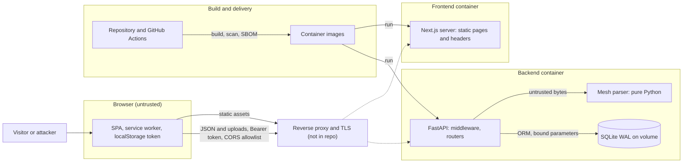

# Threat model and attack tree

State of the code: commit `47ba9b9` on branch `audit/security-perf-ux`; baseline `215bc8c`. Defensive model of the 3D Hub Iran marketplace: what is worth protecting, who threatens it, where trust changes, and which attack paths remain. It contains no exploit payloads.

Related: [finding register](03-security-audit.md) (SEC-nn ids are defined there), [penetration test](04-penetration-test.md), [implementation report](00-implementation-report.md). A bare file name follows the path key in section 1 of the register; a path with a directory is relative to the repository root. Evidence files are in [evidence/](evidence/).

## 1. Method and conventions

- **Scope:** the FastAPI backend, the Next.js frontend, the SQLite file, the Docker Compose stack and the GitHub Actions workflows in this repository. A reverse proxy, TLS, the host and backups are not in the repository and are out of scope, but they appear in the model where the code depends on them.
- **Method:** STRIDE per component (section 4), then an attack tree (section 5). The tree follows the usual steps: fix the root goal, split it into OR and AND sub-goals, annotate every leaf with cost, skill and detectability, and attach the control that cuts the leaf and where it lives.
- **Status words in the tree:** `mitigated` means a control cuts the leaf; `partial` means a control exists with a stated gap; `open` means nothing in the repository cuts it. The register uses a finer vocabulary (Fixed, Mitigated, Accepted, Open); an accepted risk shows here as `partial` or `open` depending on whether any control exists.
- **Cost, skill, detectability** are qualitative estimates by this audit (Low, Medium, High), not measurements. *Cost* is attacker effort or resources, *skill* is expertise needed, *detectability* is what the operator can see today. The API writes one access-log line per request with a request id (`middleware.py:94`) and audit lines for register, failed login, order create, advance and cancel (`auth.py:32,51`, `orders.py:55,119,131`). There is no alerting or log shipping in the repository, so "High" means "is recorded", not "someone is told".
- **Evidence discipline:** every control cited was read in the current tree. Where a test or a probe check exists it is named; where none exists the cell says so. Statements about running behaviour rest on `evidence/live-probe-result.json` and the regression suite only.

## 2. Assets and actors

### Assets

| Asset | Where it lives | Why an attacker wants it | What protects it today |
|---|---|---|---|
| Accounts and password hashes | `user` table (`models.py:12-20`); scrypt hashes (`security.py:32-34`) | Account takeover, credential reuse | scrypt, per-IP and per-email limits, 8 to 128 character policy |
| JWT signing secret | Environment `JWT_SECRET` (`config.py:22`); also seeds the quote key (`security.py:87-88`) | One secret signs login tokens and prices; a leak forges both | Start-up guard (`config.py:40-49`), compose requires it (`docker-compose.yml:37`) |
| Delivery data and orders | `order`, `user` tables: name, email, phone, company, address, note | Personal data, physical addresses | Owner-only reads (`orders.py:85-89`); no encryption at rest |
| Prices and commission | Pricing engine (`pricing.py`), signed quote (`security.py:91-106`) | Revenue integrity | Server-side pricing, signed token, bounded inputs |
| Hub ratings and reviews | `hub`, `review` tables | Producer reputation, ranking | Review rules (`orders.py:135-159`) |
| Uploaded models | Request memory and the multipart spool only. Only filename, volume, box and triangle count are persisted (`orders.py:21-23,43-44`) | Customers' designs; also the DoS vector | Not stored |
| Availability | Two containers, one API worker | Quoting and ordering must keep working | Limits, caps, WAL (sections 4 and 5) |
| The SQLite file | Volume `backend-data` (`docker-compose.yml:47-48,89`) | Holds everything above | Non-root writer; nothing else |
| Admin accounts | `role` column (`models.py:18`) | Only role that can move orders (`security.py:143-147`) | Same login controls as customers; no second factor |
| Build pipeline and images | `.github/`, Dockerfiles | What runs in production | SHA-pinned actions, lockfiles, scans defined (no run record) |

### Actors

| Actor | Capability | Goal |
|---|---|---|
| Anonymous visitor | Can quote, upload, register, read the catalog | Free or cheap parts, take the service down, scrape |
| Registered customer | Valid token, can order, cancel, review | Skip payment, see other customers' orders, inflate a hub's rating |
| Hub operator | Can register as any customer; the `hub` role has no extra rights | Raise own rating, lower a rival's |
| Admin | Moves orders through the flow | Target of takeover; trusted by the design |
| Automated attacker | Credential stuffing, scanning, floods | Accounts, resources, known CVEs |
| Supply-chain attacker | Poisoned package, action or base image | Code execution in build or runtime |
| Developer or insider | Repository and CI access | Not modelled beyond CI permissions |

## 3. Trust boundaries

In the default compose file the proxy does not exist: the browser talks to `127.0.0.1:3560` and `127.0.0.1:8400` directly (`docker-compose.yml:52,79`). The dashed edges are what a server deployment adds.

| Boundary | What crosses it | Controls in the repository |
|---|---|---|
| TB-1 Browser to API | JSON, multipart uploads, Bearer token | CORS allowlist without credentials (`main.py:39-49`), body caps (`middleware.py:29-55`), schemas (`schemas.py`), rate limits (`ratelimit.py`), security headers (`middleware.py:58-95`) |
| TB-2 Browser to Next server | Static pages and assets | CSP and headers (`next.config.ts:22-58`); no user data crosses; no API routes or middleware exist in `frontend/src/app/` |
| TB-3 API to SQLite | ORM statements | Bound parameters; raw SQL is constant DDL and pragmas only (`db.py:26-29,36-40,47-49`); WAL and busy timeout (`db.py:22-30`) |
| TB-4 API to uploaded bytes | Untrusted file content into a pure-Python parser | Extension list, size and triangle caps, 2 parse slots, threadpool (`quotes.py:22-24,99-124`, `geometry.py:23`) |
| TB-5 Repository and CI to images | Source, dependencies, actions, base images | SHA-pinned actions, lockfiles, scans, SBOM (`ci.yml`, `security.yml`); tag-only base images |
| TB-6 Container to host | Kernel, mounts, resources | Non-root, `cap_drop`, `read_only`, limits (`docker-compose.yml:17-28,59-62,83-86`); not exercised in this session |
| TB-7 Proxy and TLS to the internet | Transport security, real client IP | Not in the repository; HSTS is sent only over https (`middleware.py:83-84`); `FORWARDED_ALLOW_IPS` decides whose forwarded headers are trusted (`docker-compose.yml:46`) |

## 4. STRIDE per component

Status words: Mitigated, Partial, Open, Accepted, n/a. "(config)" means the file was read but the component was not run.

### 4.1 Browser (SPA, service worker, localStorage)

| STRIDE | Threat | Control and where | Status |
|---|---|---|---|
| Spoofing | Someone else's token is used (theft, shared device) | Token in `localStorage` (`api.ts:22-32`), 24 h (`config.py:25`); logout clears it and signals other tabs (`Providers.tsx:64-73`) (SEC-38) | Partial |
| Tampering | Client alters price, status or role before sending | Price is a signed token (`security.py:91-106`); status and role are decided on the server (`orders.py:110-120`, `security.py:143-147`); `isAdmin` in the UI only hides a button (`dashboard/page.tsx:63`) | Mitigated |
| Repudiation | A user denies placing or cancelling an order | Audit lines with user id (`orders.py:55,131`) and request ids (`middleware.py:65-66,77`); stdout only, not tamper-evident | Partial |
| Information disclosure | Token or personal data read by injected script, a third party or the referrer | No third-party origins: fonts self-hosted (`fonts.css`), `connect-src` limited to the API origin (`next.config.ts:28`), Referrer-Policy (`next.config.ts:53`); `unsafe-inline` weakens the CSP (SEC-36) | Partial |
| Denial of service | A poisoned or stale offline cache serves error pages | Only 200 same-origin responses are cached (`public/sw.js:11`), versioned cache (`:8`), `/api/` never cached (`:60`) (SEC-39) | Mitigated |
| Elevation of privilege | Script in the page acts as a higher role | No client-side authority: the server checks every call (`security.py:143-147`, `orders.py:85-89`) | Mitigated |

### 4.2 Next.js server

| STRIDE | Threat | Control and where | Status |
|---|---|---|---|
| Spoofing | The app is framed inside a hostile page (UI redress) | `frame-ancestors 'none'` and `X-Frame-Options: DENY` (`next.config.ts:34,52`) | Mitigated |
| Tampering | Static assets or headers altered in transit | HSTS is set (`next.config.ts:56`) but TLS is outside the repository | Open |
| Repudiation | No application events | The server renders static shells and keeps no state (`evidence/frontend-build-routes.txt`) | n/a |
| Information disclosure | Framework banner or version | `poweredByHeader: false` (`next.config.ts:42`) | Mitigated |
| Denial of service | Framework DoS advisories, resource exhaustion | `next` 15.5.27 (`package.json:13`), limits (`docker-compose.yml:83-86`); `sharp` 0.34.5 not re-scanned (SEC-01, SEC-02) | Partial |
| Elevation of privilege | Code execution on the frontend host | Non-root (`frontend/Dockerfile:51`), `cap_drop`, `read_only` (`docker-compose.yml:17-28`); the container holds no JWT secret and no database, compose passes only `HOSTNAME` (`:73-74`) (config) | Mitigated |

### 4.3 API (FastAPI and middleware)

| STRIDE | Threat | Control and where | Status |
|---|---|---|---|
| Spoofing | Forged or confused tokens | Secret guard (`config.py:40-49`), pinned algorithm and required claims (`security.py:116-121`), separate quote key (`security.py:87-88`) | Mitigated |
| Tampering | Hostile bodies, price tampering | Bounded schemas (`schemas.py`), body caps (`middleware.py:29-55`), signed quotes (`security.py:91-106`) | Mitigated |
| Repudiation | No record of privileged actions | Audit logger (`auth.py:32,51`, `orders.py:55,119,131`); stdout only, no alerting | Partial |
| Information disclosure | Verbose errors, docs, health config, reviewer identity | `main.py:32-34,58-74`; `catalog.py:85`; `orders.py:145,159` | Mitigated |
| Denial of service | CPU, memory and concurrency exhaustion by hashing, uploads, floods | `security.py:23`, `ratelimit.py`, `quotes.py:22,110-124`, body caps; one worker; see leaves E1 to E10 | Partial |
| Elevation of privilege | Customer reaches admin functions; IDOR; mass assignment | `require_admin` (`security.py:143-147`), owner checks (`orders.py:85-89`), no role field at register (`schemas.py:28-33`) | Mitigated |

### 4.4 SQLite

| STRIDE | Threat | Control and where | Status |
|---|---|---|---|
| Spoofing | Another process writes the file | Only uid 10001 owns the volume (`backend/Dockerfile:38-39,48`) (config) | Mitigated |
| Tampering | SQL injection, row tampering | ORM with bound parameters; the only raw SQL is constant DDL and pragmas (`db.py:26-29,36-40,47-49`) | Mitigated |
| Repudiation | No history of row changes | Only `updated_at` on orders (`models.py:98`) | Partial |
| Information disclosure | File or backup theft exposes personal data in clear text | No encryption at rest; named volume (`docker-compose.yml:47-48`) | Open |
| Denial of service | Lock contention, unbounded growth | WAL and 5 s busy timeout (`db.py:26-28`); no anonymous inserts (`quotes.py:63-94`); one writer remains (SEC-33, SEC-19) | Mitigated |
| Elevation of privilege | The application account has full rights | A file database has no separate roles | n/a |

### 4.5 Upload parser (`geometry.py`)

| STRIDE | Threat | Control and where | Status |
|---|---|---|---|
| Spoofing | A file claims one format and is another | Extension allow-list (`quotes.py:23,113-114`); binary versus ASCII STL decided by content (`geometry.py:148-151`); unknown content gets a flagged estimate (`geometry.py:159-167`) | Mitigated |
| Tampering | A crafted mesh understates volume or size | Only non-manifold, truncated and unreadable inputs are flagged (`geometry.py:63-65,77-79,159-167`) (SEC-80) | Open |
| Repudiation | Files are not stored, so nothing is attributable | Request id in the access log only | n/a |
| Information disclosure | Parser errors leak paths or content | Parse errors are caught (`geometry.py:154-155`); the handler returns `internal_error` and a request id (`main.py:65-69`); the filename never reaches a path (`quotes.py:32-35`) | Mitigated |
| Denial of service | Mesh bombs: lying triangle counts, huge OBJ or ASCII files, parallel parses | 500,000 triangle cap in every parser (`geometry.py:23,88-91,99-104,119-120,138-139`), 60 MiB body cap, 2 parse slots (`quotes.py:22,119-124`), threadpool (`quotes.py:99-100`). Measured: a 90k-triangle, 8.5 MB parse took 21.00 s on a loaded machine; the 500,000 cap was not measured (SEC-11, SEC-62) | Partial |
| Elevation of privilege | Memory-unsafe parser, code execution | Pure Python, no native parser; STEP, IGES and 3MF are size-estimated, never parsed (`geometry.py:157-167`) | Mitigated |

### 4.6 CI/CD (GitHub Actions)

The workflows are defined in the repository. No run record exists in `docs/evidence/`, so every cell below is a reading of the files.

| STRIDE | Threat | Control and where | Status |
|---|---|---|---|
| Spoofing | A fork PR runs with repository secrets | Triggers are `pull_request` and `push` to `main` (`ci.yml:3-6`, `security.yml:3-10`), no `pull_request_target`; `persist-credentials: false` (`ci.yml:24-25`) | Mitigated |
| Tampering | A tampered action or dependency enters the build | Actions pinned by commit SHA (`ci.yml:23,26,51,54`), lockfile and `npm ci` (`frontend/Dockerfile:12-13`), dependency review (`security.yml:80-95`); base images pinned by tag only (SEC-84) | Partial |
| Repudiation | Nothing proves what was built | SBOM only, no signing or provenance (`ci.yml:112-119`) | Open |
| Information disclosure | Secrets in git or logs | gitleaks over full history (`security.yml:28-37`, `.gitleaks.toml`); the old default secret is in history and is rejected at start-up (`config.py:6-11`) | Partial |
| Denial of service | Stuck or abused runs | Concurrency cancel (`ci.yml:13-15`), job timeouts (`ci.yml:21,46,73`) | Mitigated |
| Elevation of privilege | A job token with more rights than needed | `permissions: contents: read` (`ci.yml:9-10`, `security.yml:12-13`); only CodeQL gets `security-events: write` (`security.yml:58-62`) | Mitigated |

### 4.7 Containers (Docker Compose)

Docker was unavailable in this session; nothing below was run.

| STRIDE | Threat | Control and where | Status |
|---|---|---|---|
| Spoofing | A caller pretends to be the proxy to forge client IPs | `FORWARDED_ALLOW_IPS` defaults to 127.0.0.1 (`docker-compose.yml:46`, `.env.example`) | Mitigated (config) |
| Tampering | A writable root filesystem lets an intruder persist | `read_only: true`; only `/app/data` and noexec tmpfs mounts are writable (`docker-compose.yml:20,47-50`) | Mitigated (config) |
| Repudiation | Old logs are dropped | Logs rotate at 10 MB x 3 (`docker-compose.yml:24-28`) | Accepted |
| Information disclosure | `JWT_SECRET` is an environment variable, visible to anyone who can inspect the container | No secrets manager (`docker-compose.yml:37`) | Accepted |
| Denial of service | One service starves the host | `mem_limit` 512 MB, `cpus` 1.0, `pids_limit` (`docker-compose.yml:59-62,83-86`); the 128 MB upload tmpfs and two parallel 250,000-triangle parses are unmeasured against it | Partial |
| Elevation of privilege | Breakout or privilege gain | `cap_drop: [ALL]`, `no-new-privileges`, non-root users (`docker-compose.yml:21-23`, `backend/Dockerfile:48`, `frontend/Dockerfile:51`) | Mitigated (config) |

## 5. Attack tree

Root goal: **an attacker profits from or damages the marketplace.** The root is an OR of seven sub-goals. Hexagons are AND gates: every child must succeed. Colour is the status of the cut: green mitigated, amber partial, red open. Gates take the status of their strongest cut.

```mermaid
flowchart LR
  ROOT["ROOT (OR): attacker profits from or damages the marketplace"]
  ROOT --> A["A: forge identity or take over accounts (OR)"]
  ROOT --> B["B: take over or manipulate orders (OR)"]
  ROOT --> C["C: get parts free or at a wrong price (OR)"]
  ROOT --> D["D: poison hub reputation (OR)"]
  ROOT --> E["E: deny service (OR)"]
  ROOT --> F["F: steal customer data (OR)"]
  ROOT --> G["G: compromise the deployment (OR)"]
  A --> A6{{"A6 AND: steal the token through XSS"}}
  C --> C3{{"C3 AND: forge a quote token"}}
  D --> D3{{"D3 AND: fake delivered orders for self-reviews"}}
  A --> A1["A1 default JWT secret"]
  A --> A2["A2 alg none or missing claims"]
  A --> A3["A3 quote token as login token"]
  A --> A4["A4 guess or stuff passwords"]
  A --> A5["A5 enumerate emails"]
  A6 --> A6a["A6a find an injection point"]
  A6 --> A6b["A6b read token from localStorage"]
  A --> A7["A7 published demo account"]
  A --> A8["A8 open redirect phishing"]
  A --> A9["A9 reuse a stolen token"]
  A --> A10["A10 sniff the wire"]
  B --> B1["B1 read or cancel others' orders"]
  B --> B2["B2 advance own order"]
  B --> B3["B3 self-assign admin"]
  B --> B4["B4 race to skip a state"]
  B --> B5["B5 compromise the admin account"]
  C --> C1["C1 negative huge or NaN numbers"]
  C --> C2["C2 change the price"]
  C3 --> C3a["C3a learn the JWT secret"]
  C3 --> C3b["C3b sign a quote"]
  C --> C4["C4 replay a cheap quote"]
  C --> C5["C5 unfit hub"]
  C --> C6["C6 never pay"]
  C --> C7["C7 declare a smaller part"]
  D --> D1["D1 spam reviews"]
  D --> D2["D2 skew rating by race"]
  D3 --> D3a["D3a create accounts and orders"]
  D3 --> D3b["D3b get them marked delivered"]
  D --> D4["D4 script or PII in reviews"]
  E --> E1["E1 hostile upload or body"]
  E --> E2["E2 hold the parse slots"]
  E --> E3["E3 hashing flood"]
  E --> E4["E4 fill the database"]
  E --> E5["E5 exhaust limiter memory"]
  E --> E6["E6 lock a victim out"]
  E --> E7["E7 dependency DoS"]
  E --> E8["E8 SQLite write contention"]
  E --> E9["E9 spoof the client IP"]
  E --> E10["E10 volumetric flood"]
  F --> F1["F1 read others' data"]
  F --> F2["F2 recon"]
  F --> F3["F3 harvest emails"]
  F --> F4["F4 steal the database file"]
  G --> G1["G1 vulnerable dependency"]
  G --> G2["G2 poisoned update"]
  G --> G3["G3 container breakout"]
  G --> G4["G4 secrets in git history"]
  G --> G5["G5 reach from the LAN"]
  G --> G6["G6 over-privileged CI"]
  classDef mitigated fill:#d1fae5,stroke:#047857,color:#064e3b;
  classDef partial fill:#fef3c7,stroke:#b45309,color:#78350f;
  classDef open fill:#fee2e2,stroke:#b91c1c,color:#7f1d1d;
  class A1,A2,A3,A7,A8,B1,B2,B3,B4,C1,C2,C3a,C3b,C5,D1,D2,D4,E1,E3,E4,E7,E8,F1,F2,G3,G5,G6,C3 mitigated;
  class A4,A5,A6a,A9,B5,C4,D3a,D3b,E2,E5,E6,E9,F3,G1,G2,G4,A6,D3 partial;
  class A6b,A10,C6,C7,E10,F4 open;
```

### Leaf table

Ids match the chart. Cost, skill and detectability are defined in section 1. The control cell says what cuts the leaf, the file and line, and the register row (SEC-nn).

| Leaf | Cost | Skill | Detectability | ATT&CK / CWE | Status | Control and where it cuts the leaf |
|---|---|---|---|---|---|---|
| **A: forge identity or take over accounts** | | | | | | OR of the leaves below |
| **A1** Mint tokens with the old public default JWT secret | Low | Low | High: failed forgeries are 401 `invalid_token` in the access log | T1606; CWE-798, CWE-1188 | mitigated | `config.py:40-49` refuses an empty, short or known-default secret outside `DEV`; `docker-compose.yml:37` requires it; `security.py:116-119`. Probe: token signed with the old default is rejected. Test: `test_default_or_weak_jwt_secret_refuses_to_start` (SEC-08). The guard checks length and a list of known strings, not entropy |
| **A2** Present a token with `alg=none`, another algorithm, or missing claims | Low | Medium | High: 401 in the access log | T1606; CWE-347 | mitigated | `security.py:116-119` pins `algorithms` and requires `exp`, `sub`, `iss`, `typ`. Probe: `alg=none` token rejected. Test: `test_token_without_sub_is_401_not_500` (SEC-26, SEC-05) |
| **A3** Use a signed quote as a login token (token confusion) | Low | Medium | High: 401 | T1606; CWE-345 | mitigated | Separate derived key (`security.py:87-88`) and `typ` check (`:120-121`). Test: `test_quote_token_cannot_be_used_as_auth_token` (passes on the original code too, because quote tokens did not exist) (SEC-61) |
| **A4** Guess passwords or replay leaked credentials against `/login` | Medium | Low | High: `login_failed ip=...` audit line (`auth.py:51`) and 429s | T1110.001, T1110.004; CWE-307 | partial | 10 per 60 s per IP (`ratelimit.py:63-66`), 10 failures per 600 s per email (`auth.py:40-42,50`), password at least 8 characters (`schemas.py:30`), scrypt (`security.py:20`). Gaps: per-process counters, shared bucket behind a NAT, check-then-record gap (SEC-13, SEC-77) |
| **A5** Learn which emails have accounts, to aim A4 | Low | Low | Medium: looks like normal logins and sign-ups until 429 | T1589.002; CWE-204, CWE-208 | partial | Login: `dummy_verify` hashes for unknown emails (`security.py:55-63`, `auth.py:44-46`); `evidence/login-timing-after.txt`. Register still answers 409 (`auth.py:25-26`), bounded by the shared limit (SEC-16, SEC-17) |
| **A6** AND: steal the token through XSS | | | | | partial | Cut if any child is cut; children below |
| **A6a** Find a way to run script in a page | High | High | Low: a successful injection looks like a normal page view | T1059.007; CWE-79 | partial | No data-bearing sink found: the only `dangerouslySetInnerHTML` is the constant theme script (`layout.tsx:52`); Semgrep rule `.semgrep.yml:62-75`; React escapes text; CSP present but `script-src 'unsafe-inline'` (`next.config.ts:22-35`) (SEC-36). No browser XSS fuzzing was done |
| **A6b** Read the Bearer token from `localStorage` once script runs | Low | Low | Low | T1528; CWE-922 | open | The token is stored in `localStorage` (`api.ts:22-32`); any script in the page can read it. Accepted trade-off (SEC-38) |
| **A7** Log in with the published demo account | Low | Low | Medium: ordinary login | T1078.001; CWE-798 | mitigated | Seeded only with `DEV` or `SEED_DEMO` (`seed.py:96-100`); compose default false (`docker-compose.yml:39`); the login button needs `NEXT_PUBLIC_DEMO=1` (`login/page.tsx:13,148`) (SEC-60). No test |
| **A8** Send a victim a login link whose `next` parameter leaves the site | Medium | Low | Low: happens off the server | T1566.002; CWE-601 | mitigated | `login/page.tsx:17-18,73,85` accept only a same-origin absolute path (SEC-37). No test |
| **A9** Keep using a stolen token | Low | Low | Low: indistinguishable from the user | T1550.001; CWE-613 | partial | 24 h lifetime (`config.py:25`); a deleted user's token stops working (`security.py:125-127`); there is no per-token revocation (SEC-28) |
| **A10** Read tokens or alter static assets on the wire | Medium | Medium | Low: outside the app's view | T1040; CWE-319 | open | No TLS layer in the repository. HSTS is sent only over https (`middleware.py:83-84`, `next.config.ts:56`). Deployment concern (residual risk 15 in `03-security-audit.md`) |
| **B: take over or manipulate orders** | | | | | | OR of the leaves below |
| **B1** Read or cancel another user's order | Low | Low | Medium: 404 `order_not_found` in the access log | T1190; CWE-639, CWE-862 | mitigated | `orders.py:85-89` answers 404 for foreign orders; the list is filtered by user (`orders.py:80`); cancel uses the same check (`:123-126`). Probe: 'another user cannot read or cancel the order'. The list isolation has no test (SEC-12) |
| **B2** Move your own order to a later status without paying | Low | Low | High: 403 `forbidden` | T1565.001; CWE-863, CWE-841 | mitigated | `require_admin` (`security.py:143-147`) on `orders.py:110-113`; role read from the database row. Tests: `test_customer_cannot_advance_their_own_order`, `test_only_admin_can_advance_orders`; probe 'customer cannot advance own order to delivered' (SEC-09) |
| **B3** Register with a `role` field to become admin | Low | Low | Medium | CWE-915 | mitigated | `RegisterIn` has no role field (`schemas.py:28-33`) and the model default is `maker` (`models.py:18`). Unknown fields are ignored, not applied (SEC-73). Read from code only, no dedicated test |
| **B4** Fire concurrent advance and cancel calls to skip or double a transition | Medium | Medium | Low | CWE-362 | mitigated | Compare-and-set update, loser gets `409 order_changed` (`orders.py:98-107`). No test; no register row because it is part of the new design |
| **B5** Take over the admin account, the only role that moves orders | Medium | Medium | Medium: `login_failed` lines; every advance logs the admin id (`orders.py:119`) | T1078; CWE-308 | partial | Same login controls as A4; no second factor. Admins are created by editing the database (the only path in the code base is the test helper `conftest.py:110-119`); there is no admin UI (SEC-82) |
| **C: get parts free or at a wrong price** | | | | | | OR of the leaves below |
| **C1** Send negative, zero, huge or NaN quantity, volume or infill | Low | Low | High: 422 `validation_error` | T1565.001; CWE-1284, CWE-20 | mitigated | `schemas.py:7-25`, `quotes.py:103-107`, volume cap `pricing.py:30` and `quotes.py:65-66`. Tests: 15 parametrised cases, NaN and Infinity, form bounds; probe 'negative quantity refused' (SEC-10) |
| **C2** Change the price in transit or in a stored quote | Low | Medium | Medium | CWE-345, CWE-472 | mitigated | The price is computed and signed on the server (`security.py:91-106`) and verified when ordering (`orders.py:31,43-51`). Probe: 'tampered price rejected at order time' (SEC-61) |
| **C3** AND: forge a quote token | | | | | mitigated | Cut if any child is cut; children below |
| **C3a** Learn the JWT secret (the quote key is derived from it) | High | High | Low | T1606; CWE-321 | mitigated | Same controls as A1; the derivation `quote-v1:` is public in the repository (`security.py:87-88`), so the secret is the only protection (SEC-08) |
| **C3b** Sign a quote with the derived key | Low | Medium | Low | T1606; CWE-347 | mitigated | HS256 with `typ=quote`, `iss`, `exp` required on read (`security.py:97-106`); needs C3a |
| **C4** Replay a cheap quote inside its 24 h life, or order one quote many times | Low | Low | Medium: repeated `order_created` lines | CWE-294 | partial | Expiry 24 h (`config.py:26`); 60 orders per hour per user (`orders.py:29`); the token is not single use (SEC-61) |
| **C5** Order from a hub that cannot make the part | Low | Low | High: 422 `hub_cannot_produce` | CWE-841 | mitigated | `orders.py:33-41` with `hub_can_make` (`quotes.py:45-48`), whole-token matching (`quotes.py:27-29`). Tests in SEC-12 and SEC-23 |
| **C6** Place orders and never pay | Low | Low | High: orders pile up in `pending_payment` | CWE-841 | open | There is no payment gateway: only an admin advances `pending_payment` (`orders.py:20,110-120`) and nothing checks payment; `commission` is computed (`orders.py:48`) and never collected (SEC-81) |
| **C7** Declare a smaller volume or box than the real part, or craft a mesh that understates volume | Low | Low | Low | CWE-20 | open | Manual entry takes volume and box as typed (`quotes.py:130-134`); only non-manifold, truncated and unreadable inputs are flagged (`geometry.py:63-65,77-79,159-167`); minimum charge `pricing.py:63`. Control is a human check at the hub (SEC-80) |
| **D: poison hub reputation** | | | | | | OR of the leaves below |
| **D1** Post many reviews, or reviews without a delivered order | Low | Low | High: 403 `review_not_allowed`, 409 `already_reviewed` | CWE-799, CWE-841 | mitigated | Own delivered order only, one per order (`orders.py:139-152`; `models.py:105` unique). Test: `test_review_requires_a_delivered_order_and_is_one_per_order` (SEC-18) |
| **D2** Skew the average with concurrent submissions | Medium | Medium | Low | CWE-362 | mitigated | One atomic UPDATE (`orders.py:153-156`) and the unique `order_id`. The unique-constraint race has no concurrent test (SEC-18) |
| **D3** AND: fake delivered orders for self-reviews | | | | | partial | Cut if any child is cut; children below |
| **D3a** Create accounts and orders in bulk | Low | Low | Medium | CWE-799 | partial | Registration 10 per minute per IP (`ratelimit.py:63-66`); orders 60 per hour per user (`orders.py:29`); no email verification (SEC-83) |
| **D3b** Get an admin to mark them delivered | High | Medium | Medium: `order_advanced` carries the admin id (`orders.py:119`) | CWE-841 | partial | Admin-only advance (`security.py:143-147`). The system checks no payment evidence and hubs cannot confirm their own jobs (SEC-81, SEC-82) |
| **D4** Plant script or personal data through review text or author | Low | Low | Low | CWE-79, CWE-200 | mitigated | Body at most 1,000 characters (`schemas.py:58`); no page renders reviews yet; the author is a name or the email local part, not the full email (`orders.py:145`) (SEC-68) |
| **E: deny service** | | | | | | OR of the leaves below |
| **E1** Send an oversized or hostile upload or JSON body | Low | Low | High: 413, 422, 503 and request duration in the access log | T1499.003, T1499.004; CWE-400, CWE-770 | mitigated | Body caps (`middleware.py:29-55`), bounded read (`quotes.py:115-118`), 500,000 triangle cap in every parser (`geometry.py:23`), threadpool (`quotes.py:99-100`). Tests and probe in SEC-11; measured: 90k triangles in 21.00 s on a loaded machine, health max 1022 ms meanwhile |
| **E2** Hold both parse slots, or send many large bodies at once | Low | Low | High: 503 `busy` | T1499.003; CWE-770 | partial | 30 per minute per IP (`quotes.py:110-111`), 2 parallel parses (`quotes.py:22,119-124`). Concurrency is not per IP, and the limiter runs after the body is received (framework order, not tested). `/manual` is unaffected (SEC-62) |
| **E3** Flood login or register to burn hashing CPU and memory | Low | Low | High: 429s | T1499; CWE-400 | mitigated | Per-IP limit (`ratelimit.py:63-66`), at most 4 concurrent scrypt hashes (`security.py:23,27`) (SEC-13, SEC-14) |
| **E4** Fill the database with anonymous quotes | Low | Low | Medium | CWE-770 | mitigated | Quotes are signed, not stored (`quotes.py:63-94`). Test: `test_quoting_never_writes_to_the_database` (SEC-19) |
| **E5** Rotate keys to grow the limiter's memory | Medium | Medium | Low | CWE-770 | partial | The 20,000-key prune removes only expired keys (`ratelimit.py:16,33-35`), so growth is bounded by distinct clients per window (SEC-77) |
| **E6** Lock a known email out of login | Low | Low | High: `login_failed` lines | CWE-645 | partial | Ten failures block the email for 600 s (`auth.py:40-42,50`); capped by the per-IP limit (SEC-78) |
| **E7** Use known DoS advisories in dependencies | Low | Medium | Low | T1190; CWE-1395 | mitigated | Versions bumped: SEC-01, SEC-03, SEC-04, SEC-05 (`evidence/dependency-and-sast.txt`) |
| **E8** Generate write contention until SQLite reports locked | Medium | Medium | Medium | none (reliability) | mitigated | WAL and a 5 s busy timeout (`db.py:22-30`), test `test_sqlite_runs_in_wal_mode_with_busy_timeout` (SEC-33); one writer remains |
| **E9** Spoof `X-Forwarded-For` to dodge or poison limits | Low | Low | Low | CWE-348 | partial | The limiter uses the socket peer (`ratelimit.py:55-56`); uvicorn trusts forwarded headers only from `FORWARDED_ALLOW_IPS`, default 127.0.0.1 (`docker-compose.yml:46`). Setting it to `*` on an exposed port reopens this. No test (SEC-77) |
| **E10** Volumetric network flood | Medium | Low | High | T1498 | open | Outside the repository: no proxy, CDN or provider filtering; ports bind to localhost by default (`docker-compose.yml:52,79`) |
| **F: steal customer data** | | | | | | OR of the leaves below |
| **F1** Read other users' quotes, reviewer identities or orders | Low | Low | Medium | CWE-639, CWE-200 | mitigated | Quote lookup is owner-only (`quotes.py:137-145`); reviews hide `user_id` (`catalog.py:85`) and the full email (`orders.py:145,159`); orders see B1 (SEC-20, SEC-68, SEC-25) |
| **F2** Learn the surface from public docs, health output or verbose errors | Low | Low | Low | T1595.002; CWE-200 | mitigated | Docs only with `DEV` (`main.py:32-34`); health returns `status` only (`main.py:72-74`); error handlers return codes and ids (`main.py:58-69`). Probe checks for docs and validation echo (SEC-29, SEC-66, SEC-65) |
| **F3** Harvest emails through enumeration | Low | Low | Medium | T1589.002; CWE-204 | partial | Same as A5 |
| **F4** Steal the SQLite file or a volume backup | High | Medium | Low | T1005; CWE-311 | open | PII (email, name, phone, company, address) sits in clear text in a SQLite file on the `backend-data` volume (`docker-compose.yml:47-48,89`). No encryption at rest, no backup policy in the repository |
| **G: compromise the deployment** | | | | | | OR of the leaves below |
| **G1** Exploit a vulnerable dependency in either container | Low | Medium | Low | T1190; CWE-1395 | partial | Upgrades done (SEC-01, SEC-04, SEC-03, SEC-05); weekly scans (`security.yml:9`) and Dependabot defined; `sharp` 0.34.5 not re-scanned (SEC-02) |
| **G2** Slip a poisoned dependency, action or base image into the build | High | High | Low | T1195.001, T1195.002; CWE-829, CWE-494 | partial | Actions pinned by SHA (`ci.yml:23`), lockfile and `npm ci` (`frontend/Dockerfile:12-13`), exact `==` pins. Base images by tag (`backend/Dockerfile:8,26`; `frontend/Dockerfile:8,16,31`), no hashes for Python (`backend/Dockerfile:16-18`), no signing (SEC-84) |
| **G3** Break out of a root or privileged container | High | High | Low | T1611; CWE-250 | mitigated | Non-root users (`backend/Dockerfile:48`, `frontend/Dockerfile:51`), `cap_drop: [ALL]`, `no-new-privileges`, `read_only` (`docker-compose.yml:17-28`). Config read only: Docker was unavailable (SEC-24) |
| **G4** Find secrets in the repository or its history | Low | Low | Low | T1552.001; CWE-798 | partial | The old default secret and the demo password are in history but rejected or opt-in (`config.py:6-11`, `seed.py:96-100`). gitleaks scans full history (`security.yml:28-37`, `.gitleaks.toml`); no run record (SEC-08, SEC-60) |
| **G5** Reach the API or frontend from the local network | Low | Low | Medium | T1190; CWE-1327 | mitigated | Ports bind to `127.0.0.1` unless `BIND` is set (`docker-compose.yml:52,79`); the original published on all interfaces (`docker-compose.yml:14` at `215bc8c`) (SEC-24) |
| **G6** Abuse an over-privileged CI token | High | High | Low | T1195; CWE-250 | mitigated | `permissions: contents: read` (`ci.yml:9-10`, `security.yml:12-13`), `persist-credentials: false`, only CodeQL gets `security-events: write` (`security.yml:58-62`). Read from the files; no run record (SEC-84) |

Tally: 49 leaves: 27 mitigated, 16 partial, 6 open (gates not counted).

## 6. Residual risk, before and after

Qualitative rating of likelihood times impact for the attacker described in the leaf table (Critical, High, Medium, Low). It was assigned by this audit; no formal scoring method was used. "Before" is commit `215bc8c`, "after" is `47ba9b9`.

| Before rank | Attack path (leaves) | Before | After | After rank |
|---|---|---|---|---|
| 1 | Exploit a vulnerable dependency, above all Next.js (G1, E7) | **Critical.** `next` 15.5.4 carried 31 advisories, 3 of them critical RCE, plus DoS advisories in `starlette`, `python-multipart` and `PyJWT` (`evidence/dependency-and-sast.txt`) | **Low to Medium.** All four were bumped; the OSV query of 2026-10-16 found nothing on them. Gaps: `sharp` was not re-scanned (SEC-02), and the scanning workflows have no run record (SEC-84) | 3 |
| 2 | Forge identity with the public default JWT secret (A1, A2, C3) | **Critical.** The secret was a default in `config.py:7` and `docker-compose.yml:8`; one forged token meant any account | **Low.** Start-up refuses default and short secrets (`config.py:40-49`); a token signed with the old secret is rejected (probe). Gap: the guard checks length and a known list, not entropy | 5 |
| 3 | Get parts free or at a wrong price (B2, C1, C6, C7) | **High.** A customer could advance their own order to delivered, and a negative quantity produced a negative price (`orders.py:69`, `quotes.py:111` at `215bc8c`) | **Medium.** Both holes are closed and tested (SEC-09, SEC-10). Left: there is no payment gateway, and the price rests on declared geometry (SEC-81, SEC-80), so a cheap order still depends on an admin and a hub | 1 |
| 4 | Deny service through the anonymous upload (E1, E2) | **High.** A CPU-bound parser ran inside `async def`, so one upload froze every request; no size check before reading, no triangle cap on ASCII and OBJ | **Medium.** Threadpool, body caps, triangle cap, 30 per minute per IP and 2 parse slots; the live probe kept health at p50 51 ms, max 1022 ms during a 21.00 s parse. Left: slot exhaustion by one client, the upload spool and the 500,000 worst case are unmeasured (SEC-62) | 2 |
| 5 | Take over an account by guessing and enumeration (A4, A5, B5) | **High.** No rate limit; login time differed 34-fold between known and unknown emails (232.7 ms against 6.8 ms) | **Low to Medium.** Limits on IP and on email, constant-time login (distributions overlap in `evidence/login-timing-after.txt`). Left: register enumeration, shared bucket behind a NAT, no second factor for admins, token in `localStorage` | 4 |

Order after the pass: payment and declared geometry (Medium), upload availability (Medium), dependency and supply-chain hygiene (Low to Medium), account takeover (Low to Medium), token forgery (Low). Just outside the five: token theft through XSS (A6), which needs an injection point that was not found, but would meet a weak CSP and a script-readable token.

## 7. What this model does not cover

- TLS, the reverse proxy, DNS, the host, backups and monitoring: none is in the repository (TB-7).
- Anything that needs a running container or CI run: Docker was unavailable and no CI results are stored, so TB-5 and TB-6 rest on reading the files.
- Browser-side injection testing: no XSS fuzzing was done (see `04-penetration-test.md`, section 9).
- Privacy law and the draft `/privacy` and `/terms` pages, which say themselves that counsel has not reviewed them.
- Business processes outside the code: how an admin verifies payment, how hubs are vetted, how disputes are settled.
