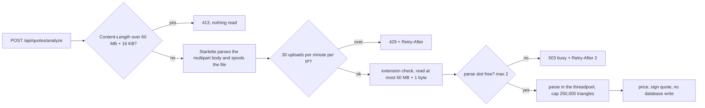

# 3D Hub Iran: security with performance

State of the code at commit `47ba9b9` on branch `audit/security-perf-ux` (base `215bc8c`), checked against the working tree on 2026-10-22. Every security control added in this pass was asked to state what it costs. This document does that, control by control, and says where no number exists.

Related: [architecture and decisions](01-architecture.md), [runbook](11-runbook.md), [implementation report](00-implementation-report.md), [index](README.md).

## How to read the evidence column

| Label | Meaning |
|---|---|
| measured | A number that sits in a file under [evidence/](evidence/). Nothing else is quoted as a measurement. |
| code fact | Read from the cited `file:line` in the working tree. Says what the code does, not how fast. |
| estimated | Reasoning from the code or from known library behaviour. No measurement exists. |

## 1. What was measured, and what was not

| Fact | Value | Source | Caveat |
|---|---|---|---|
| Login time, original code (PBKDF2, 120,000 iterations), known vs unknown email | 232.7 ms vs 6.8 ms, a factor of 34 | red-team finder run on `215bc8c` | Raw output is not stored in `evidence/`. |
| Login time, current code, known vs unknown email | medians 1283 vs 1162 ms, then 770 vs 843 ms. The two distributions overlap. | [evidence/login-timing-after.txt](evidence/login-timing-after.txt) | Machine load average was about 40, so absolute numbers are inflated. The overlap is the result, the milliseconds are not. |
| Heavy upload parse | 90,000 triangles, 8.5 MB, 21.00 s. During it `/api/health` answered with p50 51 ms and max 1022 ms over 214 pings. | [evidence/live-probe-result.json](evidence/live-probe-result.json) | Loaded machine. The file format of the probe upload is not recorded. |
| Frontend first-load JS | `/` 167 kB, `/quote` 167 kB, `/dashboard` 162 kB, `/hubs` 162 kB, `/login` 161 kB, `/privacy` and `/terms` 118 kB, shared by all routes 103 kB. All routes static. | [evidence/frontend-build-routes.txt](evidence/frontend-build-routes.txt) | Only the "after" table exists. No pre-change build output was kept. |
| Regression suite | Original code: 48 failed, 2 passed in 361.37 s. Current code: 60 pass in 15.5 s on an idle machine (the 361 s figure was measured under a load average of about 40). | [evidence/baseline-original-code.txt](evidence/baseline-original-code.txt); the current run record came with the brief | Raw output of the current run is not stored. |
| Live probe | 27 of 28 checks passed. The failing one (login timing, 1535 ms vs 16 ms) was a rate-limiter artefact, re-measured in `login-timing-after.txt`. | `live-probe-result.json` | |

**Never measured.** Idle-machine scrypt latency; parse time at the 250,000-triangle cap; peak memory of two parses or of several 60 MB uploads; database query time before and after the indexes; font load time before and after self-hosting; frame rate or GPU load of the 3D scenes; Lighthouse or Web Vitals; the size of the three.js chunk. The table below says "not measured" wherever one of these would be the evidence.

## 2. Controls: security gain against performance cost

### 2.1 Password hashing and abuse limits

| Control | Security gain | Performance cost or gain | Evidence |
|---|---|---|---|
| scrypt, N=2^15, r=8, p=1 | Memory-hard hash from the standard library, no new dependency. Replaces PBKDF2-120k; legacy hashes verify and are upgraded on the next successful login. | Cost: 32 MiB (128 x N x r bytes, computed) and one CPU-bound hash per login, per register and per unknown-email login. Idle latency was not measured. Original PBKDF2 login measured 232.7 ms. | code fact `security.py:19-34`, `auth.py:54-57`. measured 232.7 ms (finder run). Idle scrypt latency: not measured. |
| Hash slots: `BoundedSemaphore(4)` | A login burst cannot allocate one 32 MiB hash per thread; memory exhaustion by login spam is bounded. | Gain: hashing memory is capped at 4 x 32 MiB = 128 MiB (computed). Cost: extra callers queue, each holding a threadpool thread, so login and register throughput is capped and a burst can delay other synchronous routes. | code fact `security.py:23,26-29`. Queueing effect: estimated ([ADR-2](01-architecture.md#adr-2-scrypt-hashing-with-a-concurrency-cap)). |
| Dummy hash for unknown emails | Removes the account-existence oracle on login (34x gap in the original). | Cost: one extra scrypt per unknown-email attempt, spent on the attacker. The dummy hash is built lazily, so the first unknown-email request after a restart runs two hashes (`security.py:58-63`). | measured: distributions overlap in `login-timing-after.txt` (load about 40). code fact `auth.py:44-46`. |
| Sliding-window limiter and per-account failure budget | Login and register share 10 per minute per IP; 10 failures per 10 minutes per account; uploads 30 per minute per IP; orders 60 per hour per user. 429 with `Retry-After`. | O(1) per hit under one lock. It saves CPU: the IP check is a route dependency that runs before the handler hashes anything (`auth.py:36`), and a locked account returns 429 before any hash (`auth.py:41-42`). Counters are per process; memory is soft-capped by a sweep above 20,000 keys. | code fact `ratelimit.py:16,24-36,63-66`, `config.py:33-36`. The live probe check "brute force throttled with 429 + Retry-After" passed. Lock contention: not measured. |

### 2.2 Database

| Control | Security gain | Performance cost or gain | Evidence |
|---|---|---|---|
| WAL, `busy_timeout=5000`, `synchronous=NORMAL`, driver timeout 10 s | Availability: concurrent requests wait instead of failing with "database is locked". | Readers no longer block the writer and there are fewer fsyncs. Trade-off: with `synchronous=NORMAL` in WAL mode a power loss can drop the latest commits without corrupting the file (documented SQLite behaviour, not tested here). Still one writer. | code fact `db.py:18,26-28`; `test_sqlite_runs_in_wal_mode_with_busy_timeout` (`tests/test_security.py:387`). Throughput gain: not measured. |
| N+1 removed on `GET /api/orders`, page size capped | A user cannot make the server run 2N+1 queries; `limit` is 1 to 100, default 50. | One JOIN over orders, quotes and hubs. The original issued 1 query plus 2 `session.get` calls per order, up to 1 + 2 x 20 = 41 for 20 orders (fewer when orders share a hub, because the session caches the row). | code fact `orders.py:73-82` against original `orders.py:52-56` and `_decorate`. `test_dashboard_listing_is_not_n_plus_one` asserts at most 4 SELECTs for 20 orders (`tests/test_security.py:396-413`); the actual count is not recorded. |
| Indexes and unique IDs | Unique `public_id` on quotes and orders removes the collision case where `.first()` returned the wrong row; unique `review.order_id` enforces one review per order. New IDs carry 16 random hex characters (`secrets.token_hex(8)`) instead of the original 6 (orders) and 8 (quotes). | `ix_order_user_id` turns the dashboard filter from a table scan into an index lookup. Each insert pays a small index write. Fresh databases carry three duplicate unique indexes ([report, section 10, item 9](00-implementation-report.md#10-points-found-while-writing-this-report)). At 8 hubs and small tables the gain is not visible. | code fact `db.py:35-40`, `models.py:64,88,89,105`, `orders.py:43,49`. estimated; no query timing exists. |
| Quoting writes no rows (signed quote token) | Anonymous traffic cannot grow the database. The price is HMAC-signed with a derived key and a 24 h expiry, so a client cannot change it. | Removes one INSERT and one COMMIT per quote. The UI re-quotes 260 ms after every control change (`quote/page.tsx:168`), and the original wrote a row each time (original `quotes.py:58-71`). Cost: an HMAC-SHA256 signature per quote (not measured) and a longer token in the response and at order time (up to 2000 characters accepted, `schemas.py:49`). | code fact `quotes.py:63-94`, `security.py:82-106`; `test_quoting_never_writes_to_the_database` (`tests/test_security.py:120`). Row counts before and after: not measured. |

### 2.3 HTTP edge and uploads

| Control | Security gain | Performance cost or gain | Evidence |
|---|---|---|---|
| Body-limit middleware, before parsing | `413` for bodies over 64 KB (JSON) or 60 MB plus 16 KB of multipart framing. A declared `Content-Length` is rejected without reading the body; chunked bodies are counted as they arrive. | A rejected request costs no parse and no temp file. Accepted requests pay one length addition per chunk (not measured). The middleware is pure ASGI, which its docstring gives as the reason to avoid `BaseHTTPMiddleware` buffering. | code fact `middleware.py:29-55`, `config.py:31-32`. `test_oversized_upload_is_rejected_early` (`tests/test_security.py:290`). Live probe "oversized JSON body -> 413 before parsing" passed. |
| Bounded mesh parsers | One cap of 250,000 triangles on binary STL, ASCII STL and OBJ. The declared triangle count is clamped to the bytes present. An OBJ with more than 1.5 million vertices is refused. | Binary STL decodes with `struct.iter_unpack` over a memoryview instead of the original per-triangle `unpack_from` loop; OBJ is read lazily line by line. Both are expected to be faster and are unmeasured. Cost: a mesh above the cap is priced as a flagged estimate (`mesh_truncated`, `needs_engineer_review`), not as an exact volume. | code fact `geometry.py:23,88-91,99-103,117-141`. `test_every_parser_honours_the_triangle_cap` (`tests/test_security.py:325`), `test_hostile_meshes_do_not_500` (`:338`). Speed-up: estimated. Parse time at the cap: not measured; the "about 0.6 s" comment at `geometry.py:22` is unverified ([report, item 6](00-implementation-report.md#10-points-found-while-writing-this-report)). |
| Upload off the event loop, parse slots, upload rate limit | One upload cannot freeze the API for everyone. At most 2 parses at once (`503 busy` with `Retry-After: 2`), 30 uploads per minute per IP. | `analyze` is a plain `def`, so it runs in the threadpool; the original was `async def` and parsed on the loop (original `quotes.py:85-102`). Measured: during a 21.00 s parse, `/api/health` stayed at p50 51 ms with a 1022 ms maximum, so the loop stays responsive and GIL contention is visible. Cost: a third concurrent upload gets 503. | measured (`live-probe-result.json`). code fact `quotes.py:22,97-127`; tests `:284`, `:305`. |
| `Cache-Control`: catalogue cacheable, private routes `no-store` | `no-store` on `/api/auth`, `/api/orders` and `/api/quotes` keeps tokens, orders and quotes out of browser and shared caches. | Other `200` GETs under `/api/` (except health) get `public, max-age=60`, so catalogue data is reused for 60 s. `/api/stats` is also cached in process for 30 s. Trade-off: a changed rating can be up to 60 s stale. Round trips saved: not measured. | code fact `middleware.py:16,85-88`, `catalog.py:88-108`. Live probe "catalog GET is cacheable, auth is no-store" passed. |
| CORS allowlist, preflight cache, no JSON `Content-Type` on GET | Exact origins, no credentials, methods limited to GET, POST and OPTIONS. The original allowed credentials with wildcard methods and headers (original `main.py:14-24`). | `max_age=600` lets a browser reuse a preflight for 10 minutes. Anonymous GETs no longer send `Content-Type`, so they stay CORS-simple and skip the preflight (original `api.ts:20` set it on every non-form request). Requests that carry an `Authorization` header or a JSON body still preflight, once per 10 minutes. Round trip saved: not measured. | code fact `main.py:39-49`, `api.ts:39-43`. `test_cors_is_an_allowlist_without_credentials` (`tests/test_security.py:373`). |

### 2.4 Frontend delivery

| Control | Security gain | Performance cost or gain | Evidence |
|---|---|---|---|
| Self-hosted Vazirmatn instead of the Google Fonts `@import` | No third-party request for fonts, so CSP `font-src 'self'` holds. No dependency on a font CDN that `fonts.css:3-5` says is throttled or blocked for many users in Iran. | Removes the render-blocking `@import` chain (original `globals.css:4`: two families, weights 300 to 800, plus Inter). Three variable WOFF2 subsets of 46,308, 34,524 and 21,860 bytes; each downloads only if its `unicode-range` is used; the Arabic subset is preloaded (`layout.tsx:42-49`); `font-display: swap`; served `immutable` for one year (`next.config.ts:60`). Side effect: Inter is gone, Vazirmatn now draws Latin too. | code fact `fonts.css`, `layout.tsx:42-49`, `globals.css:6-8`. Sizes are file sizes on disk (measured with `ls`), not transfer sizes. Load-time change: not measured. |
| three.js lazy-loaded with `next/dynamic`, `ssr: false` | None directly. | Keeps three.js out of the first-load bundle: `/` 167 kB, `/quote` 167 kB, shared 103 kB. The home page still fetches three.js after hydration for the hero, so it moved off the critical path rather than disappearing. `/quote` loads it only after a model is dropped. | measured, after only (`frontend-build-routes.txt`). code fact `page.tsx:17-20`, `quote/page.tsx:15-18`. No before number; chunk size not recorded. |
| WebGL loops sleep off-screen and in hidden tabs; theme recolours in place | None. | `IntersectionObserver` and `visibilitychange` gate the animation loop, so no frames are drawn while the hero or viewer is off-screen. A theme toggle recolours materials instead of rebuilding the WebGL context. Pixel ratio capped at 2; MSAA only below 2x; scenes disposed and the GPU context released on unmount. Under reduced motion one static frame is drawn. | code fact `Hero3D.tsx:35-47,141-168,184-186,202-217`, `StlViewer.tsx:130-142,186-188,195-213`. Frame rate and GPU load: not measured. |
| Aurora without `filter: blur` | None. | Radial gradients that fade at their own edge, only `transform` animates, `contain: strict`. The original used `filter: blur(90px)` on a full-viewport element (original `globals.css:97`), which the new CSS comment says forced a full-viewport repaint. Stops under reduced motion. | code fact `globals.css:115-138`. estimated; never profiled. |
| `/api/auth/me` skipped without a token; request hygiene | Fewer pointless authenticated calls; the browser holds less data. | One request saved on every anonymous page load (original `Providers.tsx:40` always called it). Quote requests are debounced 260 ms and aborted when superseded; hub search is debounced 200 ms and aborted; only STL files up to 30 MB are read into memory; the viewer refuses more than 1.5 million vertices. | code fact `Providers.tsx:55-56`, `quote/page.tsx:35,115-119,166-170,185-187`, `hubs/page.tsx:37-52`, `StlViewer.tsx:9,39-53`. Not measured. |
| Service-worker rules | `/api/` is never intercepted, so private responses never enter the cache. Only `200` same-origin responses are cached, never errors. The cache name is versioned (`h3d-v2`) and older caches are deleted on activate. `sw.js` is served `no-cache, no-store` so fixes ship. | Static assets are served stale-while-revalidate and navigations network-first with a cached fallback, so shell pages open offline. Install pre-caches 5 URLs one at a time. Cost: Cache Storage use. | code fact `sw.js:1-64`, `next.config.ts:63-67`. Not tested offline in a browser. |

### 2.5 Container limits

| Control | Security gain | Performance cost or gain | Evidence |
|---|---|---|---|
| Memory 512 MB with no extra swap, 1.0 CPU, 128 or 256 processes; precompiled bytecode | A runaway request cannot take the host. | The ceiling is real: Python, up to 128 MiB of hashing, two parses and up to 60 MB upload reads must fit in 512 MB. `compileall` runs at build time because `PYTHONDONTWRITEBYTECODE=1` on a read-only root filesystem would otherwise recompile on every start. | code fact `docker-compose.yml:59-62,83-86`, `backend/Dockerfile:28-30,45-46`. Docker was not run here; peak memory not measured. |

### 2.6 Upload path



Order follows `middleware.py:36-40`, `quotes.py:110-124`.

## 3. Limits that remain

- **The upload rate limit runs after the body is ingested.** It sits inside the handler (`quotes.py:110`), and FastAPI parses and spools the multipart body before the handler runs. The limit caps parse CPU, not received bytes or temp-file I/O. A proxy-level `limit_req` and `client_max_body_size` would cap bytes earlier. Reasoned from FastAPI's request handling; not tested.
- **Memory is bounded by threads, not by parse slots.** The file is read into memory (`quotes.py:116`) before the parse slot is taken (`quotes.py:119`). Concurrent in-memory copies are limited by the threadpool size (AnyIO's library default, not set in this repo) and the per-IP limit. The 128 MB `/tmp` tmpfs (`docker-compose.yml:49-50`) also counts against the container memory and could fill under two simultaneous maximum-size uploads. Neither was measured.
- **Wall-clock numbers on this machine are unreliable.** Both timing measurements were taken under heavy load. Prefer count-based checks (queries, rows, bytes) in CI and take latency on a quiet machine.
- **Compose does not forward every tuning knob.** `ANALYZE_PER_MINUTE`, `MAX_PARALLEL_PARSES` and `MAX_JSON_KB` cannot be set without editing `docker-compose.yml` ([report, item 8](00-implementation-report.md#10-points-found-while-writing-this-report)).
- **`POST /api/quotes/manual` has no rate limit** and does two read queries per call ([report, item 5](00-implementation-report.md#10-points-found-while-writing-this-report)).
- **Per-process counters.** The limiter and the 30 s stats cache are per process; do not add workers before moving them ([ADR-3](01-architecture.md#adr-3-in-process-rate-limiter-and-its-ceiling)).

## 4. Budgets and how to keep them

### 4.1 What CI enforces today

`ci.yml` runs the 50-test suite, which already holds several performance budgets as counts, not times: at most 4 SELECTs for 20 orders, WAL with `busy_timeout >= 5000`, no quote rows written, the triangle cap, `analyze` not a coroutine, oversized bodies refused. It also runs `npm run build`, which type-checks.

CI does **not** check route size, API latency, image size or Web Vitals. The `next build` route table is printed and then discarded.

### 4.2 Proposed budgets

All numbers in this table are **proposals**, not measurements and not yet agreed. The API figures are starting hypotheses to be replaced by the first idle-machine benchmark.

| Budget | Proposed limit | How to check | Where |
|---|---|---|---|
| First-load JS per route | 175 kB (about 5% above the measured 167 kB) | Parse the `next build` route table; fail above the limit. Sketch below. | New step in `ci.yml` frontend job |
| First-load JS shared by all routes | 110 kB (measured 103 kB) | Same script | Same step |
| Queries per list request | `GET /api/orders` at most 4 SELECTs for 20 orders (exists) | Keep the test; add the same style of test for any new list route | `backend/tests` |
| Rows written by anonymous quoting | 0 (exists) | Keep `test_quoting_never_writes_to_the_database` | `backend/tests` |
| p95, `GET /api/health`, catalogue GETs, `GET /api/orders` (20 orders) | 100 ms, 100 ms, 150 ms | Benchmark on a quiet machine, in process, weekly | New scheduled workflow, not in the PR path |
| p95, `POST /api/quotes/manual` | 200 ms | Same | Same |
| p95, `POST /api/auth/login` | 1 s with four concurrent hashes. Baseline unknown: measure idle scrypt first. | Same | Same |
| `POST /api/quotes/analyze` | Set after measuring a 50,000-triangle part idle. The only number today is 21.00 s for 90,000 triangles under load. | Same | Same |
| Saturation | `503 busy` below 1% of uploads; hash-slot wait p95 below 1 s | Needs the metrics in [07-devsecops.md](07-devsecops.md#6-observability) | Production |
| Web Vitals | LCP 2.5 s, INP 200 ms, CLS 0.1 (the published "good" thresholds) | Lighthouse CI against a built `/` and `/quote`; never run so far | New workflow |
| Container memory | Peak below 80% of 512 MB during the benchmark | `docker stats` during the benchmark | Needs a Docker daemon |

### 4.3 Rules for keeping them

1. **Gate on counts in the PR path, on time in a scheduled job.** Queries, rows, bytes and kilobytes are stable on a shared runner. Milliseconds are not: the load average of about 40 behind `login-timing-after.txt` shows how far they move.
2. **Every new control states its cost in the PR.** Use the four columns of section 2: control, security gain, performance cost or gain, evidence with a label.
3. **A budget that fails is fixed or raised in the same PR, with a reason.** Never raised silently.
4. **Record the numbers you measure.** Save raw output in `docs/evidence/` so the next document can quote it. Several rows above say "not measured" only because nothing was saved.

### 4.4 Route-size check (untested sketch, not in the repo)

Save `next build` output with `tee` and run this against it. It was tested only against [evidence/frontend-build-routes.txt](evidence/frontend-build-routes.txt) (exit 0) and a copy with the 167 kB values edited to 190 kB (exit 1).

```python
import re, sys
BUDGET_ROUTE_KB, BUDGET_SHARED_KB = 175, 110
bad = []
for line in open(sys.argv[1], encoding="utf-8"):
    m = re.match(r"^[┌├└] \S+ (/\S*)\s+[\d.]+ k?B\s+([\d.]+) kB", line)
    if m and float(m[2]) > BUDGET_ROUTE_KB:
        bad.append(f"{m[1]} first-load {m[2]} kB > {BUDGET_ROUTE_KB} kB")
    m = re.match(r"^\+ First Load JS shared by all\s+([\d.]+) kB", line)
    if m and float(m[1]) > BUDGET_SHARED_KB:
        bad.append(f"shared {m[1]} kB > {BUDGET_SHARED_KB} kB")
print("\n".join(bad) or "within budget")
sys.exit(1 if bad else 0)
```
