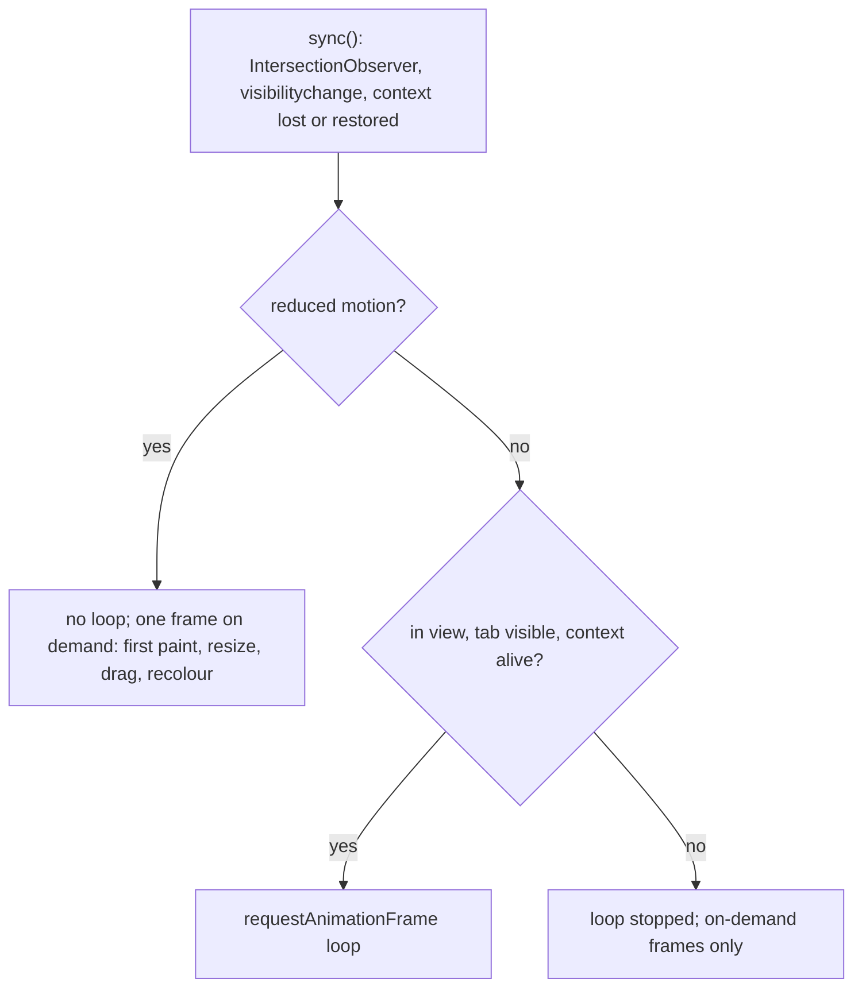

# 3D Hub Iran: UX, Apple design and accessibility

State of the code at commit `47ba9b9` on branch `audit/security-perf-ux` (base `215bc8c`), checked against the working tree on 2026-10-22. This document records how the `apple-design` principles and WCAG 2.2 were applied to the frontend, how the Persian copy compares with the UX-writing vocabulary, and what is still open.

Related: [implementation report](00-implementation-report.md), [architecture](01-architecture.md), [performance](05-performance.md), [index](README.md).

## How this was checked

- Components and CSS were read and grepped; every claim cites `file:line`.
- Contrast ratios were **computed** from the CSS tokens and Tailwind v4 palette values (OKLCH converted to sRGB). The translucent `.glass` surfaces were approximated by opaque colours: the page colour, white in the light theme, and white at 4.5% over the dark page. The script is not stored in the repository.
- The installed Framer Motion 12.43.0 source was read to see what `reducedMotion="user"` does.
- **Not done:** no browser session, no screen-reader pass, no axe or Lighthouse run, no keyboard walk-through. `docs/evidence/` holds no accessibility result. Statuses below mean "verified in code", not "verified by a user".

Status legend: **Met** (present in code), **Partial**, **Gap** (known to fall short), **Unverified** (needs a browser or assistive technology).

## 1. Apple design principles as applied

| Principle | What the code does | Where | Limit |
|---|---|---|---|
| Response on pointer-down | Buttons and links use `.pressable`: `scale(0.97)` in 110 ms on `:active`, so feedback starts on press. Under reduced motion the scale becomes an opacity change. | `globals.css:154-156`, `:208-209` | None found. |
| Direct manipulation | The STL viewer captures the pointer on `pointerdown` and rotates 1:1 per move. `touch-action: pan-y` lets vertical swipes still scroll the page. The hero object chases the pointer through a smoothing step scoped to its own box. Tilt cards use spring motion values, ignore touch, and trigger no React render per move. | `StlViewer.tsx:74,154-166`, `Hero3D.tsx:112-131,188-195`, `Bits.tsx:58-90` | Rotation has no grab offset to respect. |
| Interruptibility | Framer springs re-target from the current value. The hero chase starts from the live value with a frame-rate independent factor, `1 - 0.925^(dt x 60)`. A new quote input aborts the in-flight request and a request id discards stale responses; hub search does the same. No input is locked during a transition. | `Hero3D.tsx:128-131`, `quote/page.tsx:115-119,166-170`, `hubs/page.tsx:37-52` | `AnimatePresence mode="wait"` makes the quote result panel finish its exit before the next state enters (`quote/page.tsx:382`). Visual only, input stays live. |
| Springs, bounce 0 unless momentum | Every spring declaration in `frontend/src` has `bounce: 0` (23 of 23, by grep). The original used 0.25 and 0.3 on the dropzone and 0.2 on the segmented pills (original `quote/page.tsx:153,169,234`). | all components | No spring carries momentum. The one momentum interaction, the viewer flick, uses exponential decay and does not overshoot. |
| Velocity handoff | On release the drag velocity is not reset. It decays into the idle spin: `vy = 0.004 + (vy - 0.004) x 0.94^(dt x 60)` and `vx x= 0.9^(dt x 60)`, so there is no seam. Under reduced motion the velocities are zeroed. | `StlViewer.tsx:114-126,167-171` | The velocity is the delta of the last `pointermove`, not a short history, and it is not time-normalised. It is never zeroed if the pointer rests before release, so a held pause can still "flick" with the old delta. From code reading, not tested. |
| Momentum projection, rubber-banding | Not used. There are no sheets, carousels or snap points. | n/a | n/a |
| Spatial consistency | The mobile menu leaves along the path it arrived on (`initial` and `exit` share `menuHidden`). The nav pill and the segmented-control pills move as shared elements (`layoutId`). | `Header.tsx:57,80,150-152`, `quote/page.tsx:339`, `login/page.tsx:106` | |
| Materials | `.glass` (blur 24 px) for large surfaces, `.glass-thin` (blur 14 px) for small ones. The header switches from thin to full glass after 12 px of scroll. `Reveal` drops its `filter` once settled, because a filtered ancestor becomes a backdrop root and stops `.glass` children from blurring the aurora. | `globals.css:99-111`, `Header.tsx:28,65`, `Reveal.tsx:21-23` | "Never stack a light translucent surface on another" is stated as intent in the CSS; nesting was not audited. |
| Theme easing | A user toggle adds `theme-anim` for 450 ms and colours fade over 0.4 s. The first paint is set before hydration by an inline script, so there is no flash and no animation on load. | `Providers.tsx:93-100`, `globals.css:189-195`, `layout.tsx:36,52` | |

### 1.1 Reduced motion means gentler, not absent

| Element | Default | With `prefers-reduced-motion: reduce` | Source |
|---|---|---|---|
| Scroll reveal | 26 px slide, blur, spring | 0.18 s opacity cross-fade, no travel, no stagger | `Reveal.tsx:17-26` |
| Mobile menu | slide and blur | opacity only | `Header.tsx:57` |
| CSS transitions | per element | 150 ms | `globals.css:198-200` |
| Aurora drift (26 s loop) | on | off | `globals.css:201` |
| City marquee | scrolling loop | static wrapped row, loop copy hidden | `globals.css:203-204` |
| Ping dot, skeleton pulse | on | off | `globals.css:205-206` |
| Press feedback | scale 0.97 | opacity 0.85 | `globals.css:208-209` |
| Hero 3D object | looping, pointer-steered | one static pose, no steering | `Hero3D.tsx:170,192-195` |
| STL viewer | idle spin, release coasting | no spin, no coasting, frames on demand | `StlViewer.tsx:114,170` |
| Counters, tilt cards | count up, tilt | final value at once, no tilt | `Bits.tsx:18,79` |
| Framer animations | spring | `MotionConfig reducedMotion="user"` makes transform and `width`, `height`, `top`, `left`, `right`, `bottom` animations instant. Opacity and `filter` still animate. | `Providers.tsx:127`; library: `motion-dom/dist/es/animation/interfaces/visual-element-target.mjs:84-87`, `render/utils/keys-position.mjs` |

Two consequences of the Framer rule: the hero and login entrances still fade and de-blur, and the FAQ and sign-up `height: "auto"` reveals snap open. Both are acceptable, and neither is vestibular.

Frame control of both 3D scenes follows one rule:

### 1.2 Reduced transparency and more contrast

- `prefers-reduced-transparency: reduce`: `.glass`, `.glass-thin` and the focused skip link become solid `--bg-soft` with no blur (`globals.css:214-220`).
- `prefers-contrast: more`: borders go to 0.5 alpha, secondary text darkens to 9.4:1 (light) and 12.3:1 (dark), glass becomes opaque, aurora and grid are hidden (`globals.css:222-233`). Gradient text becomes plain brand colour under `prefers-contrast: more` and `forced-colors` (`:234-236`).

### 1.3 Typography: Persian against Latin

| Rule | Where | Note |
|---|---|---|
| Persian body tracking is 0, because the script joins letters. | `globals.css:70-71` | |
| Latin `h1` and `h2` tighten to `-0.03em`. | `globals.css:72` | The only size-specific tracking. Small Latin text gets no positive tracking, which the Apple guidance suggests. |
| Persian copy is set with tall leading (`leading-[1.9]` to `[2.1]`), the hero headline with 1.12. | `page.tsx:70,79,168,222,287` | Matches the guidance to loosen leading for scripts with tall ascenders. |
| `text-wrap: balance` on headings, `pretty` on body text. | `globals.css:73-74` | |
| One variable face, Vazirmatn 100 to 900, draws both scripts. Inter was dropped with the Google Fonts import. | `fonts.css`, `globals.css:6-8` | No optical-size axis. |
| **Gap:** the city marquee uses `tracking-wide` (0.025 em) and applies it to Persian city names. | `page.tsx:120` | Contradicts `globals.css:70-71`. Scope it to `[lang="en"]` or drop it. |
| **Gap:** all 136 text sizes are fixed `px` values such as `text-[13.5px]`; none use `rem`. | `grep` over `frontend/src` | Page zoom works. A larger default font size in the browser does not scale this text. |
| Low: digits are Persian via `toFa`, but the thousands separator is an ASCII comma from `toLocaleString("en-US")`, not the Persian separator. | `format.ts:3-4,6-9` | |

### 1.4 Suspected defect, not tested in a browser

The dropzone `<motion.div role="button">` carries `onClick={openPicker}` (`quote/page.tsx:249`) and wraps the viewer (`:257-265`). `StlViewer` registers `pointerdown`, `pointermove`, `pointerup` and `pointercancel`, sets pointer capture, and neither handles `click` nor stops propagation (`StlViewer.tsx:154-175`). A press and release on the canvas therefore appears to bubble a `click` to `openPicker`, so rotating the model could open the file chooser. If a browser confirms it, ignore clicks that follow a drag, or attach the click handler only to the empty state.

## 2. Accessibility checklist (WCAG 2.2)

| Criterion | What the code does | Status | Open point |
|---|---|---|---|
| 2.1.1 Keyboard | The dropzone is `role="button"` with `tabIndex={0}`; Enter and Space open the picker; the key handler ignores keys from inner elements. Menu, FAQ, filters and tiles are native `<button>` (`quote/page.tsx:240-249`). | Met for upload | Viewer rotation is pointer-only (`StlViewer.tsx:154-175`). It is a preview, so Partial overall. |
| 2.4.1 Bypass Blocks | A skip link is the first focusable element, becomes visible on focus, and targets `<main id="main" tabIndex={-1}>`. | Met | `Providers.tsx:30-33,128`, `globals.css:85-96`, `layout.tsx:57` |
| 2.4.7 Focus Visible | One 2 px `var(--focus)` ring on `:focus-visible`; text fields switch their border to `--focus`. | Met | See 1.4.11 for the dropzone. `globals.css:77,81-83` |
| 2.4.11 Focus Not Obscured (Minimum), new in 2.2 | `scroll-padding-top: 6rem` clears the fixed header; the hub filter bar is sticky at `top-24`. | Unverified | `globals.css:59`, `hubs/page.tsx:68` |
| 1.4.11 Non-text Contrast | The focus token measures 4.85:1 (light) and 12.5:1 (dark). | **Gap** | The dropzone focus ring is a literal `#00e5c0` (`quote/page.tsx:252`): 1.49:1 on the light page and 1.62:1 on white. It is the only focus indicator on that element. Use `var(--focus)`. |
| 1.4.3 Contrast (Minimum) | `--fg-muted` measures 5.8:1 (light) and 7.8:1 (dark), matching the CSS comments. Pill text ranges from 4.53:1 (light brand pill on the page tint) to 12.2:1 (dark brand pill). | Partial | Error text is `text-rose-500` at 12.5 px: 3.45:1 on the light page, 3.75:1 on white, 5.0 to 5.4:1 in dark (`quote/page.tsx:227,283,479`, `login/page.tsx:140`, `dashboard/page.tsx:111,205,213`). The 13.5 px gradient value labels beside the sliders measure 3.57 to 3.99:1 in light (`quote/page.tsx:351,361`). |
| 1.4.1 Use of Color | Status pills carry text; warnings carry a triangle glyph and text; selection uses `aria-pressed` plus a ring; errors are text in an alert region. | Met | `dashboard/page.tsx:143-145`, `quote/page.tsx:437` |
| 1.3.1, 3.3.2, 2.5.3 Labels | Every field has an accessible name through `aria-label`; the city select also has a visible `<label>`. The name equals the placeholder text, so label-in-name holds. | Partial | Login, address, note and manual-volume fields show a placeholder only, which disappears while typing (`login/page.tsx:122-138`, `quote/page.tsx:290-294,473-478`). |
| 4.1.2 Name, Role, Value | `aria-pressed` on technology, material, quality, producer tiles, hub filter, login mode and theme; `aria-expanded` with `aria-controls` on the FAQ and the menu; `aria-current="page"`; `aria-valuetext` on sliders. | Met | `quote/page.tsx:307,321,336,449,354,364`, `page.tsx:270`, `Header.tsx:77,97,137,156`, `hubs/page.tsx:81`, `login/page.tsx:103` |
| 4.1.3 Status Messages | Errors use `role="alert"`; the busy state uses `role="status"`; the price card is `aria-live="polite"` and `aria-atomic`. | Met in code | Unverified with a screen reader: the whole card is announced again on every re-quote. `quote/page.tsx:227,283,384,399,479`, `login/page.tsx:140` |
| 2.2.2 Pause, Stop, Hide | The marquee pauses on hover; the aurora and ping dot loop with no control. All stop under reduced motion; the aurora is hidden under `prefers-contrast: more`. | Partial | There is no on-page pause, and the `:focus-within` rule is inert because the marquee has no focusable child (`globals.css:160`). Users who have not set reduced motion cannot stop the loops. |
| Reduced motion (media query; 2.3.3 is AAA) | See section 1.1. | Met | |
| 1.4.4 Resize Text, 1.4.10 Reflow | Responsive grids; `scroll-padding` for anchors. | Unverified | Sizes are `px` (see 1.3). Not checked at 200% or 400% zoom. `body` has `overflow-x: hidden` (`globals.css:65`), which can hide overflow instead of fixing it. |
| 2.5.8 Target Size (Minimum), new in 2.2 | Header icon buttons are 36 px. | Unverified | The custom slider thumb is 22 px (WebKit) and 18 px (Firefox) against the 24 px minimum, unless an exception applies (`globals.css:169,176`). |
| 3.1.1, 3.1.2 Language | `<html lang dir>` is set before paint and on every switch; the language button marks its own label with `lang`; the legal-page notices carry `lang`. | Met | `layout.tsx:36,40`, `Providers.tsx:75-80`, `Header.tsx:94`, `privacy/page.tsx:117-118` |
| 3.3.1, 3.3.3 Error Identification | Text message, `aria-invalid` and `aria-describedby` on the login fields; codes map to plain language, including a wait time on 429; no raw codes reach users. | Met | `login/page.tsx:22-40,134-140`, `quote/page.tsx:45-49` |
| 3.3.8 Accessible Authentication (Minimum), new in 2.2 | Email and password only, `autoComplete` tokens set, paste is not blocked (no `onPaste` anywhere in `src`), no cognitive test. | Met | `login/page.tsx:133,137` |
| 2.4.2 Page Titled | One title for every route, from the root metadata. Pages are client components and set none of their own. | Partial | `layout.tsx:9-10`. A title exists but does not say which page it is. |
| 1.1.1 Non-text Content | Decorative SVGs are `aria-hidden`; the hero canvas is hidden; the viewer is `role="img"` with a label. | Met | `StlViewer.tsx:221`; the page wraps it in a second `role="img"` (`quote/page.tsx:259`), harmless but redundant. |
| 2.4.3 Focus Order | Escape closes the mobile menu and returns focus to its button. | Met for the menu | Focus after a client-side route change: Unverified. `Header.tsx:37-46` |

## 3. Persian copy against the vocabulary

Source: `~/references/persian-ux-vocab/README.md`. "UI uses" cites `frontend/src/lib/i18n.ts` unless noted. A grep of `frontend/src` finds no occurrence of the discouraged forms «اشتباه», «سفارشات» (only in a code comment, `i18n.ts:4`), «آدرس», «اکانت», «پروفایل», «رایانامه» or «پیغام».

| Term | Vocabulary recommendation | UI uses | Status |
|---|---|---|---|
| حساب کاربری | Use it for both "account" and "profile". | «حساب کاربری دارید؟» (`:69`), «وارد حساب کاربری شوید» (`:45`), `nav.account` (`:13`) | Compliant |
| ورود | Log in | `nav.login`, `auth.login` (`:13`, `:67`) | Compliant |
| ثبت‌نام | Sign up | `nav.signup`, `auth.signup` (`:13`, `:67`) | Compliant |
| رمز عبور | «رمز عبور» conveys the concept best | `auth.password` (`:67`) | Compliant |
| ایمیل | «رایانامه» is not familiar; use «ایمیل» | `auth.email` (`:67`) | Compliant |
| نادرست, not اشتباه | «اشتباه» blames the user; «نادرست» is more respectful | «ایمیل یا رمز عبور نادرست است» (`:70,85`), «اطلاعات واردشده نادرست است» (`:94`) | Compliant |
| سفارش‌ها | «سفارش‌ها» is right, «سفارشات» is wrong | `dash.orders` «سفارش‌ها», «سفارش‌های جاری» (`:61-62`) | Compliant |
| پیش‌خوان | Panel and dashboard | `nav.dashboard`, `dash.title` (`:13`, `:60`) | Compliant |
| نشانی | Address | «نشانی تحویل» (`:46`) | Compliant |
| حذف, لغو | Delete is «حذف» and must stay so end to end; «لغو» or «انصراف» for cancelling, by button purpose | Order button «لغو سفارش» (`:63`); the privacy page says «حذف حساب» for account deletion (`privacy/page.tsx:29,40`) | Compliant |
| تحویل‌شده | Delivered; the vocabulary prefers the short form on a status | `dash.status.delivered`, `dash.done` (`:62,64`) | Compliant |
| لغوشده | Canceled | `dash.status.canceled` (`:64`) | Compliant |
| در انتظار پرداخت | Pending payment | `dash.status.pending_payment` (`:64`) | Compliant. The product has no payment flow ([report, item 4](00-implementation-report.md#10-points-found-while-writing-this-report)). |
| در حال آماده‌سازی | In progress | `dash.status.in_production` (`:64`) | Compliant |
| پشتیبانی آنلاین | Name for ticketing and online support | `page.tsx:224`; `cta.btn2` «گفتگو با پشتیبانی آنلاین» (`:81`) | Wording compliant. `cta.btn2` is never rendered and no support channel exists. |
| کارمزد | Not in the vocabulary | «کارمزد پلتفرم (۱۵٪)» (`:42`), FAQ (`:76`), `page.tsx:219,224` | Not covered; used consistently |
| مبلغ and قیمت | «قیمت» for an item's value; «مبلغ» in a bill or cart; «هزینه» in informative sentences | «قیمت هر قطعه» (`:41`), «مبلغ قابل پرداخت» (`:42`), «مبلغ کل» (`:62`), «هزینه متریال» (`:76`) | Compliant. One borderline: «مبلغ و زمان تحویل» in `quote.sub` (`:33`) names a price before any cart exists. |
| اینجا را خالی نگذارید | The vocabulary's sentence for an empty-field error | `quote.empty` (`:47`) | Compliant, verbatim |
| دیدگاه‌ها | «دیدگاه» when space allows | `hubs.comments` (`:56`) | Compliant |
| تایید | Spelling without hamza | «تایید و ثبت سفارش» (`:46`), «تاییدشده» (`:55`) | Compliant |
| پیش‌فرض | Default | Used as the quality tier name for "standard" (`:40`) | Matches the word; as a tier it reads "the default setting". Product decision. |

### 3.1 Fixed since the audit

The «نشکفند» wording is gone: `thin_wall` now reads «دوام نیاورند» (`i18n.ts:49`). Backend error codes no longer reach users; they map through `errText` and fall back to `errors.unknown` (`quote/page.tsx:45-49`). A network failure no longer shows "wrong email or password" (`login/page.tsx:28-29`). The footer privacy and terms entries are links (`Footer.tsx:34-35`) and the "Careers" link is gone.

### 3.2 Copy gaps that remain

1. **«تولیدکننده شوید» goes to `/login`** (`page.tsx:306`). No producer onboarding exists ([report, section 9](00-implementation-report.md#9-what-is-intentionally-not-built-yet)).
2. **«پرداخت امن» / "Secure payment"** is promised on the landing page (`i18n.ts:21,126`, `page.tsx:229`) and there is no payment flow ([report, item 4](00-implementation-report.md#10-points-found-while-writing-this-report)).
3. **«تماس» links to the FAQ section** (`Footer.tsx:28`). No contact channel exists, and `cta.btn2` (online support) is unused.
4. **«نشست» in the expired-login messages** (`i18n.ts:97-98`) is not a vocabulary term and may not be familiar. The vocabulary speaks of «ورود» and «دستگاه‌های فعال». Proposed wording: «ورود شما منقضی شده است. دوباره وارد شوید.»
5. **«محاسبه کن»** (`i18n.ts:37`) is informal and singular; the rest of the interface uses the polite plural («رها کنید», «بگیرید»). Proposed: «محاسبه کنید».
6. **Thousands separator** is ASCII `,` in Persian numerals (see 1.3).
7. **Legal pages** are working drafts and say so on the page (`privacy/page.tsx:116-118`). Their wording was not reviewed against the vocabulary beyond the grep above, and no linguist has reviewed any Persian copy here.

## 4. Open items, in order of value

1. Replace the literal teal in the dropzone focus ring with `var(--focus)` (1.4.11).
2. Raise light-theme error text to at least 4.5:1: a darker rose step, as was done for the brand teal (1.4.3).
3. Scope the marquee `tracking-wide` to Latin.
4. Confirm or dismiss the dropzone click bubbling (section 1.4) in a browser.
5. Run axe and a keyboard and screen-reader pass; none has been done.
6. Give each route its own `<title>` (2.4.2).
7. Offer a visible label or helper text on login and order fields (3.3.2).
8. Add an on-page control that stops the marquee and aurora for users who have not set reduced motion (2.2.2).
9. Convert type sizes from `px` to `rem`.
