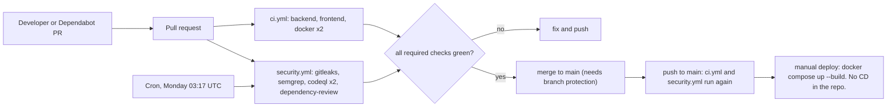

# 3D Hub Iran: delivery pipeline and DevSecOps

State of the code at commit `47ba9b9` on branch `audit/security-perf-ux` (base `215bc8c`), checked against the working tree on 2026-10-22. This document describes what each gate in `.github/` does, how the containers are hardened, how the supply chain and secrets are handled, what logging exists, and what has **not** been validated.

Related: [architecture](01-architecture.md), [runbook](11-runbook.md), [implementation report](00-implementation-report.md), [performance](05-performance.md), [index](README.md).

**Important caveat.** Nothing in `.github/` has run on GitHub yet, and the Docker daemon was unavailable while this was written. The workflows were read, not executed. The only scanner results on file are an OSV query of the installed backend packages and a Bandit run ([evidence/dependency-and-sast.txt](evidence/dependency-and-sast.txt)). Section 7 lists everything that is unvalidated.

## 1. Pipeline and gates

Both workflows set `permissions: contents: read` at the top, cancel superseded runs through `concurrency`, set a job timeout (10 to 30 minutes), and check out with `persist-credentials: false` (`ci.yml:9-15`, `security.yml:12-18`).

### 1.1 Gates

| Gate | Where | What it checks | Fails when | Limits |
|---|---|---|---|---|
| Backend tests | `ci.yml:33-35` | The 50-test regression suite, in process: no server, no network. | Any test fails. | |
| Bandit | `ci.yml:37-38` | Python SAST, `-ll`: medium severity and above. | A medium or high finding. | Evidence: none at that level on 2026-10-16. |
| pip-audit | `ci.yml:40-41` | `backend/requirements.txt` against known advisories. | An advisory on a pinned runtime package. | Not run here; an OSV query stood in. |
| Frontend audit | `ci.yml:59-62` | `npm ci` from the lockfile, then `npm audit --omit=dev --audit-level=high`. | A high or critical advisory in production dependencies. | Dev-tool advisories are ignored on purpose. |
| Frontend build | `ci.yml:64-68` | `next build`, which also type-checks (`typescript.ignoreBuildErrors` is false). | A type or build error. | No lint (there is no ESLint config, [report, item 14](00-implementation-report.md#10-points-found-while-writing-this-report)); no route-size budget ([05](05-performance.md#4-budgets-and-how-to-keep-them)). |
| Hadolint | `ci.yml:84-85` | Both Dockerfiles, `--failure-threshold warning`, image `hadolint/hadolint:v2.12.0`. | A warning or worse. | The backend Dockerfile has one inline `ignore=DL3013`. |
| Image build | `ci.yml:87-97` | Builds each image with the GitHub cache. | A failed build. | |
| Trivy image scan | `ci.yml:101-109` | OS and library packages of the built image; `HIGH,CRITICAL`; `ignore-unfixed: true`; `exit-code: 1`. | A fixable high or critical CVE, including one inherited from the base image. | Inputs not checked against the action's current schema. |
| Syft SBOM | `ci.yml:112-119` | CycloneDX JSON of the exact scanned image, uploaded as an artifact (`sbom-backend`, `sbom-frontend`). | Never blocks. | An inventory, not a gate. |
| gitleaks | `security.yml:20-37` | Full git history (`fetch-depth: 0`), default rules plus one repo rule (below). | A match outside the allowlist. | See section 4 on the `docs/` allowlist. |
| Semgrep | `security.yml:39-51` | `.semgrep.yml` plus the `p/owasp-top-ten` registry pack, image pinned to `semgrep/semgrep:1.179.0`, `--error`. | Any finding. | Rules never executed here. |
| CodeQL | `security.yml:53-78` | `python` and `javascript-typescript`, `security-extended`, `build-mode: none`. | Reports to code scanning; blocks only if a ruleset requires it. | Needs a public repo or GitHub Advanced Security. |
| Dependency review | `security.yml:80-95` | On pull requests, a new dependency with a known high or critical advisory. | `fail-on-severity: high`. | Needs the dependency graph enabled. |
| Schedule | `security.yml:7-10` | The whole security workflow weekly (Monday 03:17 UTC) and on demand. | | New advisories apply to unchanged code too. |
| Dependabot | `.github/dependabot.yml` | Weekly: pip `/backend`, npm `/frontend` (type packages grouped), docker `/backend` and `/frontend`, github-actions `/`. At most 5 open PRs for pip and npm. | Opens PRs. | Does not pin image digests (only bumps tags). |
| Local equivalent | `Makefile:5-6` | `make test`; `make audit` runs Bandit, pip-audit and `npm audit`. | | |

### 1.2 Repo-specific Semgrep rules (`.semgrep.yml`)

| Rule | Guards against |
|---|---|
| `h3d-no-datetime-utcnow` | Naive datetimes; SQLModel rejects them. Use `app.models.utcnow()`. |
| `h3d-no-md5-sha1` | MD5 and SHA-1 for anything security-related (allowed with `usedforsecurity=False`). |
| `h3d-jwt-decode-needs-algorithms` | `jwt.decode` without an `algorithms` allow-list, or with `verify_signature: False`. |
| `h3d-cors-credentials-with-wildcard` | `allow_credentials=True` together with `allow_origins=["*"]`. |
| `h3d-no-dangerously-set-inner-html` | `dangerouslySetInnerHTML` with a non-literal value. |
| `h3d-no-token-in-web-storage` | Token-like keys written to web storage outside `frontend/src/lib/api.ts`. It forbids writes only, not reads ([report, item 19](00-implementation-report.md#10-points-found-while-writing-this-report)). |

## 2. Container hardening

| Control | Where | Why | At `215bc8c` |
|---|---|---|---|
| Multi-stage build; no package installer in the runtime image | `backend/Dockerfile:8-23,26,34` | `pip`, `setuptools` and `wheel` are removed from the builder venv and from the base interpreter. The only advisory left in the OSV scan was `pip 24.0`, a build tool ([evidence](evidence/dependency-and-sast.txt)). | Single stage; `pip` in the image |
| Non-root user | `backend/Dockerfile:34-39,48`; `frontend/Dockerfile:41-42,51` | Backend uid and gid 10001, no shell, no home. Frontend uid 1001, no shell. A compromised process has no root inside the container. | Backend ran as root; frontend already non-root |
| Read-only root filesystem | `docker-compose.yml:20` | Code cannot be modified or persisted. Writable paths are listed: backend volume `/app/data` (SQLite and WAL files) and a 128 MB `/tmp`; frontend `/tmp` (16 MB) and `.next/cache` (64 MB). | Writable |
| `noexec,nosuid,nodev` tmpfs | `docker-compose.yml:49-50,75-77` | A dropped binary cannot be run from `/tmp`. | n/a |
| All capabilities dropped | `docker-compose.yml:21` | Both services bind ports above 1024 and need none. | Docker default set |
| `no-new-privileges` | `docker-compose.yml:22-23` | A setuid binary cannot escalate. | Off |
| CPU, memory, process limits | `docker-compose.yml:59-62,83-86` | Backend 512 MB with no extra swap, 1.0 CPU, 128 processes; frontend 512 MB, 1.0 CPU, 256 processes. Limits the blast radius of an upload or login flood. | None |
| `init: true` | `docker-compose.yml:18` | tini reaps zombies and forwards signals. | Off |
| Bounded logs | `docker-compose.yml:24-28` | `json-file`, 10 MB times 3 files per container: a noisy client cannot fill the disk. | Unbounded |
| Loopback binding | `docker-compose.yml:52,79` | `${BIND:-127.0.0.1}`: a laptop run is not reachable from the LAN. | `0.0.0.0` |
| Required secret | `docker-compose.yml:37`; `backend/app/config.py:40-49` | Compose refuses to start without `JWT_SECRET`; the app refuses a secret under 32 characters or on the known-weak list unless `DEV=true`. | Default `change-me-in-production` |
| Health checks and start order | `backend/Dockerfile:52-53`; `frontend/Dockerfile:55-56`; `docker-compose.yml:53-58,80-82` | Python and Node one-liners, so no `curl` in the image. The frontend waits for a healthy backend. | Backend check and start order already existed; no frontend check |
| Lockfile-only install | `frontend/Dockerfile:10-13` | `npm ci` with no fallback, so versions cannot drift from the lockfile. | `npm ci \|\| npm install` |
| Build-context hygiene | `backend/.dockerignore:9-12,19-24`; `frontend/.dockerignore:15-16` | `.env*`, virtualenvs, SQLite files, tests and docs stay out of the image layers. | `.dockerignore` files existed (contents not compared) |
| Bytecode compiled at build | `backend/Dockerfile:28-30,45-46` | `PYTHONDONTWRITEBYTECODE=1` plus a read-only filesystem would otherwise recompile on every start. | n/a |
| No server banner | `backend/Dockerfile:57` | `--no-server-header`; the live probe check "no server banner" passed. | Banner sent |
| Public build arguments | `frontend/Dockerfile:21-22` | `NEXT_PUBLIC_*` values are inlined into the browser bundle: never a secret. | Same |

**Not done:** base-image digest pins (tags only, by design, with Dependabot bumping them; `backend/Dockerfile:3-5`); a custom seccomp or AppArmor profile (Docker defaults apply); user-namespace remapping or rootless Docker; image signing; Docker or compose secrets (`JWT_SECRET` is an environment variable, visible to anyone who can run `docker inspect`); the `docker-bench-security` host audit. None of the runtime controls were exercised: there was no Docker daemon.

## 3. Supply chain

| Control | Where | Detail |
|---|---|---|
| Actions pinned to commit SHAs | `ci.yml`, `security.yml` | All 17 `uses:` lines carry a 40-character SHA with the version in a comment (checked with a grep: none is unpinned). The SHAs were not re-resolved against upstream tags here. Dependabot's `github-actions` entry bumps them. |
| Tool images pinned by tag | `ci.yml:85`, `security.yml:45` | `hadolint/hadolint:v2.12.0` and `semgrep/semgrep:1.179.0`. Tags, not digests. |
| Lockfile-only npm installs | `ci.yml:59`, `frontend/Dockerfile:13` | `npm ci` fails if `package.json` and `package-lock.json` disagree. `package.json` pins exact versions for `next`, `react`, `react-dom` and `three`. |
| Pinned direct Python requirements | `backend/requirements.txt`, `requirements-dev.txt` | The seven direct requirements are `==` (the four dev tools too). Transitive packages such as `starlette`, `pydantic`, `anyio` and the `uvicorn[standard]` extras are **not** pinned, so a rebuild can resolve newer versions; the `starlette 1.8.0` in the OSV scan came in through `fastapi==0.142.4`, not from a pin. No hashes, so `--require-hashes` is not possible yet (`backend/Dockerfile:16-18`). |
| Advisory gates | `ci.yml:40-41,61-62`; `security.yml:93-95` | pip-audit, `npm audit`, dependency review. |
| Image scan | `ci.yml:101-109` | Trivy on the built images; fails on fixable high or critical. |
| SBOM | `ci.yml:112-119` | Syft CycloneDX per image, kept as an artifact. `sbom/` and `*.cdx.json` are git-ignored. |
| Automated updates | `.github/dependabot.yml` | Five ecosystems, weekly. See [08](08-threat-intelligence-lifecycle.md) for triage. |
| Least-privilege workflow token | `ci.yml:9-10`, `security.yml:12-13` | `contents: read`. Only `codeql` adds `security-events: write`, and `gitleaks` adds `pull-requests: read`. |

**Not present:** a compiled lock file for the transitive Python dependencies (`pip-compile` or `uv`, ideally with hashes), build provenance attestations (SLSA), image signing or verification, `npm ci --ignore-scripts` (dependency install scripts run in CI and in the image build), a private registry or any image publishing.

## 4. Secrets handling

- **`JWT_SECRET` is required.** Compose fails without it (`docker-compose.yml:37`). The app fails to start if it is empty, shorter than 32 characters, or one of four known defaults, unless `DEV=true`, in which case it makes a random per-process secret (`config.py:6-11,40-49`). Test: `test_default_or_weak_jwt_secret_refuses_to_start` (`tests/test_security.py:30`). The live probe confirmed that a token signed with the old public default is rejected.
- **The quote key is derived**, not the login key (`security.py:87-88`), so a quote token cannot be used as a login token and the reverse.
- **`.env` is ignored.** `.gitignore:8-9,16-17` ignore `.env*` except `.env.example`, whose `JWT_SECRET=` is empty (`.env.example:10`). `.dockerignore` files also exclude `.env*`.
- **gitleaks** runs on full history with the default rules plus `h3d-jwt-secret-assignment`, which flags `JWT_SECRET` assigned a literal of 32 or more characters (`.gitleaks.toml:10-15`). Allowlisted: the config file itself, `*.example` files, the public demo password `demo1234`, the fake test secret, and everything under `docs/` (`.gitleaks.toml:17-27`).
  - The `docs/` allowlist means the scanner never looks at documentation. Narrow it to named files when the docs hold examples.
  - The original defaults (`change-me-in-production` and `change-me-in-production-3dhub-iran`) are in git history and in `KNOWN_WEAK_SECRETS` (`config.py:6-11`). Treat them as public. The custom rule does not match them: a `git grep -P` of its regex over every revision returned nothing. Whether a default gitleaks rule flags them in the first full-history run is unknown; if it does, allowlist the fingerprint instead of rewriting history.
- **Demo account.** `demo@3dhub.ir` is created only when `DEV` or `SEED_DEMO` is true (`seed.py:97`); the login button needs `NEXT_PUBLIC_DEMO=1` at build time.
- **Rotation.** Changing `JWT_SECRET` signs everyone out and invalidates outstanding quotes. Procedure: [runbook, key rotation](11-runbook.md#key-rotation).
- **Never in logs:** see section 6.2.

## 5. Branch protection recommendations

None of this can be checked from the repository; it is a settings checklist for `main`. Required-check names must match the job names exactly.

| Setting | Recommendation |
|---|---|
| Pull request required | Yes, at least one approval, dismiss stale approvals, require conversation resolution |
| Required status checks | `Backend (tests, bandit, pip-audit)`, `Frontend (audit, build)`, `Docker (backend)`, `Docker (frontend)`, `Secrets (gitleaks, full history)`, `SAST (semgrep)`, `CodeQL (python)`, `CodeQL (javascript-typescript)`, `Dependency review` |
| Up to date before merge | Yes |
| Force pushes and deletion | Blocked; restrict who can push |
| Code owners | Add a `CODEOWNERS` file (none exists) covering `.github/`, `backend/app/security.py`, `backend/app/config.py`, `docker-compose.yml` and both Dockerfiles |
| Repository settings | Enable Dependabot alerts and security updates, secret scanning with push protection, and the option that requires actions to be pinned to a full commit SHA |
| Actions defaults | Default token permission read-only; require approval for workflows from first-time contributors |
| Deploy | There is no CD. If one is added, use a protected environment with a required reviewer |

Add a pre-commit hook for gitleaks so secrets are caught before a push. There is no `.pre-commit-config.yaml`.

## 6. Observability

### 6.1 What exists

| Signal | Where | Detail |
|---|---|---|
| Request id | `middleware.py:65-66,77,94-95`; `main.py:65-69` | A 16-hex id (`uuid4().hex[:16]`) is made per request, returned as `X-Request-ID`, ends the access line, and is in the body of a `500` as `request_id`. |
| Access log | `middleware.py:94-95` | Logger `app.access`: `METHOD path status duration_ms rid=<id>`. Path only, no query string, no client address, no user. Always INFO. |
| Audit log | logger `app.audit` | See the table below. |
| Error log | `main.py:65-69` | `unhandled error rid=<id>` with the traceback. |
| uvicorn access log | `backend/Dockerfile:57` | Not disabled. It records the client address and the full request target, including any query string. The app puts no secret in a query string: the token travels in the `Authorization` header. |
| Format and sink | `main.py:15`; `docker-compose.yml:24-28` | Plain text to stdout; Docker keeps 3 files of 10 MB. |
| Health check | `main.py:72-74` | `/api/health` returns `{"status":"ok"}` without touching the database, so it proves the process serves HTTP, not that SQLite works. |

| Audit event | Level | Fields | Line |
|---|---|---|---|
| `register` | INFO | user id | `auth.py:32` |
| `login_failed` | WARNING | client IP, not the email | `auth.py:51` |
| `order_created` | INFO | order id, user id, amount | `orders.py:55` |
| `order_advanced` | INFO | order id, admin id, new status | `orders.py:119` |
| `order_canceled` | INFO | order id, user id | `orders.py:131` |

No audit line exists for: a successful login, a review, a `429` (visible only as an access-line status), an order conflict, or a role change (done in the database).

### 6.2 Deliberately not logged

Passwords; login and quote tokens; request and response bodies; the email address on a failed login (only the IP); addresses, notes, phone numbers and uploaded file names; the query string in the app's access line. Validation failures return only `loc` and `type`, never the submitted value (`main.py:58-62`), so rejected input is not echoed into responses or proxy logs. Two caveats: the client IP in `login_failed` and in uvicorn's line is personal data, kept for as long as Docker rotation keeps it; and an exception message in a traceback can contain a fragment of input.

### 6.3 Gaps against the observability patterns

| Pattern | State |
|---|---|
| Structured (JSON) logs | Not yet; plain text |
| Correlation id through the whole request | Partial. The id is in the access line and the `500` body. It is not in audit lines, so a `login_failed` cannot be joined to its request except by time. An inbound `X-Request-ID` is ignored; the code always makes its own. The `500` answer has no `X-Request-ID` header ([report, item 17](00-implementation-report.md#10-points-found-while-writing-this-report)). |
| Four golden signals | None exported; no `/metrics` endpoint, no tracing |
| Tests for observability | None: no test asserts the header, the access line, or the absence of a password in logs |
| Readiness | The health check does not exercise the database |

### 6.4 Proposal (not implemented)

**Logs.** Switch to JSON using a stdlib `logging.Formatter` (no new dependency). Bind the request id with a `contextvars` variable and a logging filter so every record, audit lines included, carries `rid`. Fields: `ts`, `level`, `logger`, `rid`, `method`, `route`, `status`, `duration_ms`, `user_id` when known. Keep plain text until a log collector exists. Add a readiness probe that runs `SELECT 1`.

**Metrics.** Label by FastAPI route template, never by raw path: `/api/orders/{public_id}` would otherwise make unbounded labels.

| Metric | Type | Labels | Why |
|---|---|---|---|
| `http_requests_total` | counter | `method`, `route`, `status` | Traffic and errors |
| `http_request_duration_seconds` | histogram | `route` | Latency |
| `auth_attempts_total` | counter | `result`: ok, failed, locked, rate_limited | Credential-guessing signal |
| `hash_slots_in_use`, `hash_wait_seconds` | gauge, histogram | none | Saturation of the 4 hash slots |
| `parse_slots_in_use`, `analyze_total`, `parse_seconds` | gauge, counter, histogram | `result`: ok, busy_503, too_large_413, rate_limited_429 | Saturation of the 2 parse slots |
| `mesh_truncated_total` | counter | none | How often the 250,000-triangle cap bites |
| `sqlite_busy_errors_total` | counter | none | "database is locked" after the 5 s wait |
| `rate_limit_keys` | gauge | none | Early sign of a key flood ([report, item 18](00-implementation-report.md#10-points-found-while-writing-this-report)) |

Expose metrics on an internal port or a protected path, **not** under `/api/`: the cache rule in `middleware.py:87` would stamp `public, max-age=60` on any 200 GET there. The `prometheus-client` package would be one new dependency; decide when a Prometheus exists.

**Tracing.** Optional OpenTelemetry with W3C `traceparent` from the proxy, and spans only around the two expensive operations, hashing and mesh parsing. Allow-list attributes (route, status, hub id). Never attach an email, an address or a body.

**Alerts.** Any `unhandled error` line; a spike of `login_failed` or `429`; any `503 busy`; an unhealthy container; memory above 80% of 512 MB; the `/app/data` volume nearly full; the WAL file growing.

**Tests to add.** One `caplog` test that a wrong-password login writes `login_failed` and not the password; one that every normal response carries `X-Request-ID` and the access line ends with the same id.

**Frontend.** There is no real-user monitoring. Add Web Vitals reporting only after a privacy decision.

## 7. Not validated here

| Item | Why it matters |
|---|---|
| Docker daemon unavailable | The Dockerfiles were never built here, Hadolint never ran, `docker compose config` never ran, and no hardening control (read-only root with SQLite WAL, `noexec` tmpfs, dropped capabilities, health checks) was exercised. |
| CI never executed on GitHub | Workflow syntax and inputs are unchecked by Actions. The action SHAs were not re-resolved. Trivy may fail on base-image CVEs that nobody has seen yet. |
| Scanners other than Bandit and OSV | gitleaks, Semgrep, CodeQL, dependency review, Trivy, Syft and pip-audit have no result on file. |
| Semgrep rule `h3d-no-dangerously-set-inner-html` | `layout.tsx:52` passes a `const` string, not a literal. The rule depends on Semgrep's constant propagation to allow it. Unverified; the first CI run will show. |
| gitleaks on history | Not known whether a default rule flags the old default secrets. |
| Branch protection, Dependabot, GHAS | Settings of the hosted repository; not visible from here. CodeQL needs a public repo or GHAS. |
| DAST | None in the pipeline. The live probe (28 checks, 27 passed) was a manual run against a running stack, and the script that produced it is not committed. |
| Case-insensitive checkouts | `.gitignore:13` lists `Docs`. On a case-insensitive filesystem git may treat the new `docs/` directory as ignored. Reasoned, not tested. |
| Deployment | There is no CD stage, staging environment or image registry. |

## Addendum: first CI run on the pull request (2026-10-22)

The workflows ran for the first time when the PR was opened. Results and what was done:

| Job | First result | Cause | Action |
|---|---|---|---|
| Backend (tests, bandit, pip-audit) | pass | 60 tests, bandit and pip-audit all green on GitHub's runners | none |
| CodeQL (python, javascript-typescript) | pass | | none |
| Docker (backend) | pass | image builds, hadolint and Trivy clean | none |
| Frontend (audit, build) | fail | `npm audit` found `sharp`, `source-map-js` and the `postcss` bundled inside `next` (4 advisories); this had been missed locally because the earlier audit was run from the wrong directory | `npm audit fix`, plus an `overrides` entry pinning `postcss` 8.5.31; `npm audit` now reports 0 vulnerabilities, rebuilt and verified |
| Docker (frontend) | fail | Trivy: 16 HIGH, five in the `npm` CLI shipped inside the Node base image, three from the same old app dependencies | npm, corepack and yarn removed from the runtime stage; lockfile fix as above |
| Secrets (gitleaks) | fail | false positive: the throwaway test secret in `backend/tests/conftest.py` | narrow regex allowlist in `.gitleaks.toml` (the pattern `pt-secret-...`, not the whole tests folder) |
| SAST (semgrep) | fail | Dependabot config without a cooldown | 7-day cooldown on every ecosystem; the two Docker blocks merged |
| Dependency review | fail | "Dependency graph" is disabled in the repository settings, so the action cannot run at all | made non-blocking with a comment; enable Settings > Code security > Dependency graph, then remove `continue-on-error` |
