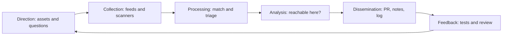
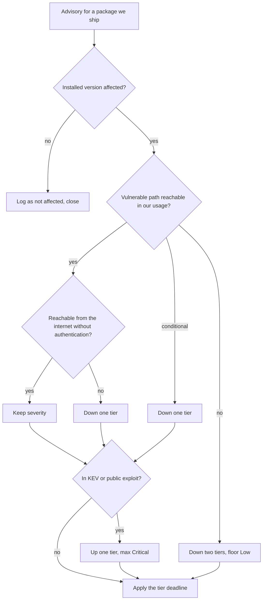

# 3D Hub Iran: threat-intelligence lifecycle for dependencies

State of the code at commit `47ba9b9` on branch `audit/security-perf-ux` (base `215bc8c`), checked against the working tree on 2026-10-22. This applies the intelligence lifecycle (direction, collection, processing, analysis, dissemination, feedback) to a small web product, using the dependency advisories handled in this pass as the worked example.

Related: [delivery pipeline](07-devsecops.md), [architecture](01-architecture.md), [runbook](11-runbook.md), [index](README.md). The assets and attack tree live in `02-threat-model-and-attack-tree.md`, a separate document.

**Scope and proportion.** One small team, two containers, about a dozen direct dependencies. A threat-intelligence platform such as MISP or OpenCTI would be out of proportion. A Markdown log in Git, the scanners already in CI, and a written triage rule are enough. Revisit when more than one team or many more services appear.

## 1. Direction

### 1.1 What we protect

| Asset | Why it matters | Where it lives |
|---|---|---|
| Signing key `JWT_SECRET` | Anyone holding it can mint admin tokens and price quotes | environment variable; `config.py:40-49` |
| User accounts and password hashes | Credential stuffing; scrypt hashes in SQLite | `backend/app/security.py`, volume `/app/data` |
| Order data (addresses, phones, notes) | Personal data | SQLite |
| API availability | Upload and login are CPU-heavy | `quotes.py`, `security.py` |
| The frontend server and the browser bundle | The Next.js server is internet-facing | `frontend/` |
| The build and delivery chain | A poisoned package or action reaches production | `.github/`, lockfile, requirements |

### 1.2 Priority intelligence requirements

| ID | Question | Level | Owner |
|---|---|---|---|
| PIR-1 | Which direct runtime dependency has an advisory that affects the installed version? (`next`, `react`, `react-dom`, `three`, `framer-motion`; `fastapi`, `uvicorn`, `sqlmodel`, `pydantic-settings`, `PyJWT`, `email-validator`, `python-multipart`; their transitive `starlette` and `sharp`) | Tactical | Maintainers |
| PIR-2 | Is any of them exploited in the wild or does it have a public proof of concept? | Operational | Maintainers |
| PIR-3 | For each applicable advisory, is the vulnerable code path reachable in this product, and from where? | Operational | Maintainers |
| PIR-4 | Do the base images (`python:3.12-slim-bookworm`, `node:22-alpine`) carry a fixable high or critical CVE? | Tactical | Maintainers |
| PIR-5 | Is a secret of ours exposed in history, CI logs or a public paste? | Tactical | Maintainers |
| PIR-6 | What new attack techniques target the places we are exposed: the App Router flight protocol, multipart upload parsing, JWT handling, SQLite, the mesh-file parsers? | Strategic | Maintainers |

Review the list every quarter and whenever a dependency, a public route or a file format is added.

## 2. Collection

| Source | Covers | How it is consumed | Status |
|---|---|---|---|
| OSV.dev | PyPI and npm advisories, with GHSA aliases | API query of installed versions. Used on 2026-10-16 ([evidence](evidence/dependency-and-sast.txt)). | Manual |
| GitHub Advisory Database | npm and pip | Dependabot alerts and security updates; `dependency-review-action` on pull requests (`security.yml:80-95`) | Configured, not yet run |
| CISA Known Exploited Vulnerabilities | Exploited-in-the-wild CVEs | Checked by hand during triage. Proposal: a weekly script that diffs our CVE list against the KEV JSON. No KEV check is on file for this pass. | Proposed |
| Vendor channels | Release notes and security advisories of the Next.js, FastAPI, Starlette, PyJWT, python-multipart, uvicorn, pydantic and three.js projects | Watch each repository for security alerts and releases | Proposed; watch settings are not visible from the repo |
| Dependabot | pip, npm, docker (two), github-actions | Weekly PRs (`.github/dependabot.yml`) | Configured, not yet run |
| `npm audit`, `pip-audit` | Production npm tree; pinned Python requirements | `ci.yml:61-62`, `ci.yml:40-41` | Configured, not yet run |
| Trivy | OS and library CVEs in both built images, including Debian and Alpine package data | `ci.yml:101-109` | Configured, not yet run |
| gitleaks and GitHub secret scanning | Secrets in history | `security.yml:20-37`; secret scanning is a repository setting | Configured / recommended |
| Semgrep, CodeQL, Bandit | Code patterns in our own code | `security.yml:39-78`, `ci.yml:37-38` | Bandit ran once; the others have not run |
| Internal telemetry | `login_failed` bursts, `429` and `503` counts | `app.audit` and access logs; no metrics yet ([07, section 6](07-devsecops.md#6-observability)) | Logs only |
| Weekly schedule | Re-runs every scanner on unchanged code | `security.yml:7-10` | Configured |

Not used on purpose: commercial feeds and dark-web monitoring. EPSS could be added later as a tie-breaker.

## 3. Processing and triage

1. **Match.** Map each advisory to a package and version in `package-lock.json`, `requirements.txt` or the image. Transitive packages (`starlette`, `sharp`) count: they are installed, even though only direct requirements are pinned.
2. **Deduplicate.** One issue often has a GHSA and a CVE id and appears in several feeds. Keep one row per advisory.
3. **Score.** Start from the advisory's severity, then adjust for reachability and exposure.

| Condition | Adjustment |
|---|---|
| Reachable in our usage, from the internet, without authentication | Keep the severity |
| Reachable only after authentication, or only with unusual configuration | Down one tier |
| Not reachable, or build-time or dev-only | Down two tiers, floor Low. Still bump at the next routine upgrade and write down why. |
| Listed in CISA KEV, or a public exploit exists | Up one tier, at most Critical (not applied to a not-reachable advisory) |

| Tier | Deadline from the day we first see it | Typical action |
|---|---|---|
| Critical | 48 hours | Upgrade or mitigate now; consider rotating `JWT_SECRET` if the flaw exposed it |
| High | 7 days | Upgrade in a dedicated PR |
| Medium | 30 days | Next scheduled upgrade |
| Low | Next release | Batch with routine bumps |

An exception needs an owner, a reason and an expiry date no more than 30 days away, recorded in the advisory log.

## 4. Analysis: is the vulnerable code path reachable here?

Method: find the vulnerable component or function named in the advisory; search the repository for its use (`grep`); check configuration and feature flags; decide who can reach it; note existing mitigations (body limits, rate limits). The advisory titles below are those recorded in `HANDOFF.md` section 4. The advisory texts were not re-read in this pass.

### 4.1 Worked example: the Next.js flight-protocol RCE (GHSA-9qr9-h5gf-34mp)

- **Claim.** Remote code execution in the React flight protocol that App Router servers speak.
- **Our usage.** The app uses the App Router (`frontend/src/app/`). The root layout is a server component (no `"use client"`, `layout.tsx`). `output: "standalone"` runs the Next.js server, which serves these routes. Every page is a client component, but the HANDOFF analysis is that the flight RCE still applies because the App Router server handles the protocol.
- **Exposure.** Any request to the frontend port, no authentication.
- **Verdict.** Reachable, unauthenticated, Critical: the 48-hour tier. Fix: `next` 15.5.4 to 15.5.27 and `react` and `react-dom` 19.1.1 to 19.1.9 (`frontend/package.json:13-15`; lockfile resolves `next` 15.5.27).
- **Lesson.** "All our pages are client components" sounds like a defence and is not one.

### 4.2 Worked example: PyJWT advisories that did not apply

- **Claim.** Several PyJWT advisories concern `PyJWKClient` (JWKS fetching).
- **Our usage.** `grep -rniE "PyJWKClient|jwks" backend/app` finds nothing. The code calls only `jwt.encode` and `jwt.decode` with a symmetric HS256 secret (`security.py:79,94,100,116`).
- **Verdict.** The JWKS advisories do not apply: down two tiers.
- **But the package still had to move.** The other advisories (unauthenticated denial of service while parsing token payloads, unknown `crit` headers accepted, non-canonical signatures) are reachable: `jwt.decode` runs on every authenticated route and on every quote token. Fix: `PyJWT` 2.10.1 to 2.15.1 (`requirements.txt:5`).
- **Lesson.** Split the advisories of one package; the answer differs per advisory.

### 4.3 Reachability of everything else in this pass

| Advisory (as recorded) | Evidence in the repo | Reachable here | Effect on priority |
|---|---|---|---|
| Next.js RCE in Image Optimization with AVIF (GHSA-2xp9-vwfh-vxw4) | No `next/image` import, no `images` option in `next.config.ts`; the image `.next/cache` is prepared for the optimiser (`frontend/Dockerfile:44-45`). The default optimiser endpoint is treated as present. | Conditional, unverified | Down one tier, to High; the upgrade removes the question |
| Next.js RCE on Windows hosts (GHSA-p293-qw3h-jr36) | Both images are Linux (`node:22-alpine`) | By its title, no | Down two tiers; shipped by the same bump |
| Next.js middleware bypass | No `middleware.ts` in `frontend/` | No | Down two tiers |
| Next.js Server Components DoS | App Router in use | Yes | Keep severity |
| `python-multipart` multipart DoS issues | `POST /api/quotes/analyze` takes an unauthenticated multipart upload (`quotes.py:99-109`) | Yes | Keep severity |
| `starlette` multipart large-file DoS | Same upload route; the dependency arrives through `fastapi` | Yes | Keep severity |
| `starlette` Range-header DoS | No `StaticFiles` or `FileResponse` anywhere in `backend/app` (grep) | No | Down two tiers |
| `starlette` Host-header path poisoning | Not analysed in this pass | Unknown | Treat as reachable until analysed |
| `pip` 24.0 in the image | Build tooling; the runtime never calls it | No | Removed instead of patched (`backend/Dockerfile:23,34`) |
| `sharp` 0.34.5 (two inherited libvips and libheif advisories) | Used only by the Next.js image optimiser; the lockfile still resolves `sharp` 0.34.5, inside the range `^0.34.3 \|\| ^0.35.4` that `next` 15.5.27 declares | Conditional, as for the optimiser | **Not closed by this pass** (see 7) |

## 5. Dissemination

| Channel | Audience | Content | Status |
|---|---|---|---|
| Pull request or Dependabot PR | Maintainers | Advisory ids, affected and fixed versions, the reachability verdict and its evidence, the test added, rollback | No PR template exists: `.github/` holds only workflows and `dependabot.yml`. Proposed template below. |
| Commit message | Future maintainers | `security(scope): ...` prefix | In use (`228f4a1`, `35e6115`) |
| Release notes | Operators | A "Security" section: advisories fixed, upgrade steps, anything operators must do (for example rotate a key) | No changelog exists. Proposed. |
| Advisory log | Maintainers and auditors | One row per advisory (section 6 of this document) | Exists here |
| GitHub Security tab | Maintainers | Dependabot alerts, code-scanning results | Depends on repository settings |
| `SECURITY.md` | External reporters | How to report a vulnerability in our code | Absent. Proposed. |
| Runbook | Operators | Upgrade and rotation procedure | Exists: [upgrading dependencies](11-runbook.md#upgrading-dependencies), [key rotation](11-runbook.md#key-rotation) |

Write the weakness, the evidence class, the fix and the test. Never include a working payload.

Proposed PR template fields: advisory ids; package, from and to version; reachable (yes, conditional, no) with the grep or file that shows it; tier and deadline; test or CI gate that keeps it fixed; rollback; operator action needed.

## 6. Advisory log: this pass (verified 2026-10-16)

"Detected" is the date of `HANDOFF.md`, last updated 2026-10-02, whose OSV queries found these; the true date may be earlier. "Verified" is the OSV query in [evidence/dependency-and-sast.txt](evidence/dependency-and-sast.txt) dated 2026-10-16. "Landed" is the commit date.

| Component | Change | Advisories | Reachable | Verified | Landed |
|---|---|---|---|---|---|
| `next` | 15.5.4 to 15.5.27 | 31, of which 3 critical: GHSA-9qr9-h5gf-34mp (flight-protocol RCE), GHSA-2xp9-vwfh-vxw4 (Image Optimization RCE), GHSA-p293-qw3h-jr36 (RCE on Windows hosts); many high-severity DoS, middleware-bypass and SSRF issues | Flight RCE yes; see 4.3 for the rest | 2026-10-16: 0 advisories at upgrade time (`next` 15.5.27) | `47ba9b9`, 2026-10-22 |
| `react`, `react-dom` | 19.1.1 to 19.1.9 | None listed; bumped with `next` | n/a | 2026-10-16 | `47ba9b9`, 2026-10-22 |
| `python-multipart` | 0.0.20 to 0.0.32 | Several multipart-parsing DoS issues | Yes, upload route | 2026-10-16: none | `228f4a1`, 2026-10-16 |
| `starlette` (transitive) | 0.41.3 to 1.8.0 | Multipart large-file DoS, Range-header DoS, Host-header path poisoning | Multipart yes, Range no, Host not analysed | 2026-10-16: none | `228f4a1`, 2026-10-16, via `fastapi` |
| `PyJWT` | 2.10.1 to 2.15.1 | Unauthenticated payload-parsing DoS, unknown `crit` accepted, non-canonical signatures; JWKS issues | Core yes, JWKS no | 2026-10-16: none | `228f4a1`, 2026-10-16 |
| `fastapi` | 0.115.6 to 0.142.4 | None of its own; it pinned the vulnerable `starlette` | n/a | 2026-10-16: none | `228f4a1`, 2026-10-16 |
| `pip` in the image | Removed from builder venv and runtime | Advisory on `pip` 24.0, a build tool | No | 2026-10-16: the only package with an advisory, removed from the runtime image | `47ba9b9`, 2026-10-22 (`git log` on `backend/Dockerfile` shows only that commit) |
| `uvicorn`, `sqlmodel`, `pydantic-settings`, `email-validator` | 0.34.0 to 0.54.0; 0.0.22 to 0.0.48; 2.7.1 to 2.15.0; 2.2.0 to 2.3.0 | None. The `email-validator` lookup had timed out in the earlier session | n/a | 2026-10-16: none (the query covered every installed backend package) | `228f4a1`, 2026-10-16 |
| `sharp` (via `next`) | Still 0.34.5 | 2, inherited from libvips and libheif | Conditional | No OSV result on file after the upgrade | **Open** |

## 7. Feedback

### 7.1 A regression test or a durable gate for every fixed advisory

A behavioural test is possible only where the repository owns the behaviour. Otherwise the fix is kept by a CI gate.

| Fixed advisory | What keeps it fixed | Gap |
|---|---|---|
| `next` RCEs and DoS | Exact pin in `package.json:13`, `npm ci` from the lockfile, `npm audit --omit=dev --audit-level=high` (`ci.yml:59-62`), Dependabot, dependency review | No unit test is possible for a framework flaw |
| `python-multipart` and `starlette` DoS | `pip-audit` (`ci.yml:40-41`); `test_oversized_upload_is_rejected_early` covers our body limits, not the parser flaws themselves | `starlette` is transitive and unpinned, so only the audit holds it |
| `PyJWT` | `test_token_without_sub_is_401_not_500` (`tests/test_security.py:42`), `test_quote_token_cannot_be_used_as_auth_token` (`:50`); the live probe rejected `alg=none` and a token signed with the old default secret | No test for `crit` headers or non-canonical signatures |
| `pip` in the image | Removed in the Dockerfile; Trivy gate (`ci.yml:101-109`) | Nothing asserts the runtime image has no `pip`. Proposal: a CI step that runs `python -m pip --version` in the image and expects failure |

### 7.2 Review and measures

Run a short review when an SLA is missed, when an advisory judged not reachable turns out reachable, or when a scanner misses something. Record: what happened, the timeline, which source detected it, whether the reachability call was right, whether the deadline was met, and which control, test or PIR changes. Proposed measures: time to triage, time to fix against the tier deadline, the share of advisories judged not reachable, Dependabot PR age, and whether the weekly scheduled run stays green.

### 7.3 What this pass shows

- **The deadline was missed.** The three critical Next.js advisories were known on or before 2026-10-02. The backend fixes landed on 2026-10-16 (14 days later) and the frontend upgrade was committed on 2026-10-22 (20 days later), against a proposed 48 hours. The cause is that the work ran as an audit pass, not as a patch run. The tier table and the weekly Dependabot schedule exist to prevent this.
- **`sharp` stayed.** The log in section 6 has an open row for it. An OSV re-query of the frontend lockfile after the upgrade would close or confirm it.
- **Transitive pins.** `starlette` 1.8.0 is in the log because OSV reported it, not because a file pins it.
- **Reachability changed the work.** It split the PyJWT advisories, removed the `pip` question by deleting `pip`, and showed that "all pages are client components" does not protect against a flight-protocol flaw.
