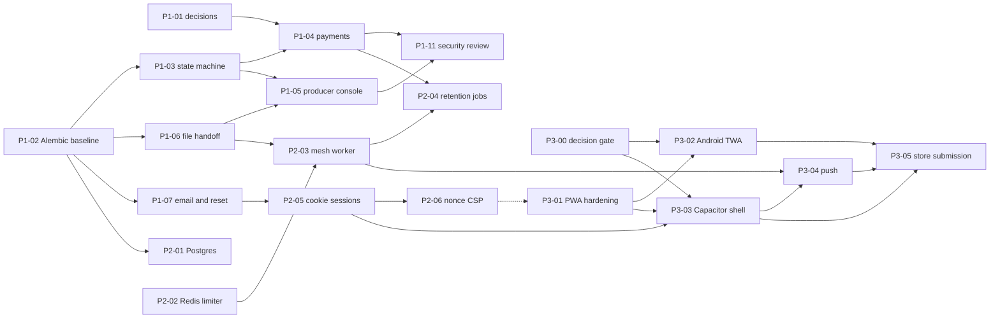
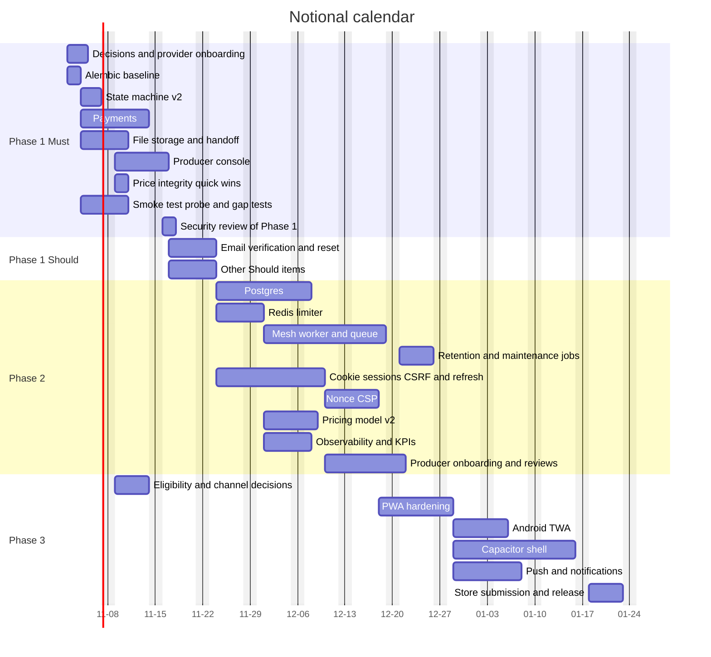
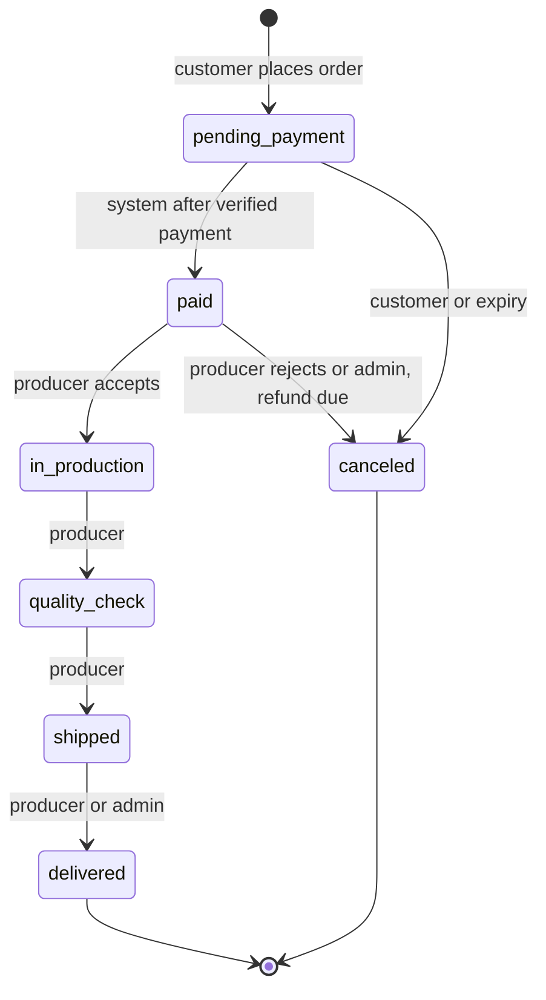
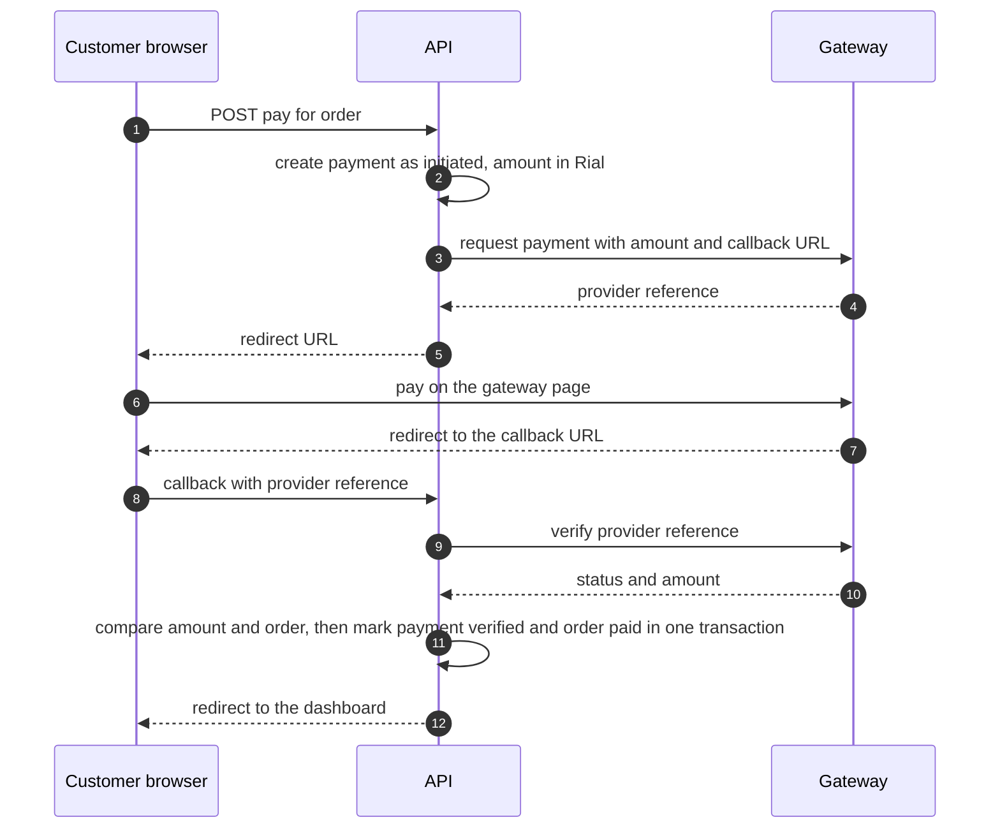

# 3D Hub Iran: implementation plan

Forward plan from commit `47ba9b9` on branch `audit/security-perf-ux`. It turns the open items in [09-role-reviews.md](09-role-reviews.md) and the "not built" list in [00-implementation-report.md](00-implementation-report.md) section 9 into phases, tasks, acceptance criteria and risks.

> **APK and IPA were not built in this PR.** The repository holds an installable PWA shell only: a manifest, icons and a service worker. It has no Bubblewrap or Capacitor project, no signing key, no `assetlinks.json`, no `apple-app-site-association` and no native project. Phase 3 describes how to get there; none of it exists yet.

All day counts are **estimates in person-days**. They are planning numbers for a team of two backend engineers, one frontend engineer and one QA/DevOps engineer, with a product owner and a security reviewer part-time. They were not measured and are not commitments. Facts about the current code cite `file:line`; the same path conventions as in the reviews apply.

## 1. Objective and the state the plan starts from

Objective: turn a quote-and-order intake funnel into a marketplace where a customer pays, a producer receives the paid job and the model file, and the platform can operate, scale and ship to app stores without reopening the security work.

| Area | State at `47ba9b9` | Where | Plan item |
|---|---|---|---|
| Order status | Linear `FLOW`, admin-only advance, owner cancel; compare-and-set update; no `paid` state, no history | `orders.py:20,98-132` | P1-03 |
| Payment | None. `commission` is computed, never collected | `orders.py:48` | P1-04 |
| Producer side | Role `hub` is a string; `Hub` has no owner; no hub-scoped route | `models.py:18,23-45`; `security.py:143-147` | P1-05 |
| Model file | Parsed in memory, never stored; the order has only a filename | `quotes.py:116-127` | P1-06 |
| Accounts | No email verification, reset or deletion; 24 h token; no revocation | `auth.py`; `config.py:25`; `security.py:109-127` | P1-07, P1-09, P2-05 |
| Schema changes | Four hand-written index statements | `db.py:32-54` | P1-02 |
| Database | SQLite in WAL mode, one node; seed and migrations run at app start | `db.py:22-30`; `main.py:19-23` | P2-01 |
| Rate limits | In-process, per worker | `ratelimit.py:1-5` | P2-02 |
| Mesh parsing | Pure Python in the request threadpool; 2 slots; 250,000-triangle cap | `quotes.py:22,119-124`; `geometry.py:23` | P2-03 |
| Session | Bearer token in `localStorage`; CSP allows `'unsafe-inline'` scripts | `api.ts:22-32`; `next.config.ts:14-24` | P2-05, P2-06 |
| PWA | Manifest, icons, hand-written service worker with a fixed cache name, `/api/` never intercepted | `public/manifest.webmanifest`; `public/sw.js:8,60` | P3-01 |

### Conventions the plan applies

| Convention | Where it shows |
|---|---|
| Plan structure: objective, current state, files to change, steps, risks, verification | Each phase repeats that order. |
| Feature delivery order: requirements, build, test, rollout, observability, with a feature flag and a rollback path for the first money feature | `PAYMENTS_ENABLED` in Phase 1; report-only before enforce for the CSP in Phase 2. |
| Error handling: fail fast at the boundary, specific exception classes, partial failures settled by reconciliation instead of aborting | The payment callback and the gateway exception family (section 5.3). |
| Test patterns: fakes instead of network, parametrised outcomes, strict expected failures for known bugs | The fake gateway fixture; the replay and quantity tests in `docs/09-role-reviews.md` (QA-05, QA-06). |
| Background-job patterns: job id returned at once, explicit job states, idempotency key, timeouts, no retry for permanent failures, a failed-job record, queue-depth alert | The mesh worker (section 6.2). |

## 2. Phases at a glance

| Phase | Goal | Target length (estimate) | Exit criterion |
|---|---|---|---|
| 0 (done, this PR) | Fix the confirmed security, performance and UX findings; document the system | done | 60 of 50 regression tests pass; 27 of 28 live-probe checks pass (see section 4) |
| 1 | A paid order reaches a producer who can see the file, accept and advance it; accounts are recoverable; schema changes run through migrations | 2 weeks for the payment path, about 3 to 4 weeks for everything listed (section 5.1) | Real money may flow only after the Must tier and P1-11 pass |
| 2 | Scale and harden: Postgres, Redis, worker for parsing, cookie sessions with CSRF and refresh, nonce CSP, retention jobs | 5 to 6 weeks | Same suite green on Postgres; no CPU-bound work in the API process; token no longer readable by page script |
| 3 | PWA hardening, Android TWA and Capacitor shells, push, store submission | 4 to 5 weeks plus store review time outside our control | Signed builds verified on devices; release checklist complete; legal text counsel-reviewed |

### Sequence and dependencies



The same work as a calendar. Dates are notional (a Monday start); read the weeks, not the days. Bars are dependency spans and include review and test time, so they run longer than effort divided by headcount.



## 3. Estimate and scope summary

| Phase | Tasks | Must (days) | Should (days) | Total (days) |
|---|---|---|---|---|
| Phase 1 | 14 | 33.25 | 16.25 | 49.5 |
| Phase 2 | 9 | 48.5 | 20 | 68.5 |
| Phase 3 | 6 | 19.5 | 25 | 44.5 |
| **All phases** | **29** | **101.25** | **61.25** | **162.5** |

All figures are estimates in person-days, summed from the task tables in sections 5.2, 6.1 and 7.1. Phase 0 is done and not counted. Product-owner and security-reviewer days are included in the totals and are part-time roles, so they do not draw on the four-person team. Calendar length is set by dependencies and review time, not by dividing effort by headcount, which is why section 2 shows longer spans than the totals suggest. Provider onboarding, counsel review and store review time are outside these numbers.

## 4. Phase 0: this PR (done)

| Commit | Content |
|---|---|
| `215bc8c` | MVP (original code, the baseline) |
| `228f4a1` | Backend security fixes (auth, orders, uploads, config) and the regression suite |
| `35e6115` | Upload rate limit and parse concurrency cap |
| `47ba9b9` | Security headers, self-hosted fonts, accessibility, UI polish, hardened containers, CI |

What the evidence supports, with sources:

| Claim | Number | Source |
|---|---|---|
| Regression suite on the original code | 48 failed, 2 passed (50 tests, 361.37 s) | `evidence/baseline-original-code.txt` |
| Same suite on the fixed code (now 60 tests) | all 60 pass | `evidence/final-test-run.txt`; earlier raw output not stored |
| Live probe against a running stack | 27 of 28 checks passed; the one failure is a rate-limiter measurement artefact, re-measured separately | `evidence/live-probe-result.json`, `evidence/login-timing-after.txt` |
| Login timing oracle | known email 232.7 ms against unknown 6.8 ms on the original code (34x); the distributions overlap after the fix (measured under a load average of about 40, so absolute numbers are inflated) | HANDOFF finder run; `evidence/login-timing-after.txt` |
| Password hashing | scrypt N=2^15, r=8, p=1; at most 4 concurrent hashes | `security.py:20,23` |
| Upload limits | 250,000 triangles; 2 parallel parses; 30 uploads per minute per IP | `geometry.py:23`; `config.py:36-37` |
| Body limits and login limits | 64 KB JSON, 60 MB upload; 10 per minute per IP plus 10 failures per 10 minutes per account | `config.py:31-34`; `middleware.py:29-55` |
| Frontend | home route first-load JS 167 kB, three.js not in the initial bundle, all routes static | `evidence/frontend-build-routes.txt` |
| Dependencies and SAST | OSV (2026-10-16): only `pip 24.0` (build tooling, removed from the runtime image) has advisories; bandit reports no medium or high finding | `evidence/dependency-and-sast.txt` |

Left open on purpose, and where this plan picks it up:

| Open item | Review IDs | Plan |
|---|---|---|
| Payment, producer console, file handoff | PO-03, PO-04, PO-05 | P1-04, P1-05, P1-06 |
| Quote replay, declared geometry, quantity inversion, unmetered `/manual` | RT-02, RT-03, PO-16, RT-06 | P1-06, P1-08a |
| Email verification, reset, account deletion, registration oracle | RT-05, BT-12, PO-13 | P1-07, P1-09 |
| Hand-written schema upgrades, role name | TL-04, PO-02 | P1-02 |
| In-process limiter, SQLite, pure-Python parsing | TL-05, TL-06, TL-07 | P2-01, P2-02, P2-03 |
| Token in `localStorage`, `'unsafe-inline'` scripts, no revocation | RT-08, RT-09 | P1-07 (revocation), P2-05, P2-06 |
| Native packages | n/a | P3-02, P3-03 |

## 5. Phase 1: money, producers, recoverable accounts

### 5.1 Goal, schedule and cut line

**Goal.** A customer pays for an order; the producer (hub) it was matched to sees the paid job and the model file, accepts it and advances it; accounts can be verified, recovered and deleted; schema changes go through migrations.

**Schedule, stated honestly.** The request was a two-week box. At the estimates below, the Must tier has a critical path of about 12 working days (P1-02, then P1-03, then P1-04, then P1-11), so the payment path fits in two weeks only with provider onboarding finished by day 3 and no new scope. Everything listed, including email verification and reset, comes to about 3 to 4 weeks. If the box is fixed, cut the Should tier first and keep the Must tier whole: real money without the Must tier is the one combination this plan advises against.

**Decisions needed (owner: product owner).** These block build tasks; the dates are days from the start.

| ID | Decision | Needed by | Options and a default |
|---|---|---|---|
| D1 | Payment provider and test-mode access | day 3 | Shaparak-licensed gateways are the candidates; none was evaluated for this plan. Needs a sandbox, settlement terms, amounts in Rial, and whether callbacks are signed or must be confirmed by a server-to-server verify call. Start onboarding on day 1: merchant approval time is not under our control |
| D2 | Who pays the platform fee, and at what rate | day 5 | Today the quote adds the fee on top of the price (`pricing.py:67-74`) while landing copy suggests the producer pays (`app/page.tsx:219-220`). Pick one, show it in the quote and in the terms, and store `fee_rate` on each order |
| D3 | Pricing model | before Phase 2 | A quote per producer (uses `hourly_rate`) or one platform table with a clear label (PO-08) |
| D4 | Payout process | before the first paid order | Default: manual bank transfer with an exported statement per producer; automate later |
| D5 | Order policy: who may cancel in each state, refund path, file retention period | day 8 | The transition table is data, so the answer changes one line (see the state diagram); retention needs a number from counsel |
| D6 | Verification channel and registration response | day 8 | Email as planned, or SMS one-time code (پیامک). Closing the registration oracle (SEC-17) means registration stops returning a session; if that UX cost is refused, SEC-17 stays accepted |

### 5.2 Tasks

Owner roles: PO product owner, BE backend, FE frontend, QA quality, OPS DevOps, SEC security reviewer. Tier: Must gates real money; Should does not.

| ID | Task | Owner (days) | Est. days | Tier |
|---|---|---|---|---|
| P1-01 | Decisions D1 to D6; start provider onboarding | PO 2 | 2 | Must |
| P1-02 | Alembic baseline (model-equal), `alembic check` in CI, `stamp` procedure for existing databases, migration 0002: rename role `maker` to `customer`, add `order.fee_rate`, lower-case stored emails (SEC-70), drop the three duplicate indexes; remove `_UPGRADES` | BE 1.5 | 1.5 | Must |
| P1-03 | Order state machine v2: transition table with actors, `paid` state, `order_event` table, `InvalidTransition` mapped to 409 or 403, admin override needs a reason | BE 2.5 | 2.5 | Must |
| P1-04 | Payments: gateway adapter plus fake gateway, `payment` table, pay endpoint, callback with server-side verify, reconciliation command, `PAYMENTS_ENABLED` flag, pay button and return page, status copy | BE 5, FE 1.5, QA 1.5 | 8 | Must |
| P1-05 | Producer link and console: `Hub.owner_user_id`, link command, `current_hub` dependency, hub-scoped list, accept, reject and advance, minimal `/hub` page, order-without-producer assignment | BE 3, FE 3, QA 1.5 | 7.5 | Must |
| P1-06 | Model file storage and handoff: upload after the order exists, server re-parse and volume check, hash in the record, authenticated download, privacy text updated in the same change | BE 3, FE 0.5, QA 1 | 4.5 | Must |
| P1-07 | Email verification, password reset, `tokens_valid_after` revocation, generic replies where D6 allows | BE 3.5, FE 1.5, OPS 0.5, QA 1 | 6.5 | Should |
| P1-08a | Price-integrity quick wins: single-use quote through `jti` (RT-02), limit on `/manual` (RT-06), quantity-break fix (PO-16), fee rate returned by the API and used in the label (PO-09), update the replay-dependent test (QA-05) | BE 1.75 | 1.75 | Must |
| P1-08b | Availability quick wins: upload limit before the body is read (TL-09), timed hash acquire with 503 (TL-08), 500 answer with request id and headers (TL-10), `/api/ready` (BT-10) | BE 2 | 2 | Should |
| P1-08c | Copy, logging and ops quick wins: remove unbacked claims (PO-11), sample-data flag and demo-user guard (PO-12, BT-09), access line with address, user and escaped path (BT-02, RT-13), compose `env_file` (TL-11), `SECURITY.md`, `security.txt` and a one-page IR plan (BT-06) | BE 1, FE 0.5, OPS 0.75 | 2.25 | Should |
| P1-09 | Account deletion: anonymise the user row, keep order rows, block while orders are open | BE 1.5, FE 0.5, QA 0.5 | 2.5 | Should |
| P1-10a | Smoke test in CI, commit the live-probe script, backend gap tests (QA-03, QA-04, QA-06, QA-07 as strict expected failures where the bug is open), measure peak memory and tmpfs use at the parse cap under compose limits (TL-07, RT-07) | QA 3, OPS 1 | 4 | Must |
| P1-10b | Vitest for `safeNext`, `api()`, formatting; Playwright for guest quote and sign-up-then-order with the fake gateway; ESLint | FE 1.5, QA 1.5 | 3 | Should |
| P1-11 | Security review of Phase 1: run the abuse cases below, refresh `evidence/`, update the audit register | SEC 1.5 | 1.5 | Must |

### 5.3 Design notes

**State machine.** The table is data: a mapping from (from, to) to the set of allowed actors (`system`, `customer`, `hub`, `admin`). One function applies it, keeps the compare-and-set update that exists today (`orders.py:98-107`) and writes an `order_event` row in the same transaction. Who may cancel from `paid` and `in_production` is decision D5.



**Payment flow.** The callback query string is never trusted. Authenticity comes from the provider's signature when it offers one, and always from a server-to-server verify call that returns the amount.



Rules that follow from it:

- **Idempotency.** `payment.provider_ref` is unique. A repeated callback finds the payment already verified and returns the same result. The order transition is a compare-and-set, so two racing callbacks produce one transition and one `order_event`.
- **Error classes** (python-error-handling): `GatewayTimeout` is transient, so nothing changes and the reconciliation command settles it; `PaymentDeclined` is permanent and marks the payment `failed`; `AmountMismatch` is never auto-accepted and writes an alert-level audit line. A timeout never marks an order paid.
- **Partial failure.** A customer can close the browser before the callback. The reconciliation command verifies every payment still `initiated` after a set number of minutes (the number is a decision, not measured) and runs by hand in Phase 1; P2-04 schedules it.
- **Currency.** Prices and `Order.amount` are Toman (`pricing.py:1`); gateways take Rial. One function converts, with a test table, and the verify step compares in Rial. Confirm the factor against the provider's documentation.
- **CSP.** Sending the browser to the gateway by navigation is not limited by `form-action 'self'` (`next.config.ts:33`). A page that auto-submits a POST form to the gateway would be, so prefer a GET redirect or add the gateway origin.
- **Feature flag.** `PAYMENTS_ENABLED` defaults to false. With it off, today's admin-advance path is unchanged, so the existing tests keep their meaning and rollback is a configuration change.
- **Tests** (python-testing-patterns): a `FakeGateway` fixture with the same interface, parametrised over success, decline, timeout then success, duplicate callback, amount mismatch and unknown reference. No network in the suite; a manual contract run against the provider sandbox before launch.

**Data additions.**

| Change | Purpose |
|---|---|
| `order.fee_rate` | The rate applied at order time (D2), so a later setting change cannot rewrite history |
| `order_event` (order, from, to, actor type, actor id, reason, time) | Who moved what and when, beyond rotating logs |
| `payment` (order, provider, `provider_ref` unique, amount in Rial, status, created, verified, hash of the raw callback) | The record that backs `paid` |
| `hub.owner_user_id` (nullable, unique, indexed) | Link from an operator account to its hub |
| `order_file` (order, sha256, size, file name, verified flag, time) | The file the producer prints, bound to the order |
| `email_token` (user, purpose, token hash unique, expires, used) | Verification and reset, single use, hashed at rest |
| `user.email_verified_at`, `user.tokens_valid_after` | Verification state; per-user revocation |
| `quote.public_id` built from a signed `jti` | The existing unique index makes a replayed quote fail with a conflict |

**Producer console.** A `current_hub` dependency reads the role from the database, as `require_admin` does (`security.py:143-147`), and loads the hub whose `owner_user_id` is the caller. Routes live under `/api/hub/`. A producer sees only orders of its own hub in status `paid` or later, and sees address and phone only from `paid` on; it never sees the customer's email. An order from another hub, or one not yet paid, answers `404`. Admin keeps an override, logged with a reason. Linking an account to a hub is a command-line action that logs, not an open endpoint. An order created without a hub is assigned by the admin (or by the matcher at payment time); today nothing can assign it.

**File handoff.** The quote stays stateless. After the order exists, the customer uploads the file for that order; the server parses it with the same code and compares the volume with the signed quote, flagging a mismatch for the producer. Orders from a manual volume cannot be paid until a file is attached, which closes the cheapest route in RT-03. The file is stored outside the web root under its hash; download is authenticated, for the owner, the producer of that order and an admin only, served as `application/octet-stream` with `attachment` and `nosniff`. The privacy text (`privacy/page.tsx:20`) changes in the same pull request; retention follows D5.

**Revocation without a session table.** The token already carries `iat` (`security.py:70-78`). `current_user` rejects a token issued at or before `tokens_valid_after`, which gives logout-everywhere, reset-invalidates-sessions and account disable without refresh tokens. Phase 2 builds the full session design on top.

### 5.4 Files to inspect or change

| Path | Change |
|---|---|
| `backend/app/routers/orders.py` | Replace `FLOW` and `_transition` with the table-driven function; `fee_rate`; `jti`-based quote id (`:20,43-51,98-132`) |
| `backend/app/models.py`, `backend/alembic/` (new) | New tables and columns through migrations; remove `_UPGRADES` from `db.py:32-54` |
| `backend/app/security.py` | `tokens_valid_after` check in `current_user` (`:109-127`); `jti` in `sign_quote` (`:91-94`); `current_hub` next to `require_admin` (`:143`) |
| `backend/app/routers/payments.py`, `hub.py`, `files.py` (new) | Pay and callback; producer console; file upload and download |
| `backend/app/middleware.py`, `main.py` | Upload limit before the body (`middleware.py:36-40`); error answer headers (`main.py:65-69`); `/api/ready` |
| `backend/app/config.py` | `PAYMENTS_ENABLED`, provider settings, file directory and retention (`:17-37`) |
| `frontend/src/lib/i18n.ts` | `paid` in both status maps (`:64,169`); remove unbacked claims (`:21,23,126,128`) |
| `frontend/src/app/dashboard/page.tsx`, `app/hub/page.tsx` (new), `quote/page.tsx` | Pay button and return page; producer page; file step after ordering (`quote/page.tsx:192-213`) |
| `frontend/src/app/privacy/page.tsx` | File storage and deletion statements (`:20,28-30`) |
| `.github/workflows/ci.yml` | Smoke test job; `alembic check` |
| `docs/evidence/` | Refreshed probe output, smoke-test output, memory measurement |

### 5.5 Acceptance criteria

1. Given an order in `pending_payment` and a verified payment for the exact amount, when the callback arrives twice, then the order is `paid` once and exactly one `order_event` records it.
2. Given a callback with an unknown reference, or a verify answer with a different amount, then the order stays `pending_payment`, the payment is `failed`, and an alert-level audit line is written.
3. Given a verify timeout, then no state changes, and the reconciliation command settles the payment on its next run.
4. Given `PAYMENTS_ENABLED=false`, then the admin-advance behaviour and its tests are unchanged.
5. Given producer A, then producer B's order answers `404`, an unpaid order of A's own answers `404`, and a customer calling a producer route gets `403`.
6. Given a quote from a manual volume, then payment is refused until a file is attached; given a file whose volume differs from the quote beyond the agreed tolerance, then the order is flagged for the producer.
7. Given a file, then download works for the owner, the producer of that order and an admin, and is `404` for everyone else.
8. Given a quote token already used, then a second order answers `409`.
9. Given a reset, then the link works once, old tokens are rejected afterwards, and the responses for known and unknown addresses match (subject to D6).
10. Given three database shapes (empty, a pre-audit copy, one created by the current code), then `alembic upgrade head` ends at the same schema and `alembic check` is clean.
11. Given the 50 existing tests, then all pass; only the dashboard test changes, because it relied on quote replay (QA-05).

Abuse cases the security review (P1-11) must try, from RT-14: a forged or replayed callback, a callback for another user's payment, an amount changed in transit, file download with another user's order id, reset-token reuse, and a producer operator ordering from its own hub to farm reviews.

### 5.6 Risks

| Risk | Effect | Mitigation |
|---|---|---|
| Provider onboarding takes longer than the phase | No real money in the box | Start D1 on day 1; build against the fake gateway and the sandbox; the flag keeps rollback trivial |
| Callback lost or duplicated | Order stuck or transitioned twice | Unique `provider_ref`, compare-and-set transition, reconciliation command |
| Toman and Rial mix-up | Ten times too much or too little charged | One conversion function, a test table, an amount comparison at verify time |
| Migration on a live SQLite volume | Data loss | Backup first (`docs/11-runbook.md:143-172`), rehearse on the three database shapes, document the `stamp` step |
| Personal data shown to producers | Privacy breach | Address and phone only from `paid`, never the email; tests in criterion 5 |
| Privacy text out of step with file storage | A false legal statement | Same pull request as P1-06; counsel review (PO-13) |
| Tests encode old behaviour (quote replay, admin advance from `pending_payment`) | Red CI during the change | Change them with the code; keep the flag-off path under test |
| Stuck orders while jobs do not exist yet | Manual work | Reconciliation by hand; a dashboard filter for `pending_payment` older than a day |

### 5.7 Rollout, rollback and verification

1. Take a backup and rehearse the restore (`docs/11-runbook.md:143-172`). Apply migrations with `PAYMENTS_ENABLED=false`.
2. Enable payments against the provider sandbox for staff accounts only.
3. Enable real payments with an order-amount ceiling and an allow-list of producers for the first week. The ceiling is a decision, not a measured value.
4. Rollback: switch the flag off. Migrations are additive, so no downgrade is needed; payments in flight are settled by reconciliation.

Verification before each step: `cd backend && python -m pytest`; bandit and pip-audit as in `ci.yml`; `npm audit --omit=dev --audit-level=high` and `next build` as in `ci.yml:59-68`; the compose smoke test; the live probe re-run with its output saved under `docs/evidence/`; the audit register updated. After code changes run `graphify update .` (project rule in `CLAUDE.md`).

## 6. Phase 2: scale and harden

### 6.1 Goal and tasks

**Goal.** Remove the single-process ceilings (database, limiter, parser) and shrink the blast radius of a script injection or a stolen token. Exit: the regression suite is green on SQLite and Postgres in CI; no CPU-bound work runs in the API process; the page's own script cannot read the session token.

| ID | Task | Owner (days) | Est. days | Tier |
|---|---|---|---|---|
| P2-01 | Postgres: pinned driver, CI matrix on SQLite and Postgres, rating query that works on both, migrations and seed as a release command, pool sizing, data move rehearsal, backups with `pg_dump` or WAL archiving | BE 4, OPS 3, QA 1.5 | 8.5 | Must |
| P2-02 | Redis limiter behind the same function names (`hit`, `over`, `forget`, `too_many`), atomic sliding window, fallback to the in-process limiter with an alert when Redis is down | BE 2.5, OPS 1, QA 1 | 4.5 | Must |
| P2-03 | Mesh parsing in a worker: 202 with a job id, job state machine, polling endpoint, hash-keyed result cache, worker container with no network and its own memory limit, queue-depth backpressure instead of `_parse_slots` | BE 6, FE 2, OPS 2, QA 2 | 12 | Must |
| P2-04 | Retention and maintenance jobs: expire `pending_payment` orders, settle stale payments, purge staged and expired files, anonymise deleted accounts, audit-log retention, scheduled backups | BE 3, OPS 1, QA 1 | 5 | Must |
| P2-05 | Cookie sessions: HttpOnly cookies, short access token plus rotating refresh with a server-side session table, reuse detection, CSRF defence, logout and admin revoke, token removed from `localStorage`, privacy text updated | BE 6, FE 3, QA 2.5, SEC 1 | 12.5 | Must |
| P2-06 | Nonce-based CSP: per-request nonce in Next middleware, report-only first, then enforce | FE 3, OPS 0.5, QA 1.5, SEC 0.5 | 5.5 | Should |
| P2-07 | Pricing model v2 per decision D3 (a quote per producer using `hourly_rate`, or a clearly labelled platform table) | BE 3, FE 2, QA 1 | 6 | Should |
| P2-08 | Observability and first-party KPIs: log shipping, metrics endpoint, dashboards, the alerts in `docs/09-role-reviews.md` (BT-04), load test with k6 and budgets set from its first run, quote-to-order and order-to-paid counts | OPS 4, BE 1, PO 1 | 6 | Must |
| P2-09 | Producer self-serve onboarding (application, admin approval, capacity and lead-time editing with audit) and the review screen for delivered orders | BE 3, FE 4, QA 1.5 | 8.5 | Should |

### 6.2 Design notes

**Postgres.**
- Run the suite on both backends in CI before the cut-over. The known SQLite-specific spots are the pragmas and `check_same_thread` branch (`db.py:15-30`), the `PRAGMA table_info` check (`db.py:46-49`) and `func.round(float expression, 2)` in the rating update (`orders.py:154-156`), which may not exist for `double precision`; compute the average with a cast or from an aggregate.
- `init_db()` and `seed()` leave app start-up (`main.py:19-23`) and become a release command, so several processes never race on first boot.
- Cut-over: stop writes, back up, load into Postgres, run `alembic check`, switch `DATABASE_URL`, smoke test, start. Keep the SQLite file read-only for a set number of days as the rollback.

**Redis.** Use two Redis instances with different eviction policies: the limiter can lose keys, the job queue must not. `maxmemory-policy` is per instance, and an eviction policy on the queue instance drops jobs. Redis becomes a new single point of failure, so the limiter falls back to the in-process version and raises an alert instead of failing closed.

**Mesh worker** (python-background-jobs):

| Aspect | Design |
|---|---|
| API contract | `POST /api/quotes/analyze` stores the upload in a staging area, enqueues, returns `202` with an unguessable job id. `GET /api/quotes/jobs/:id` returns `pending`, `running`, `succeeded` or `failed` |
| Signing | The worker returns mesh statistics only. The API builds and signs the quote when the result is fetched, so the signing key never enters the sandbox (`security.py:87-105`) |
| Queue | A process-per-job queue fits CPU-bound sync code and gives real parallelism beyond the GIL. RQ and Dramatiq both fit; Celery is heavier than this needs. Pick one in the task |
| Idempotency | Key on the file hash plus parameters. Mesh statistics are a pure function of the bytes, so a cache keyed on the hash skips repeat parses |
| Failure handling | Parse errors are permanent: no retry. Worker crash or timeout marks the job `failed` and keeps it in the failed registry for inspection. Infrastructure errors retry a small, fixed number of times |
| Limits | A hard job timeout and a worker memory limit, both set from the P1-10a measurement, not guessed. Queue depth above a threshold answers `429` or `503` with `Retry-After`, replacing `_parse_slots` (`quotes.py:22,119-124`) |
| Frontend | Poll with backoff and abort on a knob change, extending the existing request-id guard (`quote/page.tsx:84-87,115-119`). Manual re-pricing stays synchronous because it does not parse |
| Sandbox | The worker container has no network, a read-only root and the same resource limits style as `docker-compose.yml:17-28,59-62` |

**Cookie sessions.**
- Serve the web app and the API from one origin by routing `/api/` through the proxy. Then cookies are same-site, CORS is unnecessary for the web client, `NEXT_PUBLIC_API_BASE` can be relative, and CSP `connect-src` can be `'self'`. Keep the exact-origin CORS list for native shells (`main.py:39-49`).
- The access token is short-lived. The refresh token is rotated on use and stored hashed in a `session` table with a family id; presenting a used refresh token revokes the whole family. Logout and admin revoke delete the session.
- CSRF: `SameSite` cookies, an origin check on every state-changing request, and a custom header or double-submit token. Define it once and test it; do not rely on `SameSite` alone.
- Frontend: `api.ts:22-32` and `Providers.tsx:56-73` stop reading a token; `credentials` flips from `"omit"` (`api.ts:60`) to same-origin; cross-tab logout moves from the `storage` event to `BroadcastChannel` or a focus-time `/me` check. The Semgrep rule against storing tokens (`.semgrep.yml:77`) stays. The privacy text that mentions `localStorage` (`privacy/page.tsx:36-37`) changes.
- Per-user revocation from P1-07 remains the emergency lever.

**Nonce CSP.** The comment at `next.config.ts:14-24` explains the deferral: a per-request nonce forces dynamic rendering and gives up static caching. Measure TTFB and first-load JS before and after (the baseline is 167 kB for the home route, from `evidence/frontend-build-routes.txt`) and keep the better trade. Scope: `script-src` with the nonce and `'strict-dynamic'`; the inline theme script gets the nonce (`layout.tsx:36,52`). `style-src` keeps `'unsafe-inline'` because React and framer-motion write style attributes, which a nonce does not cover. Ship report-only for a week, collect violations, then enforce. Check that a service-worker-served page keeps its own header and nonce pair when offline.

### 6.3 Acceptance criteria

1. The full regression suite passes on SQLite and Postgres in CI.
2. With the worker running, an upload of a cap-sized mesh does not move API health latency, and a worker killed mid-job leaves the job `failed` and the API healthy.
3. A repeated upload of the same bytes is answered from the cache without a parse.
4. Two API workers share one Redis limiter: the 11th login attempt in a minute is refused regardless of which worker serves it.
5. After login, `document.cookie` and `localStorage` do not contain a credential; a cross-site POST without the CSRF defence is refused; a replayed refresh token revokes its family.
6. The enforced CSP has no `'unsafe-inline'` in `script-src`, and a deliberately injected inline script is blocked in the test page.
7. A `pending_payment` order older than the configured age is canceled by the job and recorded in `order_event`.

### 6.4 Risks

| Risk | Effect | Mitigation |
|---|---|---|
| Database move | Downtime or data mismatch | Rehearse on a copy; maintenance window; keep the SQLite file as rollback |
| Redis outage | Limits lost, queue stalled | Fallback limiter with alert; queue health on the dashboard |
| Duplicate job delivery | Double parse | Idempotency key; parse is pure |
| Poison upload kills workers | Queue starvation | Process-per-job, timeouts, memory limit, failed registry |
| CSRF or cookie mistakes | Account takeover | Single reviewed design, tests, SEC sign-off before enforcing |
| Nonce CSP loses static prerender | Slower first byte | Measure first; keep static pages static where possible |
| Cookie model clashes with native shells | Rework in Phase 3 | Decide the shell strategy in P3-00 before building sessions |

### 6.5 Rollout and verification

Each task ships behind its own switch where it can (queue on or off, cookie sessions on or off, CSP report-only then enforce). Verify with the suite on both databases, the smoke test, a k6 run before and after each change (budgets from the first run, none invented here), the probe re-run with saved output, and the audit register updated.

## 7. Phase 3: PWA hardening and store packaging

> Nothing in this phase exists in the repository today. No APK, AAB or IPA was built in this PR, and no signing key, store account or native project has been created.

### 7.1 Goal and tasks

**Goal.** A well-behaved installable PWA first, then signed Android and iOS packages that load the same product, with a release process that does not depend on one person's laptop. For this phase "Must" means needed for the first native channel.

| ID | Task | Owner (days) | Est. days | Tier |
|---|---|---|---|---|
| P3-00 | Decision gate: store eligibility and channels (with counsel), session strategy for native shells, push channel, which shell loads the site (remote) or bundles it | PO 1.5 | 1.5 | Must |
| P3-01 | PWA hardening: build-id cache name, offline page, update prompt, install prompt, offline quote drafts, Lighthouse CI budget | FE 5, QA 2 | 7 | Must |
| P3-02 | Android Trusted Web Activity with Bubblewrap: `assetlinks.json`, signing, APK and AAB, device verification | FE 2, OPS 2, QA 2 | 6 | Must |
| P3-03 | Capacitor shell for iOS (and Android if the gate chooses it): static export build, CORS origins, secure token storage if bundled, native plugins, Xcode signing, TestFlight | FE 8, BE 3, OPS 2, QA 4 | 17 | Should |
| P3-04 | Push and transactional notifications: device-token table, sender job, opt-in UX, SMS fallback for order status | BE 4, FE 1.5, OPS 1, QA 1.5 | 8 | Should |
| P3-05 | Store listing, review submission and the release checklist run | PO 2, QA 2, OPS 1 | 5 | Must |

### 7.2 Starting point

| Fact | Where |
|---|---|
| Manifest has `display: standalone`, `start_url` and `id` `/`, `lang` `fa-IR`, `dir` `rtl`, 192 and 512 icons plus a maskable icon, two shortcuts, and `prefer_related_applications: false` | `public/manifest.webmanifest:5-25` |
| Service worker pre-caches five URLs one at a time, serves navigations network-first with a cached fallback, serves static assets stale-while-revalidate, never touches `/api/`, and caches only 200 same-origin responses | `public/sw.js:9,15-24,34-64` |
| The cache name `h3d-v2` is a constant, so a release does not rotate it | `public/sw.js:8` |
| The worker skips waiting at install, so an update takes over without asking the user | `public/sw.js:21` |
| The worker is registered in production only, with `updateViaCache: "none"` | `components/SwRegister.tsx` |
| Offline, pages load from cache but every data call fails; no quote can be made | `public/sw.js:60`; `api.ts:63-65` |
| The frontend image copies `public/` into the runtime image, so a `.well-known` folder there would be served | `frontend/Dockerfile:48` |
| No `push`, `notificationclick` or `sync` handler exists | `public/sw.js` |

### 7.3 P3-00: decisions before any native work

| Question | Why it gates the phase |
|---|---|
| Which stores and channels can the publishing entity and the target users actually use? | Developer-account eligibility, store availability for users in Iran and sanctions rules are legal and commercial questions this plan does not answer. Local Android stores and direct APK or PWA install may be the realistic channels; verify with counsel and the stores before building |
| Do native shells load the live site, or bundle the app? | Loading the live site shares the web session (cookies work) but is more exposed to a "repackaged website" rejection on iOS. Bundling needs a separate token flow, secure storage and CORS for the shell origin. Decide before P2-05 fixes the session design |
| Which push channel? | Native push depends on Apple and Google services, and web push on browser vendor endpoints; reachability for users in Iran is not known. SMS or in-app polling may be needed as a fallback |
| What does the payment stance say to reviewers? | The product sells physical goods; see the constraints below |

### 7.4 P3-01: PWA hardening

- **Cache name from the build.** Derive `CACHE` from the build id so each release rotates it; `activate` already deletes other caches (`public/sw.js:26-31`).
- **Offline page.** A small page for navigations that are neither cached nor reachable, in both languages.
- **Update prompt.** Replace the automatic `skipWaiting` (`public/sw.js:21`) with a "new version available" prompt, so a reload never lands in the middle of a quote form.
- **Install.** Android Chrome: capture `beforeinstallprompt` and offer an install action at a calm moment. iOS Safari has no prompt, so show short manual instructions for Add to Home Screen.
- **Offline drafts.** Store quote parameters and the measured volume and bounding box in IndexedDB, not the file. On return, re-quote through `/api/quotes/manual`. After P1-06 a manual-volume order needs a file again, so a restored draft asks for the file before payment. Drafts expire, are wiped at logout (shared devices), and the privacy text says so. Background sync is not available on iOS; re-quote on open instead.
- **Budget.** Lighthouse CI with the current 167 kB home-route first-load JS as the starting budget (`evidence/frontend-build-routes.txt`), tightened later.
- **With nonce CSP** (P2-06): verify that a page served from the cache offline keeps a matching header and nonce.

### 7.5 P3-02: Android Trusted Web Activity (Bubblewrap)

A Trusted Web Activity shows the live site in Chrome without browser UI when the site proves ownership through Digital Asset Links. If verification fails it falls back to a Custom Tab with a URL bar.

1. Build on a developer or CI machine with a JDK and the Android SDK, not on the application servers. Commit the generated `twa-manifest.json`; keep the keystore out of the repository and back it up (gitleaks would flag it).
2. Create the Bubblewrap project from the published manifest, then build; the output is an APK for sideloading or local stores and an Android App Bundle for Google Play.
3. Host the Digital Asset Links file at `https://<web origin>/.well-known/assetlinks.json` from `frontend/public/.well-known/`. It must answer `200`, as JSON, without a redirect, on the exact origin of `start_url`. Skeleton with placeholders:

```json
[{
  "relation": ["delegate_permission/common.handle_all_urls"],
  "target": {
    "namespace": "android_app",
    "package_name": "<package name>",
    "sha256_cert_fingerprints": ["<SHA-256 of the signing certificate>"]
  }
}]
```

4. List the fingerprint of every key that signs a distributed build: the local release key, and the Google Play signing key if Play App Signing is used (it re-signs the app).
5. Add a smoke-test step that fetches the file and checks the package name.
6. Verify on a real device that the app opens without the URL bar; if the bar shows, the fingerprint or the origin is wrong.
7. Keep the manifest and icons consistent with the app (`public/manifest.webmanifest`, maskable icon already present).

### 7.6 P3-03: Capacitor shell

| Topic | Constraint |
|---|---|
| Build | Bundling needs `output: "export"` instead of `"standalone"` (`next.config.ts:41`). Every route is already static (`evidence/frontend-build-routes.txt`), so it is feasible. Use a separate build mode so the server build is unchanged |
| Headers | `headers()` (`next.config.ts:45-69`) does not apply to a static export. The CSP for the bundle must come from a meta tag or the shell configuration |
| API origin | `NEXT_PUBLIC_API_BASE` is already absolute (`api.ts:1-2`). The shell origin must be allowed by CORS: Capacitor uses `capacitor://localhost` on iOS and a localhost origin on Android whose scheme depends on the Capacitor version and `server.androidScheme`. Add both to `CORS_ORIGINS` (`main.py:41` reads it from the environment, no code change) |
| Session | A bundled shell runs on another origin, so web cookies are cross-site and unreliable in the iOS web view. Use a bearer token in Keychain or Keystore through a plugin, with its own login transport. If that transport can be reached from page script, it weakens the HttpOnly cookie design, so decide it with security in P3-00. A shell that loads the live site avoids the problem |
| Service worker | Do not rely on the service worker inside the Capacitor web view; verify. Offline in a bundled shell comes from the bundled assets |
| File input | iOS has no registered type for STL, so the picker must fall back to a generic file type; test STL, OBJ and 3MF selection from Files |
| Deep links | iOS universal links need `/.well-known/apple-app-site-association` and the Associated Domains entitlement; Android App Links reuse `assetlinks.json` |
| Signing | Apple developer account, certificates, provisioning, TestFlight for internal testing |

### 7.7 Store constraints that shape the work

Verify each against the stores' current policies at submission time; they change.

| Topic | Constraint | Consequence here |
|---|---|---|
| Wrapper apps | Apple's guideline on minimum functionality (4.2) can reject an app that is only a repackaged website. Google Play accepts TWA but reviews quality | Give the iOS shell native value (file picker from Files, share, push, offline drafts) and list it in the review notes |
| Payments | Physical goods and services consumed outside the app may use external payment (Apple guideline 3.1.3(e)); in-app purchase is for digital goods. 3D-printed parts are physical goods | No IAP, but say so in the review notes. Reviewers need a demo account and a payment path they can reach: an Iranian gateway may not be reachable from the review location, so prepare a sandbox gateway for review |
| Account deletion | Apple (5.1.1(v)) and Google Play require in-app and web account deletion where accounts are created | P1-09 is a prerequisite |
| Privacy disclosures | App Privacy labels and the Play Data safety form must match the privacy page, which is still a draft | Counsel review of `privacy/page.tsx` and `terms/page.tsx` before submission (PO-13) |
| Login | Sign in with Apple is required only when other third-party logins are offered | Not needed: there is no third-party login |
| Push | Apple Push Notification service on iOS; Firebase Cloud Messaging on Android depends on Google Play services. Web push on iOS works only for a PWA added to the Home Screen | Reachability for users in Iran is unknown: test from inside the country, keep SMS and in-app polling as fallbacks |
| Distribution | Google Play, the App Store, and local Android stores each have different eligibility and review rules | Settled in P3-00; the TWA APK also works for direct download |
| Signing | One lost keystore means no updates under the same package | Store the keystore and Play App Signing details in the secret manager, with a recovery owner |

### 7.8 Acceptance criteria

1. Given the installed PWA and no network, when the user opens it, then the cached shell loads, a saved quote draft is restored, and data calls show the network message instead of failing silently.
2. Given a new release, then the cache name changes, the old cache is deleted, and the user sees an update prompt instead of an unannounced reload.
3. Given the Android build on a real device, then it opens without a URL bar, which proves the Digital Asset Links check passed.
4. Given a TestFlight build of the iOS shell, then login, quote, STL selection from Files, order and a sandbox payment all complete.
5. Given an order status change, then the customer receives a push notification or the SMS fallback within a delivery time agreed in P3-00 (the time is a decision, not a measured value).
6. Given the release checklist in section 7.10, then every item is ticked or has a written exception.

### 7.9 Test plan

| Layer | What | How |
|---|---|---|
| Unit and integration | Everything from Phases 1 and 2 stays green | Existing suites, on SQLite and Postgres |
| PWA | Install, offline open, draft save and restore, update prompt, cache rotation on a new build | Playwright with mobile emulation; manual on devices |
| Lighthouse | PWA checks and the first-load budget | Lighthouse CI in the pipeline |
| TWA | Opens without the URL bar; `assetlinks.json` served correctly; deep links | Smoke test for the file; real device for the bar |
| Capacitor | Login, quote, STL pick, order, pay with the sandbox gateway, push, deep link, logout wipe | TestFlight and internal test tracks on real devices |
| Device matrix | A low-end Android phone, a mid-range Android phone, iOS Safari, the installed iOS PWA, the iOS shell | Manual checklist per release |
| Persian input and RTL | Persian digits in number fields, mixed RTL and LTR text, the 3D viewer overlay, the keyboard | Manual with a Persian keyboard (QA-16) |
| Security | Re-run the probe against the shipping API configuration; no secrets in the bundle; cleartext traffic disabled | Probe script, gitleaks on the native projects, platform network settings |
| Accessibility | Screen reader pass on the shell, axe scan in the web build | Manual plus the axe step from QA-09 |

### 7.10 Release checklist

- [ ] Privacy page and terms reviewed by counsel, published at stable URLs, and consistent with the store disclosures
- [ ] Account deletion works in the app and on the web
- [ ] Payment stance written in the review notes; demo account and sandbox payment path reachable by reviewers
- [ ] `assetlinks.json` lists every signing fingerprint in use; the file answers `200` as JSON with no redirect
- [ ] Keystore and signing details stored in the secret manager, with a named recovery owner
- [ ] `CORS_ORIGINS` includes the shell origins; `FORWARDED_ALLOW_IPS` verified through the proxy (RT-12)
- [ ] Version code and name set; changelog in Persian and English
- [ ] Store assets ready: icons (192, 512 and maskable exist; the iOS 1024 icon does not), RTL screenshots, descriptions, age rating
- [ ] Probe re-run with saved output; audit register updated; dependency scans clean
- [ ] Rollback path written: server-side flag to disable payments, and an API compatibility window for old app versions (a minimum-version check is worth adding, since shipped binaries cannot be patched at once)
- [ ] Support contact and incident plan (BT-06) published

### 7.11 Risks

| Risk | Effect | Mitigation |
|---|---|---|
| Store or account eligibility turns out to be a blocker | Months lost | Resolve in P3-00 before building; keep PWA and direct APK as the baseline channels |
| iOS rejects a thin wrapper | Delay | Native value in the shell; review notes; consider PWA-only on iOS |
| Reviewers cannot reach the payment path | Rejection | Sandbox gateway for review; demo account |
| Push does not reach users | Missed order updates | SMS and in-app fallbacks; test from inside the country |
| Session design incompatible with a bundled shell | Rework | Decide in P3-00 before P2-05 is frozen |
| Lost signing key | No updates | Secret manager, backup, recovery owner |
| Service worker caches a bad build | Users stuck on a broken version | Build-id cache name, update prompt, a kill-switch worker release |

## 8. Open questions for the product owner

1. Which payment provider, and does it sign callbacks or require a verify call (D1)?
2. Who pays the platform fee, and is 15% still the rate (D2)?
3. Per-producer prices or a platform table (D3)?
4. How do producers get paid in Phase 1 (D4)?
5. What is the cancel and refund policy, and the file retention period (D5)?
6. Email or SMS for verification, and is a registration flow without an instant session acceptable (D6)?
7. Which distribution channels are realistic for the first native release (P3-00)?
